<div align="center">

# dev-ops

**面向内部研发团队的 AI Bot 协作、项目管理与自托管流水线平台**

[](.nvmrc)
[](package.json)
[](apps/web/package.json)
[](apps/server/package.json)
[](docs/architecture/database.md)
[](pnpm-workspace.yaml)

[界面预览](#界面预览设计稿) · [核心能力](#核心能力) · [系统架构](#系统架构) · [快速开始](#快速开始本地开发) · [生产部署](#生产部署) · [安装 CLI](#安装与使用-cli) · [执行节点](#自托管流水线执行节点) · [文档索引](#文档索引)

<br />
<br />

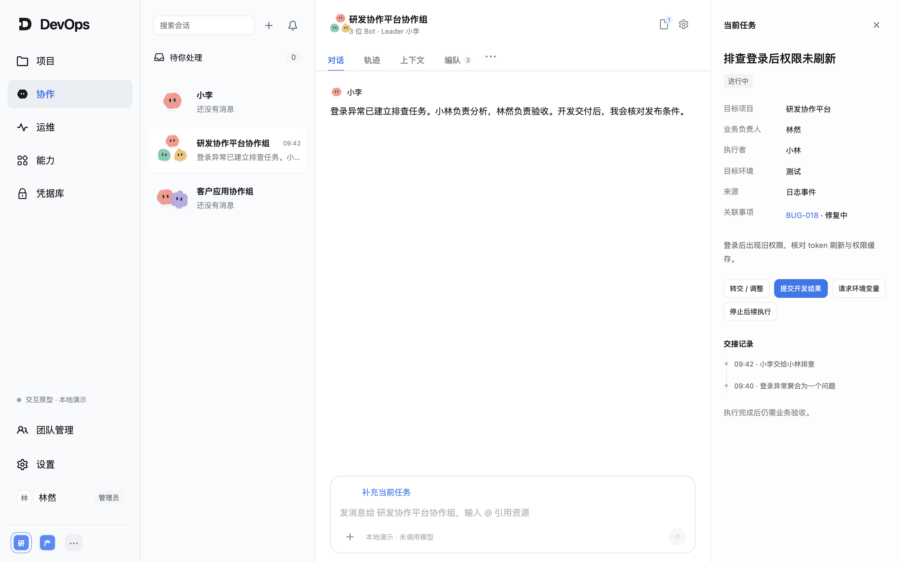

</div>

---

## 为什么做 dev-ops

大多数研发团队同时使用 GitHub/Gitea、本地 AI 编码工具（Codex、Claude、pi）、自建构建脚本与聊天工具，却缺少一个把**团队 Bot、业务事实、代码关联、流水线交付与凭据权限**放在同一套契约下的轻量中枢。

`dev-ops` 按 MVP 设想构建了一套可自托管的一体化工作台，坚持四条核心设计边界：

- **不强行接管代码托管与本地开发**：代码保留在 GitHub 或 Gitea，研发继续在本地使用习惯的编辑器与 AI 编码工具；平台通过 API、统一 CLI 与交付记录承接研发到发布的完整上下文。
- **AI Bot 协作与项目管理解耦**：团队 Bot 拥有独立身份、长期记忆、技能库与隔离沙盒工具，以**触发人当前权限**委托调用平台 API（高危接口强制列入排除名单），既能跨项目群聊接力协作，又不会污染项目业务状态。
- **业务流转与内置流水线严格解耦**：提测、回归与验收由团队显式维护；仓库内的 `.devops/workflows/*.yml` 由平台调度到自托管执行节点运行，构建结果不会自动改写需求或缺陷状态。
- **单一契约驱动全端一致**：后端 TypeBox 路由导出唯一 OpenAPI 契约，自动生成类型化客户端、CLI 校验器与 Bot API 目录，确保 Web、CLI 与智能体共享同一套业务规则与权限校验。

---

## 界面预览（设计稿）

以下截图截取自仓库内置的 [HTML 交互原型](docs/desgin/interactive-prototype-v1/index.html)（含本地演示数据，实际产品以运行中的 Web 服务为准）。克隆仓库并安装依赖后，可直接本地预览完整交互设计稿：

```bash
pnpm dev:prototype
# 浏览器打开 http://127.0.0.1:4178/（演示边界见 docs/desgin/interactive-prototype-v1/README.md）
```

|                       项目列表与活动晴雨表                        |                               需求管理与代码关联                               |
| :---------------------------------------------------------------: | :----------------------------------------------------------------------------: |
| 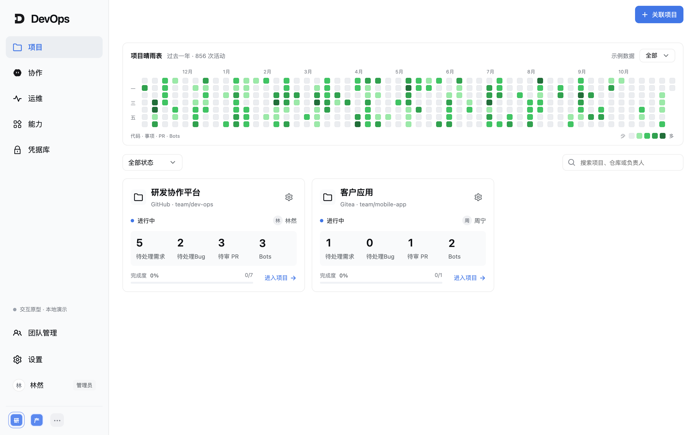 |     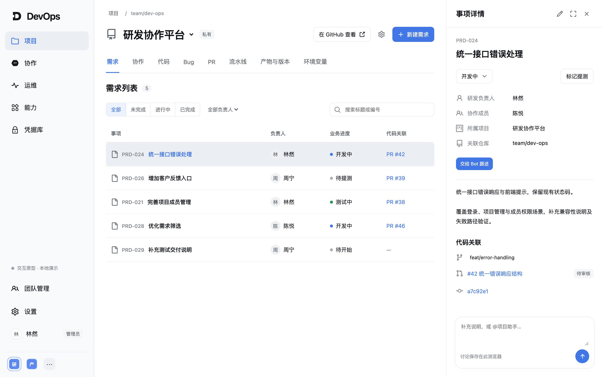      |
|             **Bot 执行轨迹（工具调用与耗时时间线）**              |                           **AI 协作回复与代码建议**                            |
|     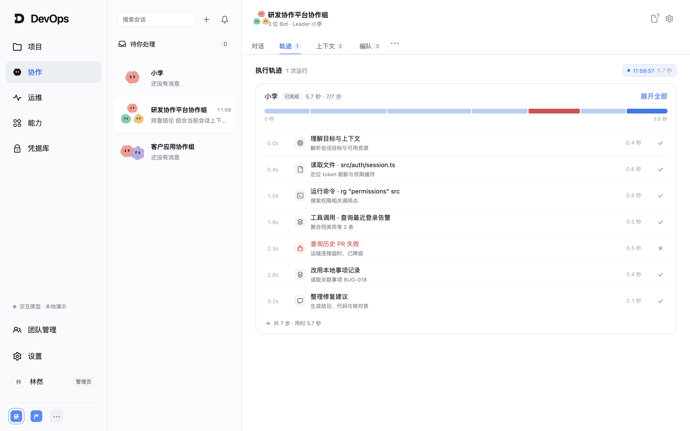     |       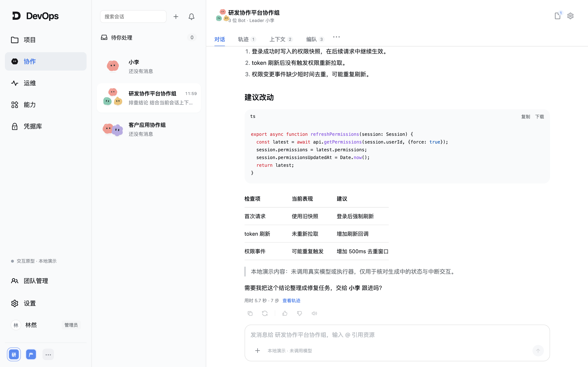        |
|                          **智能体管理**                           |                             **团队 Skills 技能库**                             |
|   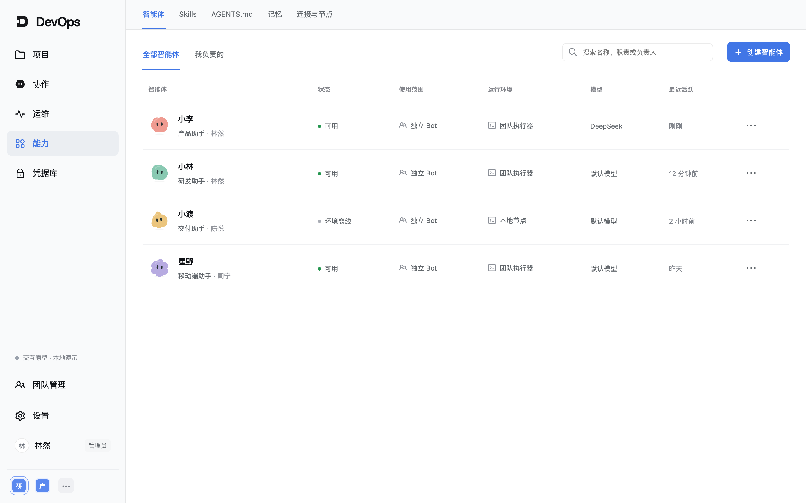    |      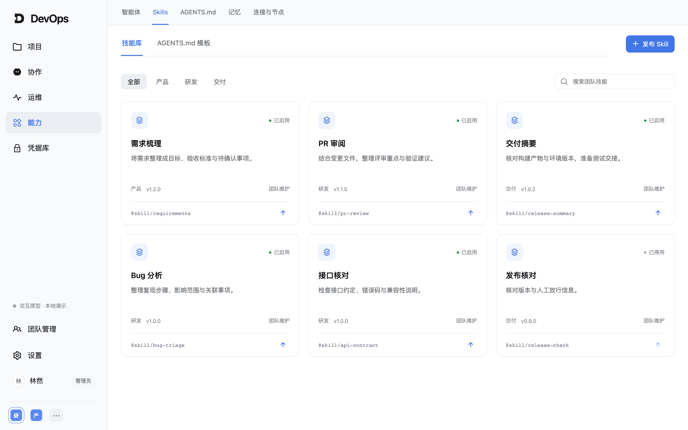      |
|                       **外部仓库代码浏览**                        |                        **服务交付：构建产物与运行版本**                        |
|   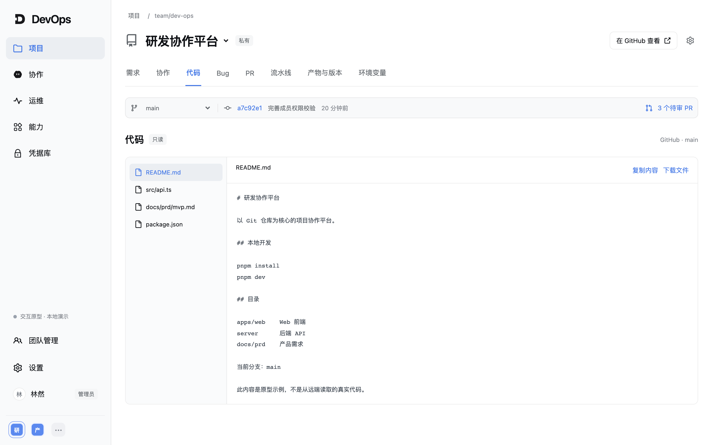   | 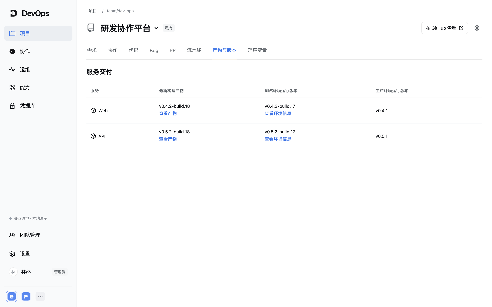 |

<details>
<summary>查看更多截图：团队凭据库 &amp; 移动端响应式适配（390×844）</summary>

<br />

|         团队凭据库（授权引用与轮换撤销）         |
| :----------------------------------------------: |
| 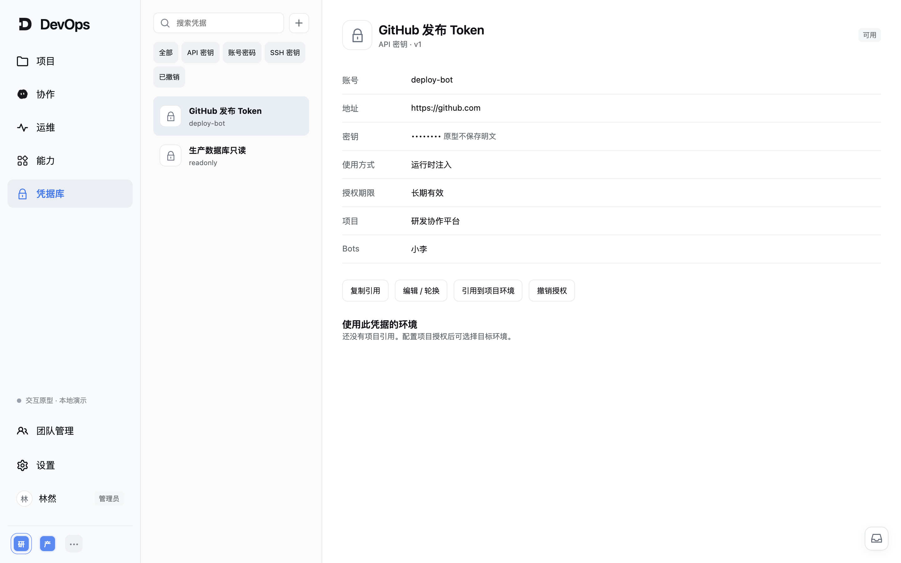 |

|                                       移动端项目晴雨表                                       |                                         移动端 Bot 协作会话                                          |
| :------------------------------------------------------------------------------------------: | :--------------------------------------------------------------------------------------------------: |
| 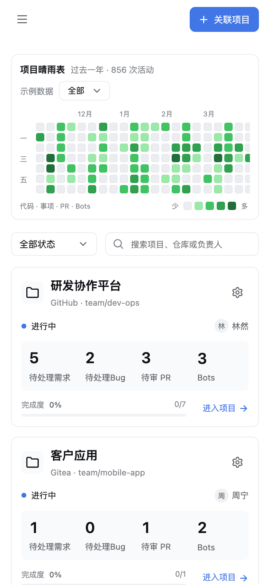 |  |

</details>

---

## 核心能力

以下能力均已在当前仓库中落地实现（详细规格见[产品需求](docs/prd/mvp.md)与[版本规划](docs/prd/release-plan.md)）：

### AI Bot 协作与运行内核

- **私聊与多 Bot 群聊**：支持与单个 Bot 对话或组建多 Bot 群组；支持群组 Leader、按序多 `@`、`@全部` 与带安全上限（4 跳 / 10 条回复）的群聊接力，可随时暂停、继续或终止。
- **显式任务与验收**：普通聊天不自动建单；通过显式任务记录执行者、补充指令、转交历史、交付结果、验收/退回及工作标签自动分类，集中汇聚在「待你处理」。
- **Pi 编码智能体运行内核**：基于独立子模块 [`packages/devops-bot`](packages/devops-bot/README.md) 驱动 `pi-coding-agent` `AgentSession`，支持会话树分支与分叉、自动与手动上下文压缩、运行中插话（`steer`）与追加、以及进程重启后的断点续跑。
- **目录沙盒与平台 API 委托**：每个 Bot 拥有独立工作目录，本地工具（`read` / `write` / `edit` / `bash` / `grep` / `find` / `ls`）默认运行在操作系统级沙盒（macOS `sandbox-exec` / Linux `bubblewrap`）中；支持联网搜索与按触发人实时权限委托调用平台 API。
- **团队能力中心**：管理员集中维护团队模型连接（API Key 加密存储或个人订阅 OAuth 登录）、团队 Skills 与 ZIP 技能包、提示模板、团队上下文、外部 MCP 服务、用户画像/Bot 笔记长期记忆（含后台定时整理）以及 Token 用量统计与月度预算控制。

### 项目与研发全流程

- **多团队隔离与权限**：平台 root 两级邮箱邀请与密码找回流程；团队内采用管理员、开发者、浏览者三角色，支持多团队切换与最后一位管理员保护。
- **项目工作区与晴雨表**：项目列表、基于 Git 提交/PR 与事项活动聚合的首页晴雨表、项目回收站与受控文件清理。
- **需求与 Bug 闭环**：内置 PRD 正文或外部文档链接、研发与测试负责人、自定义流程模板与事项规划、附件上传、提测流转与提测历史；内部 Bug 复现、修复、回归历史与需求双向关联。
- **交付、产物与版本**：按项目维护服务与环境目录；支持 CLI/API 幂等上报构建，集中展示移动端安装包、小程序二维码与 Web/后端测试入口；将「最新构建产物」与「环境已确认运行版本」、以及「外部提审」与「实际发布」分离记录。

### 外部代码仓库集成

- **GitHub 与 Gitea 接入**：通过 GitHub App / 用户授权与 Gitea Token 接入公私有仓库，按需读取分支、目录树、文件内容、Commit 与 PR/Diff，无需全仓克隆或手工同步。
- **受控项目写能力**：按「用户 × 项目 × 能力」显式授权，支持在隔离环境中应用受控代码补丁、创建远端 PR / Issue 与添加评论，所有写操作支持幂等键并写入审计记录。

### 内置流水线与自托管执行节点

- **仓库内 YAML 工作流**：直接读取仓库 `.devops/workflows/*.yml`，固定提交 SHA、工作流快照与执行计划，支持手动触发、参数输入、步骤日志流式查看、产物校验下载与取消。
- **控制面与执行面分离**：独立调度 Worker 基于 PostgreSQL 行锁与租约编排运行并收口超时/离线节点；自托管 `pipeline-agent` 主动外连平台，在非 root 隔离 Docker 容器中执行步骤并双端脱敏日志。
- **自举原生发布**：支持专用 macOS 原生发布节点（`macmini-deploy`），通过仓库工作流与发布脚本完成平台自身构建、迁移与健康检查回滚。

### 凭据库、储存桶与全能力 CLI

- **团队凭据库与项目环境变量**：AES-256-GCM 加密托管 API Key、账号密码与 SSH 密钥；管理员/开发者需二次输入登录密码临时查看明文并留存审计；项目环境只保存凭据引用，支持轮换与撤销。
- **平台储存桶管理**：默认内置本地储存桶，平台管理员可接入 S3 兼容对象存储并执行读写探针、默认桶切换与审计。
- **全业务覆盖 CLI（`devops`）**：22 个顶层命令覆盖 Web 全部核心业务操作，统一支持 `--json`、分页/全量拉取、幂等键与 stdin Token 注入，可直接被 CI 脚本或 AI 编码助手调用。

---

## MVP 路线与交付现状

| 版本  | 主题                   | 状态   | 关键产物                                                                                                                 |
| ----- | ---------------------- | ------ | ------------------------------------------------------------------------------------------------------------------------ |
| V0.1  | 研发流程基础           | 已交付 | 两级邮箱邀请、多团队与角色权限、项目、需求、Bug、提测与回归、GitHub/Gitea 代码关联                                       |
| V0.2  | 代码浏览与交付版本     | 已交付 | 目录/文件/PR 读取、服务与环境目录、交付上报、运行版本确认、外部审核与发布、凭据库与环境变量                              |
| V0.3  | 团队 Skills 底座       | 已交付 | 团队 Skills 目录、版本历史、启停与 ZIP 技能包导入导出                                                                    |
| V0.4a | 内置流水线执行器       | 已交付 | `.devops/workflows/*.yml` 解析、调度 Worker、自托管 Docker Agent、步骤日志与产物托管                                     |
| V0.4b | 项目写能力、附件与发布 | 已交付 | 受控代码变更/PR/Issue/评论、需求与 Bug 附件、本地与 S3 兼容储存桶、项目晴雨表、回收站与事项规划                          |
| V0.5  | Bot 协作与任务         | 已交付 | 独立 Bot、模型连接（API Key / 订阅登录）、私聊与群聊、显式任务与验收、工作标签、记忆、本地沙盒与委托调用                 |
| V0.6  | Bot 运行内核与平台模块 | 已交付 | `pi-coding-agent` 会话树与分支/分叉、自动与手动压缩、插话与断点续跑、群聊接力、提示模板、MCP、用量预算                   |
| V0.8  | CLI 全业务覆盖         | 已交付 | `devops` CLI 覆盖项目、事项、流水线、交付、Bot、会话、任务、Skills、凭据与储存桶，见[覆盖清单](apps/cli/WEB-COVERAGE.md) |
| V0.9  | Mac mini 原生自举发布  | 已交付 | 专用 `macmini-deploy` 节点、`.devops/workflows/deploy-macmini.yml` 与自动回滚发布脚本                                    |
| V0.7  | 运维值守与外部渠道     | 规划中 | 日志事件聚合、值守规则、自动建 Bug 与任务、飞书通知、客户反馈入口                                                        |
| V1.0  | 完整 MVP 验收          | 规划中 | 对照[需求第 13 章](docs/prd/mvp.md#13-需求核对场景)完成真实外部连接、备份恢复与跨模块全量验收                            |

---

## 系统架构

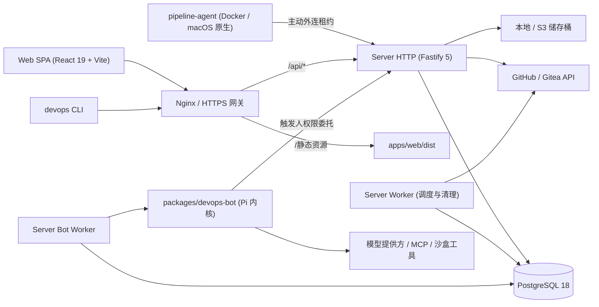

### 仓库工作区结构

```text
dev-ops/
├── apps/
│   ├── web/                     # React 19 + TypeScript + Vite + Tailwind CSS 4 前端应用
│   ├── server/                  # Fastify 模块化单体后端（http / worker / bot-worker / migrate 四个入口）
│   ├── cli/                     # devops 命令行工具（全业务覆盖，支持 --json 与自动化）
│   └── pipeline-agent/          # 自托管流水线执行节点（Linux Docker 容器 / macOS 原生发布）
├── packages/
│   ├── api-client/              # 从 Server OpenAPI 自动生成的类型化客户端与 CLI 输入校验器
│   ├── pipeline-protocol/       # Server 与 Agent 共用的 TypeBox 协议契约
│   └── devops-bot/              # Git 子模块：基于 Pi 的可复用 Bot 运行库
├── deploy/
│   ├── compose.yaml             # 本地开发 PostgreSQL 18 + Mailpit
│   ├── gateway.compose.yaml     # 可选 Docker Nginx 反向代理网关（含内置错误页）
│   ├── postgres/init.sql        # PostgreSQL 18 扩展与双角色（应用/迁移）初始化脚本
│   └── native/                  # Mac mini 原生自举发布脚本与运维说明
├── scripts/
│   ├── deploy.sh                # 生产环境初始化与原生部署脚本（支持 macOS launchd / Linux systemd）
│   └── install-cli.sh           # devops CLI 一键安装与卸载脚本
├── tooling/                     # 共享 TypeScript 配置、OpenAPI 客户端生成、依赖边界与 UI 检查
├── tests/e2e/                   # 跨 Web / Server / CLI / Agent 端到端测试
└── docs/                        # 产品需求、版本规划、架构设计与 UI 规范
```

---

## 快速开始（本地开发）

### 环境要求

- **Node.js**：`24.15.0`（见 [`.nvmrc`](.nvmrc)，约束 `>=24.15.0 <25`）
- **pnpm**：`11.12.0`（可通过 `corepack enable pnpm` 启用）
- **Docker**：用于启动本地 PostgreSQL 18 与 Mailpit（以及调试 Linux 流水线节点）
- **Git**：需拉取子模块 `packages/devops-bot`

### 一键启动本地环境

```bash
# 1. 克隆仓库及 Bot 运行库子模块
git clone --recurse-submodules https://github.com/aiShuiJiaoDeXioShou/dev-ops.git
cd dev-ops

# 2. 切换 Node 版本并安装依赖
nvm use
pnpm install --frozen-lockfile

# 3. 生成本地随机数据库配置、启动 PostgreSQL 18 + Mailpit 并执行迁移
pnpm db:setup
pnpm db:up
pnpm db:migrate

# 4. 初始化平台 root 账号（读取 apps/server/.env 中的 ROOT_EMAIL / ROOT_INITIAL_PASSWORD）
ROOT_EMAIL=admin@example.test ROOT_INITIAL_PASSWORD='ChangeMe123!' pnpm --dir apps/server seed:root

# 5. 启动 Web + HTTP Server（推荐日常开发）
pnpm dev
```

如需同时联调 **Web、HTTP 服务、调度 Worker、Bot 执行服务与流水线 Agent**，可在配置好 `apps/pipeline-agent/.env` 后运行：

```bash
pnpm dev:all
```

也可以按需单独启动后台进程：

```bash
pnpm --dir apps/server dev:worker       # 调度 Worker（流水线租约、晴雨表同步、附件清理）
pnpm --dir apps/server dev:bot-worker   # Bot 执行服务（私聊/群聊、任务与记忆整理）
```

| 服务            | 默认地址                      | 说明                                                  |
| --------------- | ----------------------------- | ----------------------------------------------------- |
| Web 前端        | `http://localhost:5173`       | 开发代理 `/api` 至后端（`DEV_OPS_API_TARGET` 可覆盖） |
| HTTP API        | `http://127.0.0.1:3001`       | `/api/v1/health`、`/api/v1/ready`                     |
| OpenAPI Swagger | `http://127.0.0.1:3001/docs/` | 非生产环境默认开启                                    |
| PostgreSQL 18   | `127.0.0.1:5433`              | 由 `deploy/compose.yaml` 提供                         |
| Mailpit Web UI  | `http://127.0.0.1:8025`       | 本地邮件捕获（SMTP 监听 `127.0.0.1:1025`）            |

---

## 生产部署

生产环境由 **PostgreSQL 18**、**三个常驻 Node.js 进程**（`http.js`、`worker.js`、`bot-worker.js`）以及托管 `apps/web/dist` 并反代 `/api/` 的 **HTTPS Nginx 网关**组成。

仓库提供生产初始化脚本 [`.devops/scripts/deploy.sh`](.devops/scripts/deploy.sh)，支持 **macOS（`launchd`）** 与 **Linux（`systemd`）**，并采用与 [Mac mini 原生自举发布](deploy/native/README.md)兼容的目录结构。

```text
~/deploy/dev-ops/
├── releases/<commit-sha>/   # 按提交隔离的完整构建产物
├── current -> releases/...  # 原子切换的当前生效版本
├── shared/
│   ├── app.env              # 应用配置与加密密钥（权限 0600）
│   ├── migration.env        # 独立迁移账号配置（权限 0600）
│   ├── nginx-devops.conf    # 生成的 Nginx 配置片段
│   └── services/            # 生成的 launchd plist 或 systemd unit 文件
├── data/                    # 发布目录外的持久化业务数据（pipeline / attachments / bot）
├── logs/                    # 三个常驻进程日志
└── scripts/release-main.sh  # 自举发布脚本
```

### 第一步：初始化目录、密钥与 PostgreSQL 18

```bash
git clone --recurse-submodules https://github.com/aiShuiJiaoDeXioShou/dev-ops.git
cd dev-ops

# 1. 初始化部署目录、随机密钥配置（0600）、Nginx 与系统服务模板
./.devops/scripts/deploy.sh \
  --root "$HOME/deploy/dev-ops" \
  --origin "https://devops.example.com" \
  --port 3001 \
  --db-host 127.0.0.1 \
  --db-port 5433 \
  --init-only
```

按照 `~/deploy/dev-ops/shared/app.env` 与 `shared/migration.env` 中自动生成的 `dev_ops_app` 和 `dev_ops_migrator` 密码初始化 PostgreSQL 18（支持本机或远程实例）：

```bash
# macOS Homebrew 安装 PostgreSQL 18 示例（Linux 使用系统包管理器或托管 PostgreSQL 18）
brew install postgresql@18
brew services start postgresql@18

# 按 shared/app.env 与 shared/migration.env 中的实际密码导出变量后初始化数据库与双角色
export APP_DATABASE_PASSWORD='<取自 shared/app.env>'
export MIGRATION_DATABASE_PASSWORD='<取自 shared/migration.env>'

createdb -h 127.0.0.1 -p 5433 dev_ops
psql -h 127.0.0.1 -p 5433 -d dev_ops -v ON_ERROR_STOP=1 -f deploy/postgres/init.sql
```

> 请同时在 `~/deploy/dev-ops/shared/app.env` 中按需补充 `SMTP_URL` 与 `MAIL_FROM`（用于发送团队邀请和密码重置邮件），并妥善备份 `AUTH_SECRET`、`GIT_CREDENTIAL_ENCRYPTION_KEY` 与 `data/` 目录。

### 第二步：构建、迁移并切换发布版本

```bash
# 首次部署：构建全量产物、执行迁移、初始化平台 root 并原子切换 current
ROOT_EMAIL="admin@example.com" \
ROOT_INITIAL_PASSWORD="YourStrongPassword!" \
./.devops/scripts/deploy.sh \
  --root "$HOME/deploy/dev-ops" \
  --origin "https://devops.example.com" \
  --seed-root
```

Linux 实例手动升级时，在同步源码与子模块后再次运行 `./.devops/scripts/deploy.sh`。Mac mini 的后续发布见下文。

### 第三步：启动守护进程并配置网关

脚本已在 `~/deploy/dev-ops/shared/services/` 生成对应系统的守护模板：

- **macOS（`launchd`）**：

  ```bash
  cp ~/deploy/dev-ops/shared/services/com.devops.*.plist ~/Library/LaunchAgents/
  for svc in http worker bot-worker; do
    launchctl bootout "gui/$(id -u)/com.devops.$svc" 2>/dev/null || true
    launchctl bootstrap "gui/$(id -u)" ~/Library/LaunchAgents/com.devops.$svc.plist
  done
  ```

- **Linux（`systemd`）**：

  ```bash
  sudo cp ~/deploy/dev-ops/shared/services/devops-*.service /etc/systemd/system/
  sudo systemctl daemon-reload
  sudo systemctl enable --now devops-http devops-worker devops-bot-worker
  ```

- **Nginx 网关与健康检查**：将 `~/deploy/dev-ops/shared/nginx-devops.conf` 引入 HTTPS `server` 块并重载 Nginx（也可使用容器化网关 [`deploy/gateway.compose.yaml`](deploy/gateway.compose.yaml)），随后验证就绪状态：

  ```bash
  curl -fsS http://127.0.0.1:3001/api/v1/ready
  curl -fsS https://devops.example.com/api/v1/ready
  ```

### Mac mini 流水线自举发布

完成首次原生部署后，在团队设置中注册能力标签为 `macmini-deploy` 的专用执行节点。后续应用发布在平台手动触发 [`.devops/workflows/deploy-macmini.yml`](.devops/workflows/deploy-macmini.yml)，由宿主安装的 [`.devops/scripts/release-main.sh`](.devops/scripts/release-main.sh) 构建、迁移、切换版本和检查就绪，异常时恢复上一版本。详见 [Mac mini 原生发布文档](deploy/native/README.md)。

---

## 安装与使用 CLI

`devops` CLI 面向终端开发、CI 脚本以及 Codex/Claude 等 AI 编码工具，通过个人 API Token 访问服务端，不直连数据库。

### 一键安装脚本

支持**本地仓库安装**与**远程独立安装**两种方式（脚本位于 [`scripts/install-cli.sh`](scripts/install-cli.sh)，要求本机已安装 Node.js 24.15+）：

```bash
# 方式一：在已克隆的仓库根目录直接安装（默认安装到 ~/.local/bin/devops）
./scripts/install-cli.sh

# 方式二：无需提前克隆，通过 curl 一键拉取并安装
curl -fsSL https://raw.githubusercontent.com/aiShuiJiaoDeXioShou/dev-ops/main/scripts/install-cli.sh | bash
```

常用安装选项：

```bash
./scripts/install-cli.sh --bin-dir /usr/local/bin   # 自定义安装目录
./scripts/install-cli.sh --ref main                 # 独立安装时指定分支或标签
./scripts/install-cli.sh --skip-build               # 本地已运行过 pnpm build 时跳过编译
./scripts/install-cli.sh --uninstall                # 卸载 devops 命令
```

### 配置 API Token 并验证

1. 登录 Web，进入「个人设置」`/settings/profile`，在 **API Token** 区域新建 Token（明文仅展示一次）。
2. 在终端绑定服务地址与凭据（本地配置以 `0600` 权限原子写入 `$XDG_CONFIG_HOME/devops/config.json`）：

```bash
devops config set server https://devops.example.com
devops config set token          # 交互式隐藏输入（也可通过 stdin 管道传入）
devops whoami
```

在 CI 或无状态脚本中，优先使用环境变量或标准输入传递 Token（禁止通过命令行参数明文传入）：

```bash
export DEV_OPS_SERVER=https://devops.example.com
printf '%s' "$DEV_OPS_TOKEN" | devops whoami --token-stdin --json
```

### 常用命令速查

```bash
# 系统与账号
devops health && devops ready
devops team list
devops project list --status active --json

# 需求与 Bug
devops requirement list --project <projectId>
devops requirement submit-test <requirementId> --test-owner <userId> --scope-note "核心链路" --self-test-result passed
devops bug create --project <projectId> --title "登录超时" --phenomenon "..." --expected "..." --reproduction "..."

# 代码浏览与交付上报
devops code tree <projectId> --repository <repositoryId> --ref main
devops delivery report --project <projectId> --file ./build.json --json
devops delivery version list <projectId> <serviceId>

# Mac mini 生产流水线触发与日志跟踪（团队管理员）
devops pipeline workflow list <projectId> --json
devops pipeline run trigger <projectId> --workflow .devops/workflows/deploy-macmini.yml --ref main
devops pipeline run logs <runId> --follow
devops pipeline run wait <runId> --json

# Bot 协作与任务验收
devops conversation list --all --json
devops conversation send <conversationId> --file ./message.json
devops task inbox --json
devops task accept <taskId> --file ./decision.json
```

完整命令与参数契约见 [CLI 使用说明](apps/cli/README.md) 与 [V0.8 全业务覆盖清单](apps/cli/WEB-COVERAGE.md)。

---

## 自托管流水线执行节点

执行仓库 `.devops/workflows/*.yml` 的 Linux 容器作业需要至少一台安装有 Docker Engine 的主机。在 Web「团队设置 → 连接与节点」创建节点并复制一次性注册令牌后启动：

```bash
# 在目标执行主机完成仓库构建后运行（或写入 apps/pipeline-agent/.env）
PLATFORM_URL=https://devops.example.com \
AGENT_REGISTRATION_TOKEN=<一次性注册令牌> \
AGENT_WORK_DIR=/var/lib/devops-agent \
AGENT_LABELS=linux,docker,node24 \
node apps/pipeline-agent/dist/index.js
```

首次注册成功后，请按 [Agent 说明](apps/pipeline-agent/README.md) 改配长期 `AGENT_TOKEN` 并交由 `systemd` / `launchd` 守护运行。节点支持启动自愈，会自动清理异常退出遗留的任务容器与临时工作区。

---

## 开发验证与质量门禁

```bash
pnpm check                 # 完整门禁：子模块检查、ESLint、Prettier、UI 规范、全量构建、依赖边界、全部测试与 E2E
pnpm test:db               # 使用本机 PostgreSQL 在隔离临时库验证迁移、权限、无外键一致性与事务
pnpm api:generate          # 修改后端 TypeBox 契约后重新导出 OpenAPI、API 客户端与 Bot 接口目录
pnpm ui:check              # 检查设计 Token、样式分层与 UI 规范基线
pnpm test:visual           # 运行 Web Playwright 视觉回归测试
pnpm format                # 统一 Prettier 格式化
```

---

## 文档索引

| 类别       | 文档                                                                                                                                       | 说明                                         |
| ---------- | ------------------------------------------------------------------------------------------------------------------------------------------ | -------------------------------------------- |
| 产品与规划 | [MVP 产品需求](docs/prd/mvp.md)                                                                                                            | 产品定位、业务边界、权限模型与验收场景       |
| 产品与规划 | [需求版本规划](docs/prd/release-plan.md)                                                                                                   | V0.1 至 V1.0 模块划分、交付顺序与里程碑      |
| 产品与规划 | [项目结构图](docs/prd/project-maps.md)                                                                                                     | 模块图、功能图与逻辑区域架构图               |
| 架构设计   | [目标架构方案](docs/architecture/system-design.md)                                                                                         | Monorepo 分层、模块化单体边界与进程模型      |
| 架构设计   | [数据库说明](docs/architecture/database.md)                                                                                                | PostgreSQL 18 建模约定、双角色权限与迁移流程 |
| 架构设计   | [Bots 执行架构](docs/architecture/bots-architecture.md)                                                                                    | Bot 运行内核、记忆、沙盒工具与权限委托设计   |
| 架构设计   | [外部仓库与流水线架构](docs/architecture/code-pr-pipeline-architecture.md)                                                                 | GitHub/Gitea 适配与内置流水线组件时序图      |
| 应用文档   | [Web 前端](apps/web/README.md) · [Server 后端](apps/server/README.md) · [CLI](apps/cli/README.md) · [Agent](apps/pipeline-agent/README.md) | 各应用运行命令、环境变量与接口说明           |
| 部署运维   | [本地与网关部署](deploy/README.md) · [Mac mini 原生发布](deploy/native/README.md)                                                          | Compose、Nginx 网关、邮件与自举发布运维手册  |
| 工程规范   | [项目协作与开发规范](AGENTS.md) · [Web 设计规范](docs/design/DESIGN.md)                                                                    | 编码约定、PostgreSQL 规范、UI 与提交门禁     |
| 设计原型   | [HTML 交互原型](docs/desgin/interactive-prototype-v1/index.html) · [原型说明](docs/desgin/interactive-prototype-v1/README.md)              | 本地交互设计稿入口（`pnpm dev:prototype`）   |
