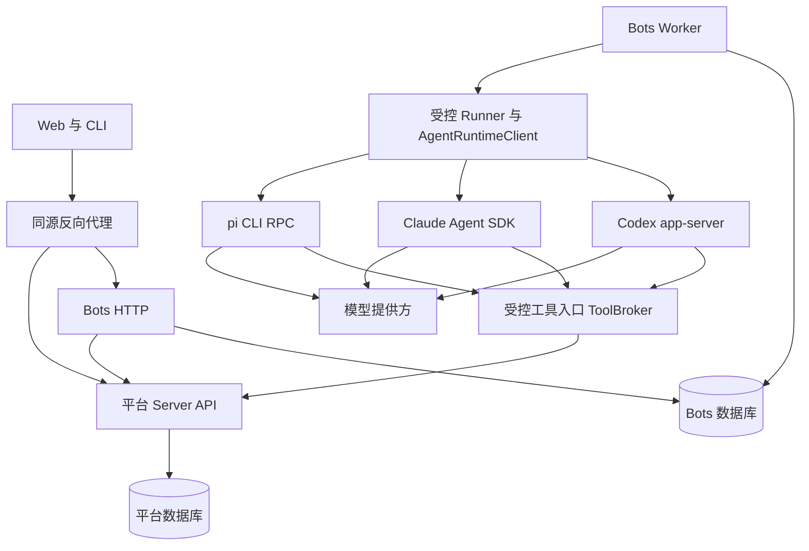

# Bots 独立子系统架构草案

**面向持续身份、跨会话长期记忆、任务交接和项目 API 调用，先交付能学习、召回与纠正记忆的单 Bot，再增加群组协作与执行节点。**

| 属性   | 内容                                                                                                                                                                               |
| ------ | ---------------------------------------------------------------------------------------------------------------------------------------------------------------------------------- |
| 状态   | 方案草案；运行时接入方式与 PostgreSQL 方向已确认，目录、表、接口及状态仍为拟议设计                                                                                                 |
| 负责人 | 项目维护者                                                                                                                                                                         |
| 读者   | 后端、前端、执行器开发者及测试人员                                                                                                                                                 |
| 范围   | Bot 定义、会话、任务、运行、工具调用、上下文、执行环境和平台接入                                                                                                                   |
| 关联   | [产品需求第 10 章](../prd/mvp.md#10-bot团队-skills-与协作模板)、[目标架构](system-design.md)、[代码接入](external-repositories.md)、[流水线架构](code-pr-pipeline-architecture.md) |

## 1. 建议方案

建议在同一 pnpm 工作区增加独立的 `apps/bots`，使用 TypeScript、Fastify 与 PostgreSQL，分别启动 HTTP 和 Worker 进程。Bots 拥有自己的业务表、迁移和数据库账号；访问项目、需求、Bug、代码、Skills 与凭据时统一调用平台 API。首批部署可以共用 PostgreSQL 实例，但不能跨服务读表或 join。

PostgreSQL 已确认为本项目存储方向。长期记忆作为首批能力，由 Bots 维护提取、更新、召回与遗忘流程；数据库引擎不决定记忆内容及生效范围。

运行时适配层参考 OpenBot 的分工：Codex 接 app-server，Claude Code 接 Claude Agent SDK，pi 接 CLI RPC。三个后端并列接入平台定义的 AgentRuntimeClient，由 Bots 控制面维护任务状态、权限、工具记录与恢复。适配器通过编译期注册接入，不建设动态插件市场。

运行时选择和模型选择分别配置，pi 是一个后端，不承担 Codex 或 Claude Code 的统一调度。平台不直接依赖 pi agent-core 或 Codex TypeScript SDK 作为这套适配层的入口。内部端口与事件结构见[运行时适配契约与示例](bots-runtime-examples.md)。

首个验收目标是：创建无项目 Bot，保存一条偏好，在新会话中正确召回，纠正或遗忘后不再使用旧值；显式任务可以读取获准项目、提交文本结果并由成员验收。关闭浏览器与重启 Worker 后，记忆和任务进展仍可恢复。群聊、代码修改和生产执行分别扩展。

> **Why & What - 独立应用与数据边界**
>
> **选择：** Bots 独立为应用，通过 HTTP API 使用平台能力。
>
> **理由：** API 隔离能避免执行器依赖业务表结构，也允许执行负载与平台 HTTP 分开发布。独立服务并不自动解决身份委托和跨服务一致性。
>
> **备选：** 同一 Server 中的模块能复用事务与部署，适合仅要求代码组织独立的情况；当前按 API 隔离目标选择独立应用。
>
> **代价与退路：** 增加鉴权、网络失败、迁移和监控成本。若部署成本过高，可将两个服务放在同一主机，保留 HTTP 与数据库账号边界。

## 2. 需求与现有工程依据

需求事实以 [MVP 第 10 章](../prd/mvp.md#10-bot团队-skills-与协作模板)为准。本方案把“Grok Bot”理解为独立角色、持续对话与群组协作的产品参考；Bot 可以选择不同模型提供方，模型品牌不进入业务实体定义。

以下源码核对基于 `4df575ff0198168afb46d3be5f592d4f69f62ee3`，读取日期为 2026-11-10。源码存在、线上部署和真实执行验收分别判断，本表只说明源码。

| 已核对事实                                                     | 来源                                                                           | 对设计的影响                                              |
| -------------------------------------------------------------- | ------------------------------------------------------------------------------ | --------------------------------------------------------- |
| Bot 独立于项目；普通消息不自动创建任务；任务只有一位当前执行者 | MVP 第 10.1 节                                                                 | 分开建模 Bot、会话、任务与运行                            |
| 项目协作按工作标签归集，且必须满足会话可见权限                 | MVP 第 10.1 节                                                                 | 项目引用不能替代标签或访问检查                            |
| Skills、模板和内容版本已有接口与持久化                         | `apps/server/src/modules/knowledge/knowledge.routes.ts`、`knowledge.tables.ts` | 通过 API 引用同一版本，不复制成第二个技能库               |
| 当前 collaboration 保存事项评论与活动                          | `apps/server/src/modules/collaboration/collaboration.tables.ts`                | 新聊天模型与现有事项评论分开                              |
| 当前 Actor 只有用户，会话与 PAT 最终均解析为用户               | `apps/server/src/modules/identity/identity.actor.ts`、`identity.tokens.ts`     | Bot 专用执行身份是接入前置工作，不能直接拿管理员 PAT 运行 |
| Server 禁止依赖生成的 api-client，应用间禁止源码导入           | `tooling/dependency-rules.mjs`                                                 | Bots 可消费平台客户端；Server 继续拥有自身契约与实现      |

现有[目标架构第 6、8 章](system-design.md#6-业务模块与数据归属)把 bots、collaboration、tasks 放在 Server 内，并建议先共用包与迁移。本方案提出更严格的应用边界，属于待确认的架构调整。本文不修改原架构的已确认内容；落地前应统一其模块归属与运行进程章节。

目标包括可恢复任务、明确的项目授权和可替换执行器。首批不包含全员自由互聊、递归多 Agent 调度、在线 IDE、通用工作流编辑器、自动生产发布或对任何模型上下文的永久保留承诺。流水线执行和发布状态继续由各自业务模块负责。

## 3. 开源与公开源码参考

下表依据 2026-11-10 查阅的官方仓库或官方文档。能力描述仅表示参考项目公开提供的机制；最后一列是本方案的选型判断，不代表已经完成依赖兼容验证。

| 项目         | 可借鉴机制与依据                                                                                                                                                                                                                                                                                                                                    | 采用方式及边界                                                                                |
| ------------ | --------------------------------------------------------------------------------------------------------------------------------------------------------------------------------------------------------------------------------------------------------------------------------------------------------------------------------------------------- | --------------------------------------------------------------------------------------------- |
| OpenBot      | 独立工作区、持久会话、FIFO 消息、交接和上下文压缩，见[固定版本 README](https://raw.githubusercontent.com/nightly-labs/openbot/818d747347fe18ccad897f508fb628feebb052e5/README.md)                                                                                                                                                                   | 产品与交互参考。它面向本地桌面；其执行权限模型不能直接作为团队平台的权限方案                  |
| OpenClaw     | Agent 独立状态与会话，见[多 Agent 文档](https://docs.openclaw.ai/concepts/multi-agent)；会话内串行、会话间限流，见[固定版本队列说明](https://raw.githubusercontent.com/openclaw/openclaw/427edb705217c93139e2577e81176a668e39814f/docs/concepts/queue.md)                                                                                           | 借鉴会话路由和 mailbox 思路。其进程内队列不能直接承担本平台跨 Worker 的持久调度               |
| pi           | agent-core 提供工具执行、事件流与上下文转换，见[固定版本说明](https://raw.githubusercontent.com/earendil-works/pi/a05e3a07763c38d23d50207742f7e073e35cd0f8/packages/agent/README.md)；coding-agent 另有[嵌入式 SDK](https://raw.githubusercontent.com/earendil-works/pi/a05e3a07763c38d23d50207742f7e073e35cd0f8/packages/coding-agent/docs/sdk.md) | 通过 CLI RPC 作为运行时接入；模型选择由 pi 支持的 provider 决定，会话文件不作为平台业务数据库 |
| LangGraph JS | [持久化](https://docs.langchain.com/oss/javascript/langgraph/persistence)区分会话 checkpoint 与长期 store；[interrupt](https://docs.langchain.com/oss/javascript/langgraph/interrupts)支持等待外部输入，并指出恢复时的副作用重放问题                                                                                                                | 作为复杂持久工作流的备选。首批流程简单，先避免同时维护图状态与平台任务状态                    |

许可记录分别见 OpenBot 的 [PolyForm Noncommercial 1.0.0](https://raw.githubusercontent.com/nightly-labs/openbot/main/LICENSE)、pi 的 [MIT](https://raw.githubusercontent.com/earendil-works/pi/main/LICENSE)、OpenClaw 的 [MIT](https://raw.githubusercontent.com/openclaw/openclaw/main/LICENSE)与 LangGraph JS 的 [MIT](https://raw.githubusercontent.com/langchain-ai/langgraphjs/af1d87cc42f00f0e2d535236c6ff211b8c5f1c9f/LICENSE)。本方案参考 OpenBot 的产品和架构机制，独立实现适配器，不复制其实现；引入其他依赖时仍需核对锁定版本及其依赖许可。

> **Why & What - 原生运行时分别适配**
>
> **选择：** 平台统一内部端口，Codex、Claude 和 pi 分别通过 app-server、SDK 与 RPC 接入。
>
> **理由：** 平台可以复用各自的原生执行循环和会话恢复，同时统一任务与审计。适配不能消除模型、工具和压缩能力差异，必须显式声明能力。
>
> **备选：** 直接使用 pi agent-core 统一所有模型，能控制同一套工具循环，但不保留 Codex 和 Claude Code 的完整运行时行为；只接一种运行时能减少首批工作，但不满足已确定的多运行时方向。
>
> **代价与退路：** 分别维护协议、版本和契约测试。某种运行时未通过实验时保持不可选，任务可明确转交，不静默切换运行时或身份。
>
> **范围：** 长期复杂工作流仍可另行评估 LangGraph，当前不让执行图替代平台任务权威。

### 3.1 OpenBot 的长期记忆机制

以下实现依据沿用第 3 章日期及 OpenBot 固定版本。其长期记忆以短文本条目保存，记录来源轮次、手工或自动来源、时间与修订；语义分类并非每类一张数据库表。

| 层次       | 已核对机制                                                                                                             | 源码依据                                                                                                                                                                                                                                                                                                                                                                                                                                                                                  |
| ---------- | ---------------------------------------------------------------------------------------------------------------------- | ----------------------------------------------------------------------------------------------------------------------------------------------------------------------------------------------------------------------------------------------------------------------------------------------------------------------------------------------------------------------------------------------------------------------------------------------------------------------------------------- |
| 所属范围   | Agent、内部群组、外部消息连接分别保存记忆，按 agent、channel、connection 标识选择                                      | [AgentMemoryStore](https://raw.githubusercontent.com/nightly-labs/openbot/818d747347fe18ccad897f508fb628feebb052e5/src/backend/agent-memory-store.ts)、[ChannelMemoryStore](https://raw.githubusercontent.com/nightly-labs/openbot/818d747347fe18ccad897f508fb628feebb052e5/src/backend/channel-memory-store.ts)、[MessagingMemoryStore](https://raw.githubusercontent.com/nightly-labs/openbot/818d747347fe18ccad897f508fb628feebb052e5/src/backend/messaging/messaging-memory-store.ts) |
| 内容筛选   | 提取跨聊天仍有价值的偏好、稳定事实、长期决定与带期限计划；排除任务进度、步骤日志和临时待办，可复用做法归入 Skill       | [记忆复盘规则](https://raw.githubusercontent.com/nightly-labs/openbot/818d747347fe18ccad897f508fb628feebb052e5/src/backend/agent/memory-review-prompt.ts)                                                                                                                                                                                                                                                                                                                                 |
| 召回策略   | essential 作为有限的常驻记忆，searchable 通过 FTS5 与 BM25 按需搜索；用户可控制选择，存储与上下文分别有预算            | [选择及检索实现](https://raw.githubusercontent.com/nightly-labs/openbot/818d747347fe18ccad897f508fb628feebb052e5/src/backend/agent-memory-store.ts)、[注入实现](https://raw.githubusercontent.com/nightly-labs/openbot/818d747347fe18ccad897f508fb628feebb052e5/src/backend/agent/developer-instructions.ts)                                                                                                                                                                              |
| 更新与遗忘 | Agent 轮次中的记忆变更先暂存、成功结束才提交；后台 review 对新增聊天提出变更；并发编辑与清空检查防止旧结果恢复已删内容 | [轮次提交逻辑](https://raw.githubusercontent.com/nightly-labs/openbot/818d747347fe18ccad897f508fb628feebb052e5/src/backend/agent/agent-memories.ts)、[后台 review](https://raw.githubusercontent.com/nightly-labs/openbot/818d747347fe18ccad897f508fb628feebb052e5/src/backend/agent/memory-review.ts)                                                                                                                                                                                    |

SQLite 同时保存其他应用记录；聊天历史、任务、运行恢复信息与上述事实记忆分别建模。是否能够跨会话持续使用所学内容，由记忆生命周期和上下文装配决定。

### 3.2 OpenBot 的运行时边界

运行时结构核对使用 OpenBot `b1f5e6020e40bb9d41b6a1afb7a4c0603ff63850`，日期同第 3 章。它在自己的 [AgentClient](https://raw.githubusercontent.com/nightly-labs/openbot/b1f5e6020e40bb9d41b6a1afb7a4c0603ff63850/src/backend/agent-client.ts) 后注册多个驱动；本项目借鉴这个边界，内部端口由本项目定义。

| 运行时      | 已核对的 OpenBot 接法                                          | 依据                                                                                                                                                     |
| ----------- | -------------------------------------------------------------- | -------------------------------------------------------------------------------------------------------------------------------------------------------- |
| Codex       | 启动 app-server 子进程，通过 stdio 交换请求和事件              | [CodexAppServerClient](https://raw.githubusercontent.com/nightly-labs/openbot/b1f5e6020e40bb9d41b6a1afb7a4c0603ff63850/src/backend/app-server-client.ts) |
| Claude Code | Claude Agent SDK 包装为统一客户端                              | [ClaudeAgentClient](https://raw.githubusercontent.com/nightly-labs/openbot/b1f5e6020e40bb9d41b6a1afb7a4c0603ff63850/src/backend/claude-client.ts)        |
| pi          | 启动 CLI RPC 子进程，翻译会话、prompt、abort 和 compact 等操作 | [PiAgentClient](https://raw.githubusercontent.com/nightly-labs/openbot/b1f5e6020e40bb9d41b6a1afb7a4c0603ff63850/src/backend/pi-client.ts)                |

官方协议入口为 [Codex app-server](https://learn.chatgpt.com/docs/app-server)、[Claude Agent SDK](https://code.claude.com/docs/en/agent-sdk/typescript) 与 [pi RPC](https://github.com/earendil-works/pi/blob/main/packages/coding-agent/docs/rpc.md)，查阅日期同第 3 章。平台适配器按锁定的 CLI/SDK 版本验证能力；运行时回复成功接收命令，与模型工作最终完成分别判断。

## 4. 组件与数据归属

Bots 控制面管理用户可见记录，Worker 领取与编排 Run，Runner 持有运行时适配器、原生进程及 SDK 会话。三种运行时都进入受控 Runner；HTTP 与 Worker 不直接执行项目脚本。首批可同主机部署，进程权限、目录和凭据边界仍分别实施。



| 归属                                           | 拥有的数据与规则                                          | 对外关系                                              |
| ---------------------------------------------- | --------------------------------------------------------- | ----------------------------------------------------- |
| 平台 identity                                  | 用户、团队、角色、服务身份、项目执行授权与凭据签发        | Bots 查询当前身份及成员资格，平台业务接口校验执行授权 |
| Bots agents                                    | Bot 名称、职责、负责人、配置版本与启停                    | 项目能力授权在平台保存，Bots 保存引用及展示投影       |
| Bots conversations                             | 会话、成员、Leader、消息、资源引用与标签                  | 现有事项评论仍留在 Server collaboration               |
| Bots tasks                                     | 任务、当前执行者、交接、交付与人工验收                    | 需求与 Bug 只保存任务引用，不维护另一套任务状态       |
| Bots execution                                 | 运行、步骤、工具调用、租约、事件与上下文快照              | 执行器 session ID 只是运行引用                        |
| Bots context                                   | Bot 长期记忆、记忆提取与召回、会话压缩、任务交接摘要      | 全局记忆页面通过 Bots API 管理这部分记录              |
| 平台 knowledge                                 | Skills、AGENTS.md 模板与版本；将来实际建设的团队/项目知识 | Bots 用 API 获取版本，Bot 不写 knowledge 数据表       |
| 平台 code、delivery、configuration、operations | Git、交付、凭据、流水线与发布计划的业务事实               | 仅通过已授权 API 调用；未建设的能力保持不可用         |

这项归属把原目标架构中统一放入 knowledge 的记忆进一步按来源拆分：Bot 私有记忆、会话记忆与运行摘要属于 Bots，经确认发布的共享项目知识属于平台。共享知识的存储和检索未出现实际用例时，不先建设第二套记忆服务。

两个应用分别导出 TypeBox/OpenAPI。`packages/api-client` 继续只由平台契约生成；Bots 契约拟生成到 `packages/bots-client`，供调用方使用。Server 不依赖自己生成的平台客户端；若实际需要调用 Bots，则通过 Bots 契约对应的客户端发送 HTTP 请求。当前页面需要任务摘要时，Web 可以并行读取两个 API，平台保存可校验的任务引用。

反向代理分流 Bot 对象路径及 `/api/v1/teams/:teamId/bots`、`/api/v1/teams/:teamId/bot-conversations`，不能把所有 `/teams` 路由转给 Bots。对象路径与事件路由见第 9 章。浏览器使用同源 Cookie，Bots 经受信任的身份核验 API 验证会话，不自行解密平台 Cookie。POST 同时实施 Origin/CSRF 检查；CLI 使用相同业务协议的独立凭据。

### 4.1 统一运行时端口

AgentRuntimeClient 是 Runner 内部端口，负责会话控制、双向事件和原生协议转换。平台 API 使用 HTTP GET/POST 的要求不改变原生 stdio 或 SDK 协议；内部端口也不直接暴露为浏览器可调用的任意 RPC。

| 操作                            | 统一语义                               | 边界                                                        |
| ------------------------------- | -------------------------------------- | ----------------------------------------------------------- |
| `connect`、`getCapabilities`    | 启动通道、握手并读取版本与已验证能力   | Codex 完成 initialize/initialized；其他适配器执行各自初始化 |
| `startSession`、`resumeSession` | 创建或继续平台绑定的原生会话           | 返回并持久化绑定后才提交任务输入；会话 ID 不是权限凭证      |
| `startTurn`                     | 在空闲会话中提交一次输入               | 只表示提交成功，结果通过事件流给出；首批不自动并行输入      |
| `events`                        | 订阅输出、工具、批准请求、用量和终态   | 提交输入前开始消费；保持有界缓冲及背压                      |
| `respondToRequest`              | 回答当前会话、当前代次的工具或批准请求 | 不能把旧连接的 request ID 回复给新连接                      |
| `interruptTurn`                 | 请求停止指定原生轮次                   | 收到终态或确认进程退出后才释放可写执行槽                    |
| `compactSession`                | 请求支持的原生压缩                     | 按能力开放；不支持时明确返回，不假装压缩成功                |
| `disconnect`                    | 释放进程、连接或 SDK 资源              | 不等于删除原生会话或遗忘平台长期记忆                        |

运行时能力按锁定版本记录 `resume`、`interrupt`、`explicitCompaction`、`automaticCompaction` 与 `platformTools`。模型和推理配置也分别确认；不支持的模型、工具绑定或参数在派发前拒绝，不静默丢弃配置。

统一事件至少包括会话绑定、输入接收、输出增量、最终正文、工具请求与执行结果、批准请求、用量更新、上下文压缩、轮次结束及运行时退出。每个事件附平台 session、Run、连接代次和单调序号；原生 ID 作为私有关联字段，不能直接用作全局去重键。

Codex 的 `turn/completed` 必须读取最终状态；Claude 的 SDK result 必须区分成功与错误。pi 的 prompt response 只确认命令处理，`agent_end` 也可能继续自动重试或压缩恢复；应等待 `agent_settled` 并检查错误/取消记录。pi 返回 `handled` 时不等待不存在的模型终态，按受控命令的实际结果处理。协议细节以第 3.2 节来源和锁定版本为准。

适配器在 Runner 内将原始消息校验为统一事件，Worker 再转换为平台状态。输出增量可有界合批，完成正文与终态必须持久化后对外确认；崩溃丢失的未提交尾部标记中断。原始协议正文、内部错误和推理内容不默认写入共享日志或直接展示。

### 4.2 会话恢复与工具桥接

原生会话按团队、Bot、当前使用者或会话、可选任务、runtime、账号、Runner、工作目录及权限/上下文版本绑定。PostgreSQL 保存平台绑定、运行记录、事件游标和记忆权威；原生 CLI 的 JSONL、SQLite 或其他私有文件按受控执行器状态保管，不成为第二套平台长期记忆库，也不直接改写它们的内部表。

Runner 的配置实验还需核对原生自动记忆、全局规则和扩展加载。首批关闭会独立学习并跨会话自动注入的非平台记忆通道，只允许受控工具维护平台记忆；项目 AGENTS.md 和 Skill 按已选版本作为明确输入。无法隔离独立自动学习的运行时不开放该能力，不能在遗忘后从原生插件重新加载旧事实。

同一物理会话同时只允许一个有效 Run。原生进程空闲后可按能力释放，恢复先检查会话文件、账号、工作目录、配置版本及上下文代次。空白 Runner 只有 session ID 无法恢复；首批采取会话粘着 Runner，丢失或不兼容时用明确交接摘要建立新会话并记录替代关系。切换 runtime 同样新建会话，不把另一运行时的 ID 原样传入。

三条工具绑定都进入同一 ToolBroker，再调用第 6 章的受控 API。Codex 优先验证 app-server 动态工具；该入口目前有实验能力开关，版本与握手不满足时必须明确拒绝工具型运行。Claude 通过 SDK 的自定义 MCP 工具回调接入；pi 通过受控扩展或 MCP 桥接本地工具入口，RPC 本身不视为任意工具注册接口。

ToolBroker 接收的上下文由 Runner 注入，模型只提供业务参数。执行前核对平台身份、Run 租约代次、目标项目和具体能力，保存调用意图与幂等键，再执行 API；结果通过原生请求关联回传。原生 shell、文件读写和浏览器能力另外受 Runner 隔离与运行时工具策略控制，不能拿平台工具鉴权代替本地隔离。

原生运行时的工具批准请求与平台生产变更放行分别处理。适配器将请求绑定到当前 Run，转交现有任务输入/批准流程；未取得授权时拒绝，不自动以创建者身份批准。等待输入超过原生通道可保持的时限时，保存阻塞原因并结束本次 Run，下一次按检查点和当前授权恢复。

Worker 或 Runner 断线后先查运行与操作记录。只有确认旧原生执行已停止，才允许另一个可写运行接管；不能从最后一条文本猜测执行成功，也不能自动重放未知写工具。进程级退出应关联该连接上全部未结束运行，不能只结束最后一个会话。stdout 按协议持续读取，stderr 仅作脱敏诊断；请求超时、单条记录大小、待处理请求数与事件缓冲均设有界限制。

## 5. 核心对象与状态

Bot 表示持续身份，Conversation 表示共享记录与可见范围，Task 表示明确交付目标，Run 表示一次执行尝试。普通聊天可以产生不含 `task_id` 的 Run。一个 Bot 在多个会话中保持同一职责配置，但各会话历史、任务上下文及执行器会话分别隔离。

| 对象         | 必要内容                                                                  | 不变量                                              |
| ------------ | ------------------------------------------------------------------------- | --------------------------------------------------- |
| Bot          | 团队、名称、负责人、职责、配置版本、runtime、模型、技能版本引用、启停     | 不因创建者有权限而自动获得项目能力                  |
| Conversation | 类型、名称、成员、Leader、指令、标签                                      | Leader 必须是有效成员；私聊和群聊的可见范围分别检查 |
| Message      | 发言人类型与 ID、正文块、序号、资源引用、关联运行                         | 普通聊天与新建任务通过显式动作区分                  |
| Task         | 目标、业务负责人、当前执行者、来源、验收条件、可选项目、版本              | 一位当前执行者；补充要求递增版本                    |
| Run          | Bot、会话、可选任务、输入版本、runtime 版本、状态、租约、预算、上下文版本 | 一个执行器会话同时只有一个有效运行                  |
| ToolCall     | 工具、规范输入、项目、授权引用、幂等键、执行结果与外部操作 ID             | 写操作结果不确定时进入核对流程                      |
| Handoff      | 原执行者、新执行者、原因、摘要、交付引用、未完成项                        | 转交追加历史，保留旧运行记录                        |

任务拟采用 `open → in_progress → awaiting_review → completed`；缺少输入、配置或执行能力时进入 `waiting`，保存明确的 `wait_reason`。拒绝验收回到 `in_progress`，取消进入 `cancelled`。运行失败只结束该次运行，并把任务设为等待重试或处理，不能自动标记任务完成。请求接收、原生轮次结束、平台 Run 成功与任务验收分别记录。

Run 拟采用 `queued → running → succeeded | failed | cancelled | interrupted`；等待人工输入时进入 `suspended`。恢复使用同一任务的新 Run，并链接前次检查点；原 suspended Run 结束为 interrupted，并记录后继运行。Run 的 `succeeded` 只表示本次执行结束。模型产出交付后，任务进入待验收。

群聊路由使用确定规则：明确选择的单个 `@Bot` 优先，否则交给 Leader；没有可用承接者时要求选择。多个 Bot 引用必须区分接收者与普通提及，首批不自动并行广播。Leader 通过受控转交工具修改当前执行者，旧任务分工不随 Leader 变更而改变。

首批转交发生在当前运行停止并保存交接摘要之后。补充当前任务采用“持久保存补充内容，当前工具到达安全边界后停止旧运行，再开启新运行”的方式。`task.version` 阻止旧输入产生的结果覆盖新要求；普通聊天消息则按进入会话的顺序排队。

## 6. 平台 API 与工具授权

工具入口将有限的业务动作映射为固定 API；模型只能选择工具和业务参数。它不能提交任意 URL、HTTP 方法、请求头、SQL 或来源 Token。工具描述可由契约辅助生成，实际开放名单、参数约束和风险分类由开发者显式维护。

| 工具示例                                               | 归属与实际行为                              | 首批范围                             |
| ------------------------------------------------------ | ------------------------------------------- | ------------------------------------ |
| `projects.read`、`requirements.read`、`code.read_file` | 平台现有读取 API，校验团队及项目            | 先实现一条项目读取链路，再按用例增加 |
| `bugs.create`、`requirements.update_progress`          | 所属模块执行状态校验并写活动                | Bot 执行身份与幂等接入通过后开放     |
| `tasks.handoff`、`tasks.submit_result`                 | Bots 本地用例，校验成员、当前执行者和版本   | 任务阶段实现                         |
| `configuration.request`                                | 平台创建配置请求，返回请求 ID               | 随配置等待恢复交付                   |
| `code.prepare_workspace`、`code.submit_change`         | 受控检出、结果收集与推送，平台保留 Git 凭据 | 代码执行阶段实现                     |
| `pipelines.trigger`、`operations.create_plan`          | 平台分别创建流水线运行或变更计划            | 对应模块具备真实能力后开放           |

一次运行的调用权限为：当前用户授权或独立调度授权、Bot 项目授权、本次任务授权、平台连接能力的交集。每次项目调用只有一个目标项目。Bot 运行上下文不能通过传入另一个 `botId` 或 `userId` 改变身份。

Bots 自身的配置、发言和任务变更同样遵循团队角色，浏览者保持只读。任务验收由具备写权限的业务负责人或明确获准的成员执行；消息发言人由服务端身份确定。调用前先记录并展示执行者、目标项目、工具和安全输入摘要，再执行实际动作；需要放行的生产操作链接到具体变更计划。

平台 identity 拟增加服务身份和受限执行授权。Bots 控制面用独立服务凭据申请绑定 `teamId`、`botId`、`runId`、项目、动作、期限及运行代次的授权；用户触发需附经过核验的用户委托，定时任务需引用独立、可撤销的自动化授权。平台自行求交集，不能相信 Bots 自报的 scope。

Bot 启停与运行存活由 Bots 权威判断；项目授权、用户资格与资源归属由平台判断。平台在发放执行授权时取得 Bot 状态证明，并在实际能力调用时通过受认证的 Bots 内部核验 API 检查当前运行和代次。该内部核验只读取 Bots 本地权威状态，避免再次请求平台形成调用环。核验失败则拒绝新调用；只验证尚未到期的离线 Token 无法满足立即撤销要求。

服务凭据只证明服务身份。运行级短期凭据由工具入口保管，不进入模型、聊天、记忆或项目脚本。外部 coding runtime 能触发的平台动作也必须经过这个入口；原生 shell 运行在受限 Runner，不能用环境变量中的长期 PAT 绕过授权。平台业务工具在 HTTP API 上统一语义；SDK 或扩展需要的 MCP/本地桥接仅承担运行时协议转换。

每次写工具先持久保存规范输入和稳定幂等键，再调用业务 API。超时后按同一键查询结果；对不提供幂等或结果核对的动作，保留 `unknown` 并等待处理。模型重新生成参数属于新意图，不能作为恢复同一写操作的方式。

跨服务流程采用“保存意图、调用所属 API、记录结果、失败核对”。从 Bug 建任务使用来源事件/请求键去重，再通过 API 关联任务；部分成功时保留可修复的待关联记录。归属模块各自提交本地事务，不跨两个数据库假设原子提交。

> **Why & What - 受控业务工具**
>
> **选择：** 工具直接映射已有业务 API，逐项开放能力。
>
> **理由：** 业务授权、错误码和审计继续由资源所属模块维护。工具白名单不能替代后端鉴权，也不能防止已授权范围内的错误操作。
>
> **备选：** MCP 适合连接多种 Agent 客户端，但协议本身不定义项目业务权限。出现第二类外部调用者后，可以在同一工具入口外增加 MCP facade。
>
> **代价与退路：** 每项写能力需要契约、幂等及失败测试；不满足条件时保持不可调用，普通对话和读取继续可用。

## 7. 持久调度、事件与恢复

首批采用 PostgreSQL 运行记录与短租约完成调度。创建消息或任务时，在同一 Bots 数据库事务内写入运行意图。Worker 使用短事务与 `FOR UPDATE SKIP LOCKED` 领取工作，提交后再调用模型；不在模型等待期间持有数据库事务。

领取同时锁定 runtime session 的执行槽，保存 `lease_owner`、`lease_until` 与单调递增的 `lease_epoch`。心跳和结果提交都带代次并检查条件更新行数；旧 Worker 失去租约后，其结果不能覆盖新状态。平台工具核验同一代次，阻止旧 Worker 发起新的项目写入。Runner 上报事件同样携带 Run 和租约代次，旧连接不得补写新运行结果。

租约到期不等于进程已停止。Worker 应取消对应运行；无法确认 Runner 或外部 CLI 已停止时，任务进入 `waiting` 并等待核对，不同时启动另一个可写运行。已经发出的外部写入仍按操作记录核对，不能通过 fencing 宣称它已撤销。

同一物理 runtime session 内串行；不同会话受团队、Bot、Runner 和模型提供方容量限制。首批可把单 Bot 并发设为一，容量通过实验后调整。只读工具也设并发和响应大小上限；写工具默认串行，避免模型一次批量耗尽连接。

执行恢复以已提交的模型轮次、工具结果与上下文快照为边界。模型流中断可从最近完整边界重新生成，未完成文字标记中断；已成功工具使用原结果续接，未知写操作先核对。进程内内存、SDK 队列或一条模型“我完成了”的回复均不能充当 checkpoint。

HTTP 提交立即返回 HTTP 200、统一响应信封及 `runId`，不等待模型完成。状态与最终消息写入事件表；前端首批用游标轮询增量读取，后续有体验需求再引入 SSE。游标以会话序号排序，客户端按事件 ID 去重；游标过期时重新读取快照及其对应游标，避免补读缺口。

> **Why & What - 数据库持久调度**
>
> **选择：** 先用 Bots 自身数据库保存运行意图、租约和事件。
>
> **理由：** 当前已使用 PostgreSQL，工作领取可与业务写入共用本地事务。该选择不提供外部副作用的恰好一次语义。
>
> **备选：** 外部队列可复用调度机制，但仍需解决业务状态与作业状态的一致性；持久工作流引擎适合复杂流程，同时增加部署和编程模型。LangGraph 可保存执行图状态，仍需业务幂等。
>
> **代价与退路：** 必须维护租约、清理与重放测试。出现复杂分支或大量定时工作流时，再用实际负载评估替换调度层。

后续队列评估可参考 [BullMQ](https://docs.bullmq.io/) 与 [Temporal TypeScript](https://docs.temporal.io/develop/typescript) 的官方能力说明，查阅日期同第 3 章。选用任何 PostgreSQL 队列实现前，需检查其迁移、数据库权限与无外键约束是否符合本仓库要求。

## 8. 长期记忆、上下文与执行环境

### 8.1 长期记忆生命周期

长期记忆由 PostgreSQL 持久保存，Bot 在新会话、执行器重建或模型切换后仍能按范围使用。Bot 职责配置、压缩摘要和长期记忆分别维护：配置表达预设职责，摘要恢复一段工作，记忆保存可再次使用的事实与经验。

| 内容               | 本项目建议处理方式                               | 示例与边界                                               |
| ------------------ | ------------------------------------------------ | -------------------------------------------------------- |
| 个人偏好           | 绑定 Bot 与使用者，默认仅本人会话可见            | 成员偏好简短的中文回复，不自动应用给同 Bot 的其他使用者  |
| 稳定事实与长期决定 | 保存来源及相关项目，更新同一事实的有效版本       | 已确认的技术选择；实时权限和部署版本仍从业务 API 读取    |
| 群组共识           | 保存于会话范围，新增成员和历史披露仍检查来源权限 | 群组约定的交付格式，不因 Bot 参与而公开到其他会话        |
| 事件经验           | 将已核实结论整理为可检索摘要并引用原记录         | 某类故障的判断依据，不复制整段日志或把待验证猜测记为事实 |
| 可复用方法         | 通过 knowledge API 提议创建或更新 Skill          | 一类部署或排查流程，按版本管理且不因此增加权限           |
| 当前工作进度       | 保存在任务、交付与 checkpoint                    | 正在执行的步骤、当前部署状态不充当稳定记忆               |

首批采用以下写入与读取过程：

1. 用户明确要求记住时，服务保存内容、来源及受众；正常对话则由后台任务对新完成的轮次提取候选条目。
2. 提取器返回受 schema 校验的新增、更新或遗忘建议；普通任务进度、秘密及无来源猜测不进入有效记忆。
3. 同范围内先检查重复与已有条目版本，优先更新或合并。用户明确纠正的旧条目标记为失效；无法判断的冲突保留为候选并请求确认，模型不能覆盖用户锁定条目。
4. 低风险且来源明确的私有条目可以自动生效；扩大受众或发布团队/项目共享知识必须经有权成员确认，发布通过所属模块 API 完成。
5. 新运行先过滤当前使用者、会话和资源权限，再装配少量 essential 记忆；其余条目由任务相关查询按需召回，并限制总上下文大小。
6. 用户编辑、遗忘或来源撤权时，停用条目并更新检索索引和派生摘要；对受影响原生会话请求中断，停止后用允许内容重建，后台旧任务不得重新激活已遗忘内容。

遗忘同时清理在线正文、检索索引及派生副本，审计只留不含正文的操作元数据；备份按保留策略到期清理。纠正可以保留受限版本证据，但旧值不再进入有效召回。

后台提取记录当前 `memory_epoch` 与来源轮次；手工编辑或遗忘后递增代次，旧代次建议不得直接提交。遗忘墓碑仅保存记忆 ID 与来源轮次，用于阻止同一来源重放恢复已删内容；用户以后明确重新记住时使用新的来源记录。

记忆记录拟包含正文、归属 Bot、使用者或会话范围、相关项目、来源引用、状态、版本、用户锁定标记及 essential/searchable 选择。归属与可见受众是两个维度，不能只用 `bot_id` 判断是否可读。规范化完全重复可自动去重，语义相似但事实冲突的内容必须经过明确处理。

模型记忆提取不与用户请求同步等待，其意图、来源序号与处理游标持久化；消息提交后崩溃仍可补做，重复消费不重复建条目。候选写入与任务成功的边界明确区分：失败运行只能提取已经验证的事实，不能把计划执行的动作存成已完成事实。

首批用 PostgreSQL 范围过滤与词项检索建立基线，使用中英文真实样例验证；essential 预算单独配置。只有基线无法召回同义表达时，再用实验决定是否引入语义检索，数据库增加向量列不能替代写入质量、范围检查与遗忘机制。

记忆验收至少包含：新会话使用先前偏好、重启后召回、纠正后旧值失效、遗忘后索引与摘要不再召回、不同用户与群组不串记忆、重复提取去重、并发编辑不被后台结果覆盖。通过 API 更新的部署或权限状态，以新查询结果为准。

> **Why & What - 首批交付长期记忆**
>
> **选择：** 与首个可用 Bot 一起交付持久记忆及其完整生命周期。
>
> **理由：** 产品要求 Bot 保持身份并持续积累工作知识，仅保存聊天不能验收跨会话学习。误提取、错误召回和过时条目需要与持久化一起验证。
>
> **备选：** 先保存全部聊天、以后再做记忆能减少初次开发，但无法验证持续学习；依赖某个执行器的本地记忆可减少接入，却限制模型切换与平台权限管理。
>
> **代价与退路：** 增加提取用量、内容治理和召回测试。自动提取尚不稳定时，保留用户明确记忆、手工纠正和有界召回，不延迟整套记忆能力。

### 8.2 上下文与执行器

持续身份通过持久配置、受限记忆与上下文重建实现。每次运行保存模型、runtime、Bot 配置、技能与模板版本、资源引用和输入消息边界。压缩摘要保存来源范围及压缩版本，原始记录按保留策略保存，不能依靠摘要恢复秘密或已撤销内容。

上下文按平台约束、Bot 职责、会话指令、明确任务目标、目标项目约定、所选 Skill 与资源证据组织。Skill 与仓库文件是工作输入，不能扩大工具或密钥权限。项目模板按 API 固定内容版本，展示来源；仓库本身的 AGENTS.md 按目录作用域传给代码执行器，不静默覆盖远端文件。存在相互冲突且影响任务的约定时，停止相关动作并请求明确选择。

跨项目上下文按项目组织，每个资源保存 `projectId`、仓库和确定版本。运行版本、权限和任务状态始终从权威 API 读取。

会话访问与内容访问分别校验。工具读取资源前，核对执行者权限和拟分享的会话受众；资源不足以向全体接收者共享时，在原会话只返回不可披露提示。历史消息、摘要、工具结果及模型输出均保存来源权限集合；无法细分时，保守继承该次上下文全部来源限制。

增加会话成员不自动授予旧内容。读取历史或重建上下文时重查其来源范围，撤权后隐藏受限正文并排除相关摘要。对含失效资料的原生会话，立即停用后续工具和受限输出，发起中断，停止后从允许内容新建会话；不能假设能拦截外部运行时内部的每次模型请求，或撤回已经发送给模型的正文。Bot 身份记忆仅保存职责等共享配置，私聊任务知识不能自动写入团队共享记忆。

原生运行时从首批接入即使用受控执行环境，代码阶段每个 Run 使用独立目录、工作分支和容器；Runner 不挂载宿主 Home、SSH 凭据或 Docker socket，设置 CPU、内存、磁盘、时限与网络出口限制。工作目录只是路径边界，实际隔离由容器或更强运行环境承担。首批按运行时能力限制工具和网络；无法实现所需限制的运行时保持不可选。恢复到新工作目录时重查原生会话兼容性，不能把旧 cwd 当作当前执行目录。

Git 检出和推送由平台受信执行通道处理，模型与项目脚本不取得来源写凭据。流水线使用已推送的确定提交和独立执行目录。Bot Runner 与流水线节点可共用节点注册协议，但队列、凭据、目录及状态归属分别维护。

## 9. 建议数据与接口草图

数据表按功能切片增加，首批不一次建立完整清单。所有业务表含 UUID 主键、`team_id`、`created_at`、`updated_at` 和中文表/字段说明；审计时间使用 UTC `timestamptz`。不使用外键，关联写入采用一致的父记录锁定与事务控制；索引、分页与迁移遵循项目数据库规范。

| 表组       | 拟议表                                                                                                       | 关键约束                                                     |
| ---------- | ------------------------------------------------------------------------------------------------------------ | ------------------------------------------------------------ |
| 身份与配置 | `bot`、`bot_config_version`、`bot_config_skill`                                                              | 配置修订唯一；历史运行绑定明确版本；技能引用去重             |
| 会话       | `bot_conversation`、`bot_conversation_member`、`bot_message`、`bot_resource_reference`、`bot_content_source` | 会话成员唯一；会话序号唯一；发言人类型明确；内容来源显式关联 |
| 任务       | `bot_task`、`bot_task_handoff`、`bot_task_result`                                                            | 任务乐观锁；验收请求去重；交付只追加                         |
| 执行       | `bot_run`、`bot_runtime_session`、`bot_tool_call`、`bot_context_snapshot`、`bot_event`                       | session 执行槽与代次；工具幂等键唯一；事件序号唯一           |
| 分类       | `bot_work_tag`、`bot_work_tag_project`、`bot_conversation_tag`、`bot_task_tag`                               | 项目关系与标签关系显式建模，按团队去重                       |
| 长期记忆   | `bot_memory`、`bot_memory_source`、`bot_memory_review`                                                       | 记忆带来源、受众与修订；提取输入范围与去重键唯一             |
| 后续能力   | `bot_trigger`                                                                                                | 触发来源事件键唯一                                           |

资源引用、消息正文块与受 schema 校验的 runtime 元数据可用 `jsonb`；成员、项目标签关系、技能版本引用和权限来源关系单独建表。runtime session 保存 Bot、会话、可选任务、runtime 与版本、账号引用、Runner、工作目录引用、外部 session ID、权限修订和上下文代次。唯一键使用明确的会话/任务分区，不使用 Bot ID 作为唯一会话键；同一绑定最多一条 active 记录。原生会话标识和文件位置仅服务端可见。

下列路由均为待设计契约，统一在 `/api/v1` 下；除明确列出的内部接口外，由登录用户或 CLI 调用。业务读取使用 GET，创建和状态转换使用 POST，返回 HTTP 200 与统一信封。错误码先复用平台语义，确需新增时统一登记。

| 路由                                                            | 目的与约束                                                                     |
| --------------------------------------------------------------- | ------------------------------------------------------------------------------ |
| `GET/POST /teams/:teamId/bots`                                  | 分页读取或创建 Bot，创建不要求项目                                             |
| `POST /bots/:botId/update`、`/enable`、`/disable`               | 配置与启停，使用配置版本检查并处理在途运行                                     |
| `GET/POST /bots/:botId/memories`                                | 分页或按查询词读取当前用户可见记忆，或显式创建记忆；服务端确定使用者与受众范围 |
| `POST /bot-memories/:memoryId/update`、`/forget`                | 纠正或遗忘条目，校验修订并使检索索引与派生上下文同步失效                       |
| `GET/POST /teams/:teamId/bot-conversations`                     | 读取可见会话或创建会话，校验成员与 Leader                                      |
| `GET/POST /bot-conversations/:conversationId/messages`          | 稳定分页读取或发送消息，返回消息和运行引用；不默认建任务                       |
| `POST /bot-conversations/:conversationId/tasks`                 | 显式建立任务，保存验收条件和当前执行者                                         |
| `POST /bot-tasks/:taskId/append`、`/handoff`、`/submit-result`  | 补充、转交、交付，检查当前任务版本与执行者                                     |
| `POST /bot-tasks/:taskId/accept`、`/request-changes`、`/cancel` | 成员验收、退回或取消；Bot 不能代替成员验收自身结果                             |
| `GET /bot-runs/:runId`、`POST /bot-runs/:runId/cancel`          | 查询与取消运行，不声称撤销已发生的写入                                         |
| `GET /bot-conversations/:conversationId/events?after=:cursor`   | 增量轮询事件，逐次检查会话与内容可见权限                                       |
| `POST /internal/bot-runs/:runId/check-authorization`            | Bots 内部核验当前 Bot、运行与代次，仅受认证的平台服务可调用                    |
| `POST /internal/bot-execution-grants`                           | 平台签发受限执行授权，仅受认证的 Bots 控制面可调用                             |

平台还需提供内部会话身份核验和当前成员/资源授权查询契约；这些入口与已有用户 PAT 分开。内部接口同样使用 GET/POST、TypeBox 与统一信封，服务认证、调用方向和资源范围显式定义，不因“内网接口”而跳过鉴权。

## 10. 实施顺序与验收

先锁定内部端口，并对三个已确定通道逐个执行兼容实验，再按下表交付垂直路径。运行时只有通过相应用例后才标记可用，不用某一适配器通过替代另外两项验证。具体文件名为落点建议，进入开发时按现有用例细化，不生成占位模块。

| 顺序 | 交付与文件落点                                                                                                                               | 可独立验收的结果                                                                                       |
| ---- | -------------------------------------------------------------------------------------------------------------------------------------------- | ------------------------------------------------------------------------------------------------------ |
| 1    | 新建 `apps/bots` 的 package、NodeNext 配置、HTTP/Worker/Runner 入口及迁移；在 `modules/execution/` 定义内部端口；生成 `packages/bots-client` | 假运行时验证双向事件、取消与终态；Bots 数据库账号不能读取平台表                                        |
| 2    | 在 `adapters/runtimes/codex/`、`claude/`、`pi/` 逐个实现 app-server、SDK、RPC 适配；增加公共契约测试和工具桥接替身                           | 每项分别验证启动、版本/能力、流式正文、恢复、中断、退出、工具请求与失败；配置不可用时明确拒绝派发      |
| 3    | 平台 `modules/identity/` 增加服务身份、委托与执行授权；Bots `adapters/platform/` 接入；ToolBroker 绑定三条运行时工具路径                     | 获准读取成功；伪造身份、跨项目、过期与撤权被拒；Codex 实验动态工具能力单独验证                         |
| 4    | Bots agents、conversations、context、execution 用例及 Web Bot、会话和记忆入口                                                                | 无项目 Bot 对话；跨会话及更换运行时后记忆可召回；纠正、遗忘、提取重试与重启恢复通过；不混用原生会话 ID |
| 5    | Bots tasks 与工具调用持久化；平台接入一项具备幂等的写能力                                                                                    | 显式任务、补充、交付、退回与验收贯通；API 已写入后断线不重复建记录；中断确认前不重复执行               |
| 6    | 群组、Leader、转交、标签、群组记忆与来源可见性；项目协作入口调用 Bots API                                                                    | 单一承接者；移出执行者后阻塞；标签复用同一会话；个人和群组记忆范围隔离                                 |
| 7    | Skills 与模板版本、配置等待、代码工作目录和受控 Git 交付                                                                                     | 技能停用阻止新调用；权限恢复后继续；代码目录与凭据隔离；原生 session 恢复检查工作目录                  |
| 8    | 事件、定时、通知、代码提交和受控运维                                                                                                         | 重复事件只建一个任务；节点离线保留阻塞；任务验收不自动放行发布                                         |

拟议目录为：

```text
apps/bots/
  src/
    entrypoints/       HTTP、Worker、Runner 与迁移入口
    bootstrap/         依赖组装与本应用表聚合
    modules/           agents、conversations、tasks、execution、context
    adapters/
      platform/        平台 API 客户端适配
      runtimes/
        codex/         app-server stdio、请求与事件转换
        claude/        Agent SDK、会话与工具回调
        pi/            CLI RPC、会话与扩展桥接
    platform/          本应用配置、HTTP、数据库连接
  drizzle/             Bots 自有迁移
  test/                用例、HTTP、数据库与 runtime 契约测试
packages/bots-client/  从 Bots OpenAPI 生成的客户端
```

工程接入时同步扩展根目录 `api:generate`、`prepare:clients`、构建顺序、依赖边界检查、测试和部署配置。应用间通过对方契约与 HTTP 通信，分别导出契约时避免依赖对方的完整应用构建，不形成源码或构建循环。不得将应用 TypeScript 版本切换为工具使用的版本。

每个源码切片执行 `pnpm prepare:clients`、对应应用 check/build、`pnpm check:boundaries`、`pnpm lint` 与 `pnpm format:check`。Bots 建立自己的 `test:db`，涉及平台持久化时另运行 `pnpm --dir apps/server test:db`；完整接入通过扩展后的 `pnpm check`。UI 另外执行 `pnpm ui:check` 并核对两种规定尺寸截图。

恢复测试必须覆盖：双 Worker 同时领取、领取后崩溃、写操作已完成但响应丢失、租约过期后旧 Worker 回写、无法确认 Runner 停止、取消与在途写入交错。权限测试覆盖跨团队、跨项目、成员变更、技能停用、私聊知识污染和摘要撤权。运行时公共契约还需覆盖初始化前通知、乱序响应、快速完成、stderr 噪声、损坏与超大记录、进程退出、无最终结果、取消与自然结束竞态、原生会话丢失、未知工具请求及能力不支持。真实模型实验记录实际用量和失败原因，不把 mock 通过当作供应商接入完成。

## 11. 待确认事项与运行成本

首批实施前由项目维护者确认应用与数据边界；执行器负责人验证已确定的三个接入通道。以下问题可以在架构评审时收敛，不阻碍先完成假工具与持久恢复实验。

| 决策                     | 建议默认方向                                                                | 确认责任                 |
| ------------------------ | --------------------------------------------------------------------------- | ------------------------ |
| 相对独立的范围           | 同仓库独立应用，首批同主机部署、独立数据库账号                              | 项目维护者               |
| 运行时版本与模型来源     | 三个接入通道已确定；逐个锁定 CLI/SDK 版本及可用模型，凭据仅在受控服务端提供 | 执行器负责人、项目维护者 |
| 首批交付内容             | 跨会话长期记忆、通用文本与项目查询，再增加可核对写能力                      | 产品、后端负责人         |
| Runner 部署与版本管理    | 首批采用受控 Runner；确认主机、注册方式、资源配额和 CLI/SDK 升级策略        | 执行器负责人             |
| 对话、工具正文与记忆保留 | 制定容量与清理策略，删除来源后使派生摘要失效                                | 产品、平台负责人         |
| 使用预算与并发           | 实验后设团队/运行上限，耗尽后保留进展并等待处理                             | 项目维护者               |

独立服务的收益是运行故障与业务 API 分开、执行器可替换、业务表归属明确。相应成本是两套应用生命周期、内部身份协议、跨服务部分失败、上下文撤权与 Runner 维护；这些成本由平台承担，不能交给模型提示词解决。

运行观察至少包含排队时长、运行耗时、模型用量、工具失败、租约过期、未知写结果与阻塞原因。业务日志关联团队、Bot、会话、任务、Run 和工具操作 ID；提示词正文与工具原始响应不默认写入日志。模型预算按供应商实际返回统计，价格配置与模型版本分别维护。

首批应保留有界执行步数、模型用量和运行时限。预算耗尽时保存检查点并明确任务阻塞；运行失败、节点离线和来源不可用均不得展示成功。生产动作进入平台具体变更计划，批准绑定版本、环境和操作参数，任务验收不能替代该授权。

本文的需求和源码事实集中在第 2 章，第三方依据集中在第 3 章；其余章节为建议设计。评审首先收敛独立应用边界、运行时版本与能力实验、记忆生命周期及验收路径，再将第 10 章拆为具体开发任务。
