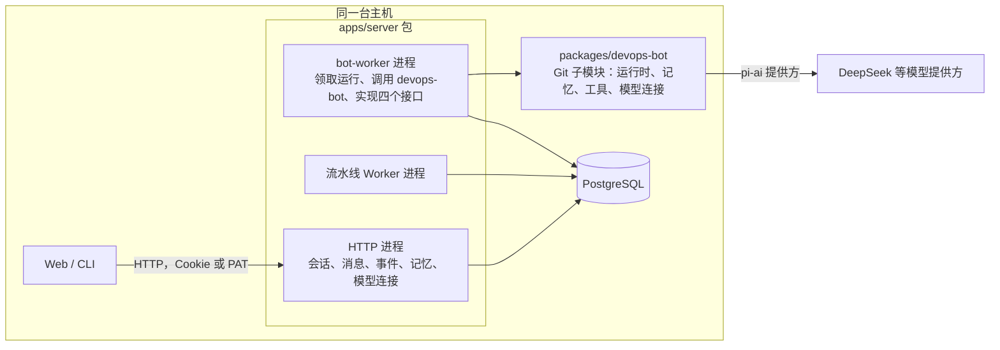
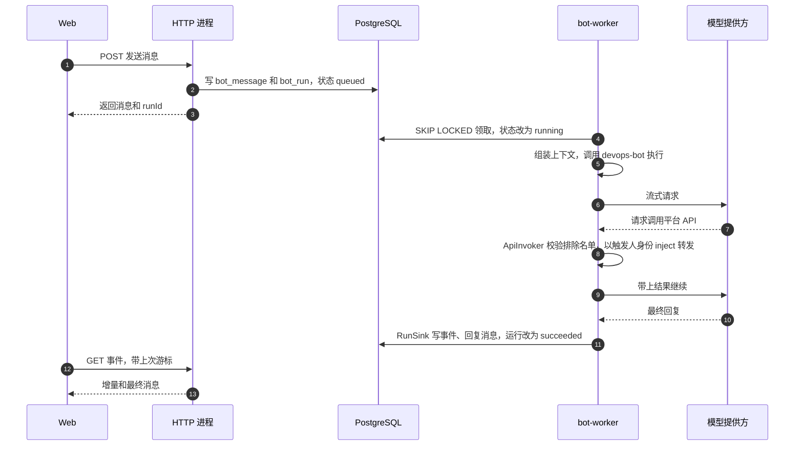
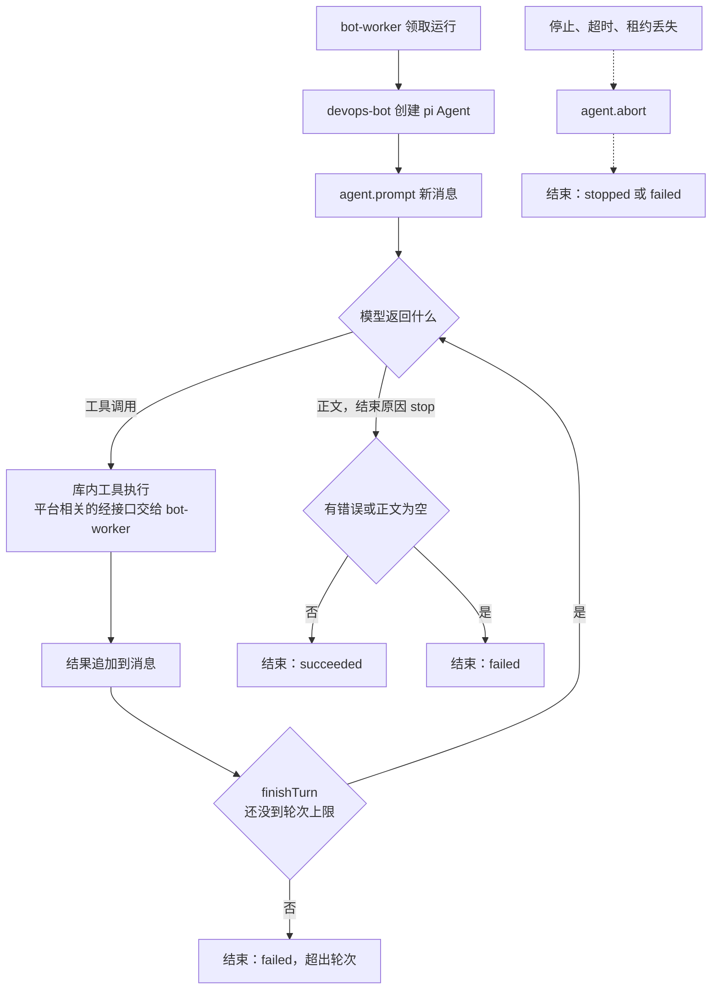

# Bots 轻量执行架构

**Bot 的执行能力来自独立开源库 devops-bot，dev-ops 在 Server 包内用独立的 bot-worker 进程调用它；协作数据与鉴权全部留在 Server。V0.6 起运行内核改为 pi-coding-agent 的 `AgentSession`，平台通过资源加载器与内置扩展叠加自有功能。**

| 属性   | 内容                                                                                                                                                                 |
| ------ | -------------------------------------------------------------------------------------------------------------------------------------------------------------------- |
| 状态   | V0.5 已按本文实现主体；V0.6 运行内核方向（第 3.6 节）已由项目维护者确认，表名、接口名与默认值仍为建议                                                         |
| 负责人 | 项目维护者                                                                                                                                                           |
| 读者   | 后端、前端开发者、devops-bot 库开发者及测试人员                                                                                                                      |
| 范围   | devops-bot 库边界、bot-worker 进程、模型连接、会话与消息、运行调度、Bot loop、平台 API 委托调用、记忆、显式任务；不含值守事件、外部通知、原生编码运行时；需求规格见 `specs/009-v05-bot-collaboration/` |
| 关联   | [产品需求第 10 章](../prd/mvp.md#10-bot-与团队-skills)、[需求版本规划](../prd/release-plan.md)、[目标架构](system-design.md)、[devops-bot 仓库](https://github.com/aiShuiJiaoDeXioShou/devops-bot) |

## 1. 摘要

- **Bot 能力做成可复用的库。** devops-bot 是独立仓库（MIT，中文注释与文档），负责运行时、记忆引擎、工具集与模型连接，通过 `MemoryStore`、`CredentialStore`、`ApiInvoker`、`RunSink` 四个接口接入平台；以后其他平台也可以引用。dev-ops 以 Git 子模块方式把它放在 `packages/devops-bot`。
- **Server 是唯一的数据权威和对外入口。** Bot、模型连接、会话、消息、运行队列、记忆、任务都存 PostgreSQL；Web 与 CLI 只访问 Server。
- **执行在 Server 包内的 bot-worker 进程。** 新入口 `apps/server/src/entrypoints/bot-worker.ts` 导入 devops-bot，直接从数据库领取运行；与 HTTP 进程、流水线 Worker 分开运行，崩溃或重启互不影响。不新建独立服务，也不需要跨进程协议。
- **Bot 以触发人的权限调用平台 API**，可读可写，排除名单挡住高风险接口。
- **失败就失败（V0.5）。** 超时、取消、进程崩溃都把运行标记为失败，由用户重发；V0.5 不做断点续跑、上下文压缩和运行中插话，这些在 V0.6 由 pi 运行内核提供（第 3.6 节）。
- **模型连接归团队，只有团队管理员能设置。** 支持 pi-ai 内置的全部提供方，包括 OAuth 订阅登录；首批使用 DeepSeek 官方 API。
- **记忆分用户画像和 Bot 笔记两种范围，Bot 可以自动写入。**

预期结果是：库与平台各自边界清楚，dev-ops 少维护一套内部协议；代价是长对话会丢失早期上下文、崩溃时当次运行需要重发，以及库与平台分两个仓库提交。第 12 章列出被推迟的机制及其触发条件。

## 2. 需求与现有工程依据

需求事实以[产品需求第 10 章](../prd/mvp.md#10-bot-与团队-skills)为准，版本归属以[需求版本规划](../prd/release-plan.md)为准。以下源码事实核对基于 `65cc2c42`，读取日期为 2026-11-17。

| 已核对事实                                                                                       | 来源                                                                         | 对设计的影响                                               |
| ------------------------------------------------------------------------------------------------ | ---------------------------------------------------------------------------- | ---------------------------------------------------------- |
| 当前 `Actor` 只有用户，会话与 PAT 最终都解析为用户                                               | `apps/server/src/modules/identity/identity.actor.ts`                         | 需要新增 Bot 代触发人的委托身份                            |
| 项目写能力只授权给用户，`ToolChannel` 只有 `web` 与 `cli`                                        | `apps/server/src/modules/tools/tools.capabilities.ts`                        | Bot 不扩展该授权，改为委托触发人                           |
| 流水线已用 PostgreSQL 行锁与 `SKIP LOCKED` 领取运行，Server 已有独立 Worker 进程入口             | `apps/server/src/modules/pipeline/pipeline.repository.ts`、`apps/server/src/entrypoints/worker.ts` | 运行领取沿用同一写法；bot-worker 作为新的进程入口          |
| 凭据加密已有实现，凭据表按 `team_id` 隔离                                                        | `apps/server/src/modules/configuration/configuration.crypto.ts`、`configuration.tables.ts` | 模型 API Key 进凭据库，OAuth 令牌复用同一加密               |
| 写请求幂等已有公共实现                                                                           | `apps/server/src/platform/http/idempotency.ts`                               | 委托调用的写操作复用幂等键                                 |
| 团队成员唯一键为 `(team_id, user_id)`，一人可属于多个团队                                        | `apps/server/src/modules/identity/identity.tables.ts`                        | 所有 Bot 数据按团队隔离                                    |
| `apps/bot` 已用 pi-agent-core 1.5.1 与 DeepSeek 跑通单人对话；单次运行最多 8 轮，历史带最近 12 轮 | `apps/bot/src/runtime.ts`、`apps/bot/src/storage/store.ts`                   | 循环、成功判定、记忆检查与联网工具迁入 devops-bot          |
| pi-ai 1.5.1 内置 43 个提供方，其中 9 个支持 OAuth 登录                                           | 本机调用 `builtinProviders()` 的结果                                         | 模型目录由 pi-ai 提供，平台不自建                           |
| pnpm 工作区包含 `packages/*`                                                                     | `pnpm-workspace.yaml`                                                        | 子模块放在 `packages/devops-bot` 即可作为工作区包引用      |

## 3. 已确认的方向

### 3.1 库与进程形态

> **Why & What - 开源库加 Server 内独立进程**
>
> **What:** Bot 的执行能力放在独立仓库 devops-bot，作为 Git 子模块接入；dev-ops 在 Server 包内新增 bot-worker 进程入口导入该库，直接读写数据库。
>
> **Why:** 项目维护者希望这套能力能被其他平台复用并开源，库的形态比服务更容易接入。数据、权限和平台 API 委托都在 Server 完成，执行侧剩下的只是模型循环；放在 Server 包内的独立进程，既保留了进程隔离，又省掉领取、心跳、事件、工具、凭据写回、登录中转等约十个内部接口和两套令牌。这个选择不解决长时间运行的恢复问题，崩溃时当次运行失败。
>
> **Alternatives considered:**
> - *独立 `apps/bots` 服务，经 HTTP 协议向 Server 领取运行:* 执行侧可以单独发布、单独部署到其他机器。但需要协议包、节点与运行令牌、凭据跨进程传递和 OAuth 登录中转，对一两个人维护的单机部署成本过高。
> - *库内也包含会话、任务等协作业务:* 其他平台接入时得到的更多。但这些业务与各平台的权限模型绑定较深，等第二个平台接入时再判断哪些值得抽出。
>
> **Fallback:** 库不预设部署形态。需要 Bot 在容器内执行命令或跑在其他机器上时，可以把 bot-worker 拆成独立服务，参照 `apps/pipeline-agent` 的拉取模式，数据不需要迁移。

### 3.2 运行时

> **Why & What - devops-bot 封装 pi-agent-core**
>
> **What:** devops-bot 使用 `@earendil-works/pi-agent-core` 的 `Agent` 执行循环，用 `@earendil-works/pi-ai` 调用模型，锁定精确版本并同时升级；dev-ops 只通过 devops-bot 使用 pi，不直接导入 pi。
>
> **Why:** `apps/bot` 已经验证过这套组合；pi-ai 自带模型目录和多家提供方，新模型随依赖升级获得。循环本身约一两百行，复杂度集中在平台的协作规则。
>
> **Alternatives considered:**
> - *`@earendil-works/pi-durable`:* 现成提供崩溃恢复、插话、压缩、交接和子 Agent。但 README 标注为实验版、API 随时变化，1.0.0 之后六周内有 6 次不兼容变更；存储只有 SQLite、JSONL 等，没有 PostgreSQL。
> - *OpenClaw 或 Hermes Agent 作为后端，平台只做界面:* 多 Agent、OAuth 订阅和会话管理现成。但 OpenClaw 官方信任模型是一个网关一个可信使用方；两者默认开放 shell 与文件权限，也没有团队授权和任务。
>
> **Fallback:** 库对外使用自有的消息与事件格式，pi 的类型不外泄。V0.6 改用 pi-coding-agent 的 `AgentSession` 作为内核，见第 3.6 节。

### 3.3 模型连接

- **归属**：模型连接是团队级对象，只有团队管理员能创建、修改、绑定。开发者和浏览者只看到连接名称和状态。
- **两种类型**：
  - API Key：存入团队凭据库，新增“模型 API Key”类型，查看明文沿用凭据库现有规则；
  - OAuth 订阅：管理员用本人账号登录授权，只供本团队的 Bot 使用，不跨团队共享。连接上显示登录人。令牌加密保存，任何人都不能查看明文。
- **绑定**：每个 Bot 绑定一个连接和一个模型。运行时统一使用 Bot 绑定的连接，不按触发人切换；用量按连接和触发人记录。
- **失效**：管理员被降级或离开团队时，其登录的 OAuth 连接停用；绑定该连接的 Bot 显示“模型不可用”，等待其他管理员重新绑定。
- **模型目录**：bot-worker 启动时通过 devops-bot 读取 pi-ai 的提供方与模型清单并写入数据库，Bot 配置页只能选清单里的模型。升级后清单里消失的模型，绑定它的 Bot 标记为不可用，不自动替换。
- **数据去向**：首批使用 DeepSeek 官方 API，对话内容按 DeepSeek 的政策处理；这是项目维护者知情后的选择。

OAuth 登录由 bot-worker 调用 devops-bot 的登录流程（底层为 pi-ai 的 `models.login()`）完成：授权链接、设备码与提示写入登录会话表，页面轮询展示，用户粘贴的回调码写回表中由 bot-worker 读取。部分提供方回调到 `localhost`，浏览器不在运行 bot-worker 的机器上时只能使用手动粘贴回调码的方式，需要逐个提供方验证。刷新令牌通过 `CredentialStore` 写回，同一连接在进程内串行，写库带版本号。

### 3.4 记忆

> **Why & What - Bot 可自动写入两种记忆**
>
> **What:** 记忆分用户画像和 Bot 笔记两种范围，Bot 在对话中自动写入，写入即生效。
>
> **Why:** 项目维护者希望 Bot 能持续积累经验，人工确认会让记忆基本停滞。这个选择不能阻止 A 的私聊内容被写进 Bot 笔记后出现在 B 的对话里；V0.5 用来源记录和“来源人可删”降低这一风险，不做锁定、回滚和注入扫描。
>
> **Alternatives considered:**
> - *Bot 笔记只允许管理员手动维护:* 不会有跨用户泄露。但 Bot 学不到新东西，和产品目标相反。
>
> **Fallback:** 若出现误写或泄露，可关闭 Bot 笔记的自动写入，只保留用户画像自动写入。

### 3.5 devops-bot 库边界

| 放在 devops-bot | 留在 dev-ops |
| --- | --- |
| 运行时：组装 pi `Agent`、轮次与超时、取消、成功判定、通用事件流 | 团队、成员、角色、会话可见范围与排除名单 |
| 库自有的消息格式及与 pi 格式的互转 | 会话、群组、Leader 路由、任务、验收、标签 |
| 记忆引擎：记忆工具、规范化、密钥检查、预算与注入格式 | PostgreSQL 存储、迁移、运行队列与租约 |
| 工具集：联网搜索与网页读取、OpenAPI 目录检索与调用 | 委托身份与 `app.inject()` 调用器、OpenAPI 目录生成 |
| 模型连接：模型目录、OAuth 登录流程、凭据刷新 | 页面、对外接口、审计 |

| 接口 | dev-ops 的实现 |
| --- | --- |
| `MemoryStore` | 读写 `bot_memory`，按团队、Bot、范围与触发人过滤 |
| `CredentialStore` | 读取凭据库中的 API Key 或解密 OAuth 令牌，刷新后带版本号写回 |
| `ApiInvoker` | 校验排除名单与路由，用委托凭据经 `app.inject()` 转发，记录 `bot_api_call` |
| `RunSink` | 把事件写入 `bot_event`，把结果与用量写入 `bot_run` |

仓库与引用方式：

- 仓库 `aiShuiJiaoDeXioShou/devops-bot`，当前为私有，许可证 MIT；注释与文档使用中文，规范见该仓库的 `AGENTS.md`。
- dev-ops 以 Git 子模块引用（`.gitmodules` 使用相对地址 `../devops-bot.git`），路径 `packages/devops-bot`，作为 pnpm 工作区包被 `apps/server` 依赖；版本由子模块提交固定。暂不发布 npm（`devops-bot` 已被无关包占用，发布时使用作用域名）。
- 依赖边界：只有 `apps/server/src/modules/bots/runtime/` 与 `entrypoints/bot-worker.ts` 可以导入 devops-bot；devops-bot 不得导入 dev-ops 的任何代码。

### 3.6 V0.6 运行内核：pi-coding-agent 的 AgentSession

> **Why & What - 先对齐 pi，再叠加平台模块**
>
> **What:** devops-bot 从「组装 pi-agent-core 的 `Agent`」改为「托管 pi-coding-agent 的 `AgentSession`」。pi 的会话管理、配置、模型运行时与资源加载全部由平台提供实现；平台自有功能以内置扩展、上下文文件和 Skills 的形式接入。
>
> **Why:** 项目维护者要求 Bot 先具备 pi 的完整能力。`AgentSession` 已经提供会话树与分支、自动压缩与分支摘要、插话与追加、自动重试、按需加载 Skills、上下文文件、提示模板、扩展与 MCP，平台自行实现这些会重复 pi 的工作并在升级时持续落后。这个选择不解决多团队隔离、权限与审计，它们仍由平台负责。
>
> **Alternatives considered:**
> - *继续用 `Agent` 并逐项补齐:* 依赖面小、控制力强。但压缩、分支、续跑、Skills 加载都要自己实现和维护，与 pi 的行为会逐渐分叉。
> - *`@earendil-works/pi-durable`:* 自带崩溃恢复与持久任务。但仍标注为实验版，接口变化频繁，存储没有 PostgreSQL。
>
> **Fallback:** 平台通过 `SessionManager` 保存 pi 会话条目，界面消息仍单独保存；若 `AgentSession` 在服务端场景不满足要求，可退回 `Agent`，会话条目可转换为普通消息继续使用。

| pi 的扩展点 | 平台实现 | 说明 |
| --- | --- | --- |
| `SessionManager` | 每个“会话 + Bot”一棵会话树（`bot_session`），聊天和任务共用；每次运行从 `bot_session_entry` 读出条目，用 `SessionManager.inMemory` 构造会话管理器，新条目在每轮结束时写回 | 条目按 pi 会话格式保存并记录格式版本，升级时用 `migrateSessionEntries` 迁移；`bot_message` 继续服务界面 |
| `SettingsManager` | 按团队与 Bot 配置在内存中构造 | 压缩阈值、重试次数、默认工具；不读写执行主机上的 pi 配置文件 |
| `ModelRuntime` 与凭据 | 沿用模型连接与 `CredentialStore` | 不读写执行主机上的 pi 凭据文件 |
| `ResourceLoader` | 平台自定义实现 | 上下文文件来自内置上下文（团队、Bot、会话三层）；Skills 来自团队技能库与平台自带技能；提示模板来自团队配置；扩展只含平台内置扩展 |
| 内置扩展 | 平台 API 委托调用、记忆、任务结果、审计、联网 | 由 V0.5 的工具改写而来，行为不变；MCP 由团队授权，支持直接提供工具或按需搜索 |
| 工具与工作目录 | 沿用每个 Bot 的独立工作目录与沙盒命令执行 | `cwd` 指向 Bot 工作目录 |

运行语义的变化：

- **续跑**：每轮结束即写回会话条目。bot-worker 重启后，新的领取从最近完成的一轮继续；结果不确定的写操作先用幂等键核对再继续。
- **插话与追加**：会话中「插话」映射为 `steer`，运行中的普通消息映射为 `followUp`，取代 V0.5 的排到下一次运行。
- **压缩**：由 `AgentSession` 按配置自动触发，摘要作为会话条目保存，原始条目保留；界面在轨迹中展示压缩事件。
- **分支与分叉**：从某条消息重新开始在同一会话内切换分支；分叉生成新会话并复制所选历史。
- **记忆整理**：bot-worker 增加定时作业，按处理游标读取新对话，用模型提出新增、合并或清理建议，经校验后经 `MemoryStore` 写入，重复执行不产生重复条目。

安全约束：只加载平台内置扩展，自定义 `ResourceLoader` 不做任何文件系统或包发现；成员不能安装扩展或 pi 包。pi 的会话、设置和凭据使用内存适配器。faux 提供方测试验证了三个入口：原输入或工具结果可走原生续跑，完整助手回复之后可补发续跑提示，虚拟上下文可直接在内存提供，远程 MCP 注入内存授权存储后无需生成 Pi 配置。读取文件型技能时，Worker 在 Bot 工作目录下创建临时资源目录，运行结束后清理。

实现入口为 [Worker 的运行装配](../../apps/server/src/modules/bots/runtime/execute-run.ts)、[Pi 会话库](../../packages/devops-bot/src/runtime/session-run.ts)和[会话存储](../../apps/server/src/modules/bots/runtime/session-store.ts)。团队的上下文、预算和记忆整理分别由团队上下文 API、用量聚合与 Worker 检查负责。

补充约定（2026-11-19 确认）：

- **已有会话播种**：某个 Bot 在 V0.6 第一次运行时，用该会话最近 24 条平台消息给它的会话树播种，之后只追加。
- **失败或停止后保留中间步骤**：已执行的工具调用与中间回复留在会话树里，Bot 重跑时知道自己做过什么，避免因幂等键随运行变化而重复写入。还原会话时，给没有结果的工具调用补一条“执行中断，结果未知”的结果。
- **条目脱敏**：会话条目会保存完整的工具输出，写入前用 `containsCredential` 检查并替换命中内容；V0.6 不开放读取会话条目的接口，只有 bot-worker 读取；删除会话时一并删除。
- **自定义工具替换 pi 内置工具**：`createAgentSession` 关闭 pi 内置工具，沙盒或完全访问的本地工具、联网与平台工具都以 `customTools` 传入，沿用 V0.5 的沙盒执行。

本版一次交付，验收见[需求版本规划第 6.4 节](../prd/release-plan.md#64-v06-的-bot-运行内核与平台模块)，产品范围见[需求第 10.3 节](../prd/mvp.md#103-bot-运行内核)。

### 3.7 V0.6 群聊调度与接力

群聊的发言规则见[需求第 10.1 节](../prd/mvp.md#101-独立-bots-与会话)。实现上把“谁来回复”放在 Server 的房间调度器，把“怎么回复”留给每个 Bot 自己的会话树：

- **房间日志与会话树分开**：`bot_message` 是全体成员共享的房间日志；每个 Bot 在每个会话有一棵 pi 会话树。Bot 运行前，运行装配把它上次同步之后的房间消息作为用户消息追加进树，带上发言人名字，单次最多 50 条，超出时写一句省略了多少条；`bot_session` 记录同步到的消息序号。
- **调度器选人**：成员消息没有 `@` 时排队 Leader；`@` 一个或多个 Bot 时按 `@` 顺序排队；`@全部` 时按成员顺序排队。一条成员消息引发的整条接力记在 `bot_room_relay`，包括跳数、Bot 回复条数和状态（进行中、暂停、结束、已停止）。
- **接力**：Bot 回复中的 `@` 由房间协议扩展解析，调度器为被 `@` 的 Bot 排下一跳。每条成员消息最多 4 跳、10 条 Bot 回复，到上限把接力置为暂停，成员选择继续时额度重新计算一次，结束或停止后不再排队。
- **跳过**：`@全部` 时，房间协议扩展提供“跳过”，Bot 没有要补充的内容时不发消息，轨迹里记一条跳过。
- **串行**：同一会话同时只有一个运行（沿用 V0.5 的唯一索引），接力天然串行，会话树不会被并发写入；后回复的 Bot 能看到前面 Bot 的回复。
- **运行中的新消息**：成员给正在运行的 Bot 用“插话”发的内容映射为 `steer`，在下一轮生效；普通消息映射为 `followUp`，在当前运行结束前处理；发给其他 Bot 的消息排在当前接力之后。
- **不变的规则**：接力只发生在消息层面；任务的执行者、转交与验收仍由成员操作，房间协议扩展不提供转交任务的能力。

实现入口为[会话服务](../../apps/server/src/modules/collaboration/bot-conversations.service.ts)、[接力持久化与顺序推进](../../apps/server/src/modules/collaboration/bot-relay.repository.ts)和[运行领取](../../apps/server/src/modules/bots/bots.run-queue.repository.ts)。接力的状态变化与下一个运行在同一事务提交。成员消息若来自另一个用户，会保留发起者身份并在当前接力之后排队。

参考：Hermes Agent 的房间同样共享日志、每个成员保留自己的会话、可以跳过；OpenClaw 把未 `@` 的群消息缓存为上下文（默认 50 条），触发时注入。我们的上限与这两者同一量级。

## 4. 组件与调用方向



三个进程共享同一套模块代码，各自启动与关闭。bot-worker 的平台 API 调用在进程内构造 Fastify 实例后 `inject()`，不经过网络。模块归属见[目标架构第 6 章](system-design.md#6-业务模块与数据归属)。

## 5. 一次运行



- **上下文**包含：系统提示（平台约束、Bot 职责、会话指令、常驻记忆）、最近 24 条消息、工具清单、模型与凭据、轮次上限和超时。
- **一个会话同时只有一个运行。** 运行中收到的消息排队，前一个运行结束后再领取。
- **状态**只有 `queued`、`running`、`succeeded`、`failed`、`stopped`。bot-worker 定时续租；租约过期由流水线 Worker 的收口任务标记为 `failed / execution_interrupted`，不自动重试。
- **前端用游标轮询事件**，不做 SSE，平台接口保持统一响应信封。

## 6. Bot loop



| pi 能力         | 在 devops-bot 中的用途                                     |
| --------------- | ---------------------------------------------------------- |
| `initialState`  | 系统提示、历史消息、工具、模型都来自调用方传入的上下文     |
| `finishTurn`    | 轮次计数，到上限结束，默认 8 轮                            |
| `subscribe`     | 输出增量和工具起止转成通用事件，交给 `RunSink`             |
| `abort`         | 停止、超时、租约丢失时停止                                 |
| `getApiKey`     | 从 `CredentialStore` 取得 API Key 或 OAuth 访问令牌        |
| `toolExecution` | 固定为 `sequential`                                        |

成功判定沿用 `apps/bot/src/runtime.ts`：没有错误信息，最后一条是助手消息且结束原因为 `stop`，正文不为空。示意代码见附录 A。

## 7. 平台工具与权限

Bot 在产品上与项目管理解耦：不按项目授权，不关联需求或 Bug。它需要团队信息时，以触发人的权限调用平台 API。

- **工具清单**：`platform_api_search`（检索 API 目录）、`platform_api_call`（调用平台 API）、`web_search` 与 `web_fetch`（联网）、记忆的写入、检索、删除、`submit_task_result`（任务内提交结果，可附标签）。前四个与记忆工具由 devops-bot 提供，`submit_task_result` 由 dev-ops 以自定义工具注册。
- **委托调用**：`platform_api_call` 只接受 GET 或 POST 与 `/api/v1/` 下的相对路径。`ApiInvoker` 校验运行仍有效、排除名单与路径属于平台路由后，用进程内一次性委托凭据经 `app.inject()` 转发；`resolveActor` 把它解析为触发人并标记经由的 Bot。所有业务路由的既有鉴权原样生效，Bot 权限等于触发人权限。
- **排除名单**：成员、邀请与角色管理；凭据与环境变量；API Token 与节点令牌；写能力授权；变更计划放行；Skills 管理；Bot 与模型连接管理；Bot 任务验收与退回；认证端点。具体路由见 `specs/009-v05-bot-collaboration/research.md` R5，新增路由默认允许，契约测试遍历 OpenAPI 校验名单覆盖。
- **API 目录**：从 OpenAPI 导出生成、过滤排除名单后作为系统技能交给 devops-bot，Bot 按关键词检索，不把整份契约放进上下文。
- **写操作带幂等键**：转发时附 `Idempotency-Key: bot:<runId>:<key>`，复用全局幂等；超时后用同一键查询结果，不重新生成参数。
- **活动追溯**：Bot 经平台 API 产生的写入，在 collaboration 活动中记录 `via_bot_id`；其他模块的审计由 `bot_api_call` 追溯。
- **群聊**里 Bot 代某成员读取的结果对会话全部成员可见，发起前提示；V0.5 不按消息追踪内容来源权限。

## 8. 记忆

| 范围                    | 内容                       | 哪些运行能读到              | 谁能写或删                                 |
| ----------------------- | -------------------------- | --------------------------- | ------------------------------------------ |
| 用户画像 `scope=user`   | 某个成员的偏好             | 这个成员与这个 Bot 的运行   | Bot 自动写；本人和管理员可删               |
| Bot 笔记 `scope=bot`    | 这个 Bot 的工作约定和经验  | 这个 Bot 的全部运行         | Bot 自动写；管理员可改可删；来源人可删     |

- **读**：运行开始时，bot-worker 通过 `MemoryStore` 取触发人的用户画像和这个 Bot 的笔记中标记为常驻的条目，由 devops-bot 以 Markdown 小节写进系统提示，并标明是参考数据而非指令。常驻部分有总字符上限。
- **检索**：未标常驻的条目通过记忆检索工具按需查找，dev-ops 的实现先按团队、Bot、范围过滤，再用 `pg_trgm` 做中文模糊匹配。
- **写**：工具动作只有新增、局部修改、删除，不提供整条覆盖。写入立即生效；超出条数或字符上限时返回错误，由模型自己合并整理。
- **检查**：长度、条数、密钥正则（由 `apps/bot/src/memory.ts` 迁入 devops-bot）。每条记录来源会话和来源成员。
- **遗忘**只影响之后的注入，历史消息中已出现的内容不追溯处理。

## 9. 数据与接口草图

所有表带 `team_id`，主键使用 `uuid`，不使用外键，与现有表一致；表和字段注释使用中文。完整字段见 `specs/009-v05-bot-collaboration/data-model.md`。

| 表                                              | 关键字段                                                     | 说明                                                   |
| ----------------------------------------------- | ------------------------------------------------------------ | ------------------------------------------------------ |
| `bot`                                           | 名称、头像、职责、指令、负责人、模型连接、模型、启停         | 职责与指令开发者可改，模型连接只有管理员能设           |
| `bot_model_connection`、`bot_login_session`     | 提供方、类型、凭据引用或加密令牌、登录人、状态、版本         | API Key 引用凭据库；登录会话中转授权链接与回调码       |
| `bot_conversation`、`bot_conversation_member`   | 类型（私聊或群组）、名称、Leader、成员                       | 群里没有 `@` 时交给 Leader                             |
| `bot_message`                                   | 会话、序号、发言人类型与 ID、正文 `jsonb`、关联运行          | devops-bot 的中立消息格式，不保存 pi 的对象            |
| `bot_run`                                       | 会话、Bot、触发人、状态、租约到期、轮次、用量、可选任务      | 同一会话最多一条 `running`                             |
| `bot_event`、`bot_api_call`                     | 运行、序号、类型、内容；接口、触发人、幂等键、结果           | 前端按游标轮询；调用记录用于追溯                       |
| `bot_memory`                                    | Bot、范围、成员、正文、常驻、来源会话、来源成员              | 同一范围内规范化正文唯一                               |
| `bot_task` 及输入、交接、结果、评审             | 目标、业务负责人、当前执行者、状态、版本                     | 业务层，运行可关联任务                                 |

对外接口沿用 GET 读取、POST 写入的项目规范，覆盖 Bot、模型连接、会话、消息、事件轮询、记忆和任务，草图见 `specs/009-v05-bot-collaboration/contracts/rest-api.md`。bot-worker 与库之间是进程内函数调用，没有内部 HTTP 接口。

## 10. 多团队与并发

- 所有查询先按 `team_id` 过滤；委托调用核对资源属于运行所在团队。root 账号不因平台级身份获得团队对话和记忆的访问权。
- 领取运行时同时检查全局并发上限和每团队并发上限，避免一个团队占满 bot-worker。上限默认值在实验后确定。
- 日志带团队、Bot、会话、运行和调用标识；提示词正文、工具原始响应和凭据不写日志。

## 11. 实施顺序与验收

| 顺序 | 交付                                                                                     | 可独立验收的结果                                                                 |
| ---- | ---------------------------------------------------------------------------------------- | -------------------------------------------------------------------------------- |
| 1    | devops-bot 子模块：包结构、运行时、消息格式、四个接口定义与一致性测试；从 `apps/bot` 迁入循环、记忆检查与联网工具 | 库用 pi-ai 的 `faux` 提供方独立通过测试；不导入任何 dev-ops 代码                  |
| 2    | identity 委托身份与排除名单；`bot`、会话、消息、运行、事件表；bot-worker 入口与租约收口 | 私聊发消息后收到假模型回复；两个 bot-worker 不会领取同一运行；租约过期标记失败   |
| 3    | API Key 模型连接、模型目录、真实模型、平台 API 委托调用与 API 目录                       | DeepSeek 真实对话可按触发人权限读取需求；触发人无权的数据与排除名单接口被拒     |
| 4    | 记忆表、`MemoryStore` 实现、常驻注入、管理页面                                           | 新会话召回偏好；删除后不再注入；来源人只能删自己来源的条目；不同团队不串记忆      |
| 5    | OAuth 模型连接与登录会话                                                                 | 管理员登录订阅后 Bot 可用；管理员降级后连接停用，Bot 显示模型不可用               |
| 6    | 显式任务、提交结果、验收与退回、站内待处理、联网                                         | 任务贯通；写操作重试只生效一次；Bot 不能验收任务                                 |
| 7    | 群组、Leader、转交、工作标签分类                                                         | 未 `@` 时交给 Leader；移出执行者后任务受阻；按标签筛选叠加会话可见               |
| 8    | Skills 在运行中使用、导航落点                                                             | 停用技能后不再出现在候选中；登录默认进入协作                                     |

dev-ops 每个切片运行 `pnpm prepare:clients`、`apps/server` 的 check 与 build、`pnpm check:boundaries`、`pnpm lint`、`pnpm format:check`；涉及数据库时运行 `pnpm --dir apps/server test:db`；界面改动另按 UI 规范验收。devops-bot 在自己的仓库运行测试，dev-ops 升级子模块提交时同时运行两边的测试。真实模型测试记录实际用量，mock 通过不代表提供方接入完成。

## 12. V0.5 不做的机制与后续归属

| 机制                                         | V0.5 做法                                                   | 何时再评估                                   |
| -------------------------------------------- | ----------------------------------------------------------- | -------------------------------------------- |
| 上下文压缩、交接摘要                         | 只带最近 24 条消息                                          | V0.6 由 pi 运行内核提供                      |
| 崩溃后断点续跑、未知写操作核对               | 运行标记失败，用户重发；写操作靠幂等键防重复                | V0.6 由 pi 会话条目续跑                      |
| 运行中途插话                                 | 补充内容作为下一条消息排队                                  | V0.6 由 pi 的插话与追加提供                  |
| 记忆暂存、版本号、遗忘后隔离历史             | 写入立即生效，遗忘只影响以后的注入                          | 出现误记忆难以清除的反馈时                   |
| Bot 笔记锁定、回滚、注入扫描、并发版本控制   | 来源记录、密钥正则，管理员与来源人可删                      | 出现误写或泄露时，先关闭 Bot 笔记自动写入    |
| 会话回溯检索、群组共识记忆、后台自动提取     | 不提供                                                      | 后台自动提取在 V0.6 记忆整理                 |
| 按消息追踪内容来源权限                       | 权限等于触发人权限；群内回复全员可见，发起前提示            | 出现成员权限差异大的群组时                   |
| 独立执行服务、原生编码运行时                 | bot-worker 在 Server 包内；代码修改走 V0.4b 的受控能力      | 需要 Bot 在容器内执行命令或跑在其他机器时    |
| SSE 推送                                     | 游标轮询                                                    | 轮询延迟影响使用时，需登记统一信封的例外     |
| devops-bot 发布 npm、库内协作业务            | 子模块引用；库只含运行时、记忆、工具、模型连接              | 第二个平台接入时                             |

## 13. 待确认事项

| 问题                                                     | 建议                                                     | 确认责任           |
| -------------------------------------------------------- | -------------------------------------------------------- | ------------------ |
| 排除名单的具体路由                                       | 按 research.md R5 的初始名单评审                         | 项目维护者         |
| devops-bot 何时改为公开仓库                              | 接口初步稳定、完成首个可用版本后                         | 项目维护者         |
| 对话、运行事件和记忆的保留期限                           | 默认长期保留，删除会话时一并删除消息与事件               | 产品、项目维护者   |
| 并发上限与单次运行的超时、轮次默认值                     | 实验后确定；V0.6 续跑后任务型运行可放宽                  | 后端开发者         |
| pi 会话条目的表结构、保留与迁移                          | 单表按会话保存条目与格式版本，升级前跑迁移测试           | 后端开发者         |
| 压缩阈值与摘要模型                                       | 按模型上下文窗口配置，默认沿用 pi 的默认值               | 后端开发者         |
| 各 OAuth 提供方在非本机浏览器下的登录方式                | 逐个验证，不支持手动回调码的提供方暂不开放               | 后端开发者         |

## 14. 收益与代价

**收益**：Bot 能力可被其他平台复用并开源；数据和权限只有一处；不需要跨进程协议，凭据不离开 Server 包；bot-worker 与 HTTP 进程隔离；pi 升级只影响 devops-bot，平台消息格式不受影响。

**代价**：

- 库与平台分两个仓库，改动库时要先提交 devops-bot，再在 dev-ops 更新子模块提交；克隆与 CI 需要递归检出子模块；
- `apps/server` 通过 devops-bot 间接依赖 pi，安装体积变大（pi-ai 带入多家提供方 SDK）；bot-worker 与 Server 一起发布；
- V0.5 长对话只看最近 24 条消息，进程崩溃或超时时当次运行失败、需要重发；V0.6 由压缩与续跑解决；
- Bot 笔记自动写入存在私聊内容出现在他人对话中的风险，依赖来源人发现并删除；
- 首批使用 DeepSeek 官方 API，对话内容发送到 DeepSeek；
- Bot 以触发人权限可读可写，误操作风险由排除名单、调用展示、幂等与活动追溯控制，不能完全消除；
- V0.6 依赖 pi-coding-agent 的接口面明显变大，版本必须锁定，升级时要跑会话条目迁移与默认行为替换的契约测试；会话条目与界面消息双份保存，需要保持一致；
- 群聊接力让一条成员消息最多产生 10 条 Bot 回复，模型费用随之增加，靠接力上限与团队预算控制。

## 附录 A. bot-worker 执行一次运行的示意代码

以下代码只说明结构，省略类型与错误处理；`runBot` 与四个接口名为 devops-bot 的设计稿。

```typescript
async function runOnce(db, bot) {
  const run = await leaseNextRun(db)
  if (!run) return
  const controller = new AbortController()
  const heartbeat = setInterval(() => renewLease(db, run).catch(() => controller.abort()), 10_000)
  try {
    await bot.runBot({
      model: run.model,
      context: await buildContext(db, run),
      tools: [...bot.memoryTools(), ...bot.webTools(), ...bot.openApiTools(apiCatalog), submitTaskResultTool(db, run)],
      limits: { maxTurns: run.maxTurns, timeoutMs: run.timeoutMs },
      signal: controller.signal,
      ports: {
        memory: new PgMemoryStore(db, run),
        credentials: new PgCredentialStore(db, run.connectionId),
        api: new InjectApiInvoker(app, run),
        sink: new PgRunSink(db, run),
      },
    })
  } finally {
    clearInterval(heartbeat)
  }
}
```

---

_第 2 章是核对过的源码事实，第 3 章是项目维护者已确认的方向，其余章节为建议设计。评审重点是第 3.5 节的库边界、第 7 章的委托调用与排除名单、第 12 章的推迟清单和第 13 章的待确认事项。_

## V0.5.0 实现入口

[HTTP 服务](../../apps/server/src/bootstrap/create-http-app.ts)负责团队、模型连接、会话、任务、标签与记忆接口，执行进程由 [Bot Worker](../../apps/server/src/bootstrap/create-bot-worker.ts)领取队列。运行期间以 PostgreSQL 租约代次处理停止和恢复，使用游标读取资源与运行事件。

[平台接口目录](../../tooling/scripts/generate-bot-api-catalog.mjs)从注册路由的 OpenAPI 生成，内部调用按触发人的当前团队和资源权限执行。执行记录追踪来源、幂等键与状态。记忆使用 PostgreSQL `pg_trgm` 检索，常驻正文总预算为 4096 字节。每次领取运行保存已配置 Skills 的版本，`skill_view` 按需读当次可用的版本。

执行过程的 Web 入口统一为会话「轨迹」，由 [ConversationTrajectory](../../apps/web/src/features/conversations/ui/conversation-trajectory.tsx) 按运行增量读取会话事件，展示状态、耗时、真实用量、分类步骤、时间线和步骤详情。智能体详情仅展示配置与模型连接状态，不再请求或展示独立运行记录列表。`bot_run`、配置快照和事件仍保留，支撑调度、停止、恢复、权限校验与轨迹；移除界面入口不删除历史数据。
