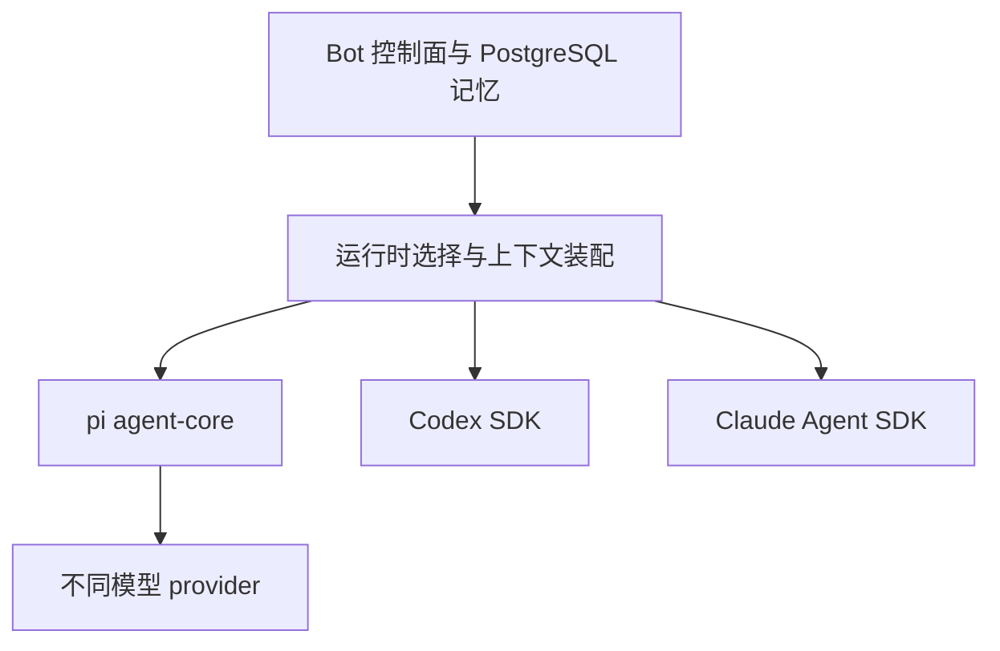

# Bots 运行时适配示例

Bot 控制面管理身份、长期记忆与任务，pi、Codex 和 Claude Code 作为可选择的运行时接入。pi 的模型 provider 与完整 Agent 运行时是不同层次；调用 Anthropic 模型并不等于启动 Claude Code。

本文是接口示例，不是已接入的业务功能。示例在临时目录使用 NodeNext、严格类型和本项目应用编译器完成类型检查，未发起模型调用；项目依赖及执行环境未改动。

## 1. 接入边界

| 目标                                    | 接入层                                                     | 官方依据                                                                                                       |
| --------------------------------------- | ---------------------------------------------------------- | -------------------------------------------------------------------------------------------------------------- |
| 自己控制 Agent 循环和工具，调用不同模型 | pi agent-core 加 pi-ai 的具体 provider                     | [pi agent-core](https://github.com/earendil-works/pi/tree/main/packages/agent)                                 |
| 使用 Codex 的完整执行循环               | Codex SDK；需要交互审批和更完整客户端协议时评估 app-server | [Codex SDK](https://learn.chatgpt.com/docs/codex-sdk)、[app-server](https://learn.chatgpt.com/docs/app-server) |
| 使用 Claude Code 的完整执行循环         | Claude Agent SDK                                           | [TypeScript SDK](https://code.claude.com/docs/en/agent-sdk/typescript)                                         |

API 核对日期为 2026-11-10。类型检查的依赖版本为 `@earendil-works/pi-agent-core@1.5.1`、`@earendil-works/pi-ai@1.5.1`、`@openai/codex-sdk@0.167.0` 和 `@anthropic-ai/claude-agent-sdk@0.3.322`。这些是示例验证版本，正式接入时再确定应用依赖及锁文件。



## 2. Codex 与 Claude Code 的最小适配

两种运行时接收相同输入，返回最终正文及原生会话标识。工作目录由控制面确定，会话标识必须从当前 Bot、使用者或会话、运行时及 Runner 的绑定记录中读取，不能接受用户任意指定。

示例只展示启动、继续、取消与结果检查，原生工具限定为读取用途。实际代码运行进入隔离 Runner，工具选择不替代操作系统隔离。生产接入还需将初始化事件、工具活动、错误和用量持久化，不能只在成功结束后记录 session ID。

```typescript
import { Codex, type ThreadOptions } from '@openai/codex-sdk'
import { query } from '@anthropic-ai/claude-agent-sdk'

export interface RuntimeInput {
  prompt: string
  workingDirectory: string
  sessionId?: string
  controller: AbortController
}

export interface RuntimeOutput {
  text: string
  sessionId: string
}

/**
 * 在受控工作目录启动或继续一个只读 Codex 会话。
 * @param input 任务输入、可信工作目录、可选会话标识及取消控制器。
 * @returns 最终正文与可供后续恢复的会话标识。
 * @throws 认证、运行、取消或会话初始化失败时抛出异常；调用会产生模型费用。
 */
export async function runCodex(input: RuntimeInput): Promise<RuntimeOutput> {
  input.controller.signal.throwIfAborted()
  const codex = new Codex()
  const options = {
    workingDirectory: input.workingDirectory,
    sandboxMode: 'read-only',
    approvalPolicy: 'never',
  } satisfies ThreadOptions
  const thread = input.sessionId ? codex.resumeThread(input.sessionId, options) : codex.startThread(options)
  const result = await thread.run(input.prompt, { signal: input.controller.signal })
  const sessionId = thread.id
  if (!sessionId) throw new Error('Codex 未返回会话标识')
  return { text: result.finalResponse, sessionId }
}

/**
 * 启动或继续 Claude Code 会话，仅开放示例所需的文件读取工具。
 * @param input 任务输入、可信工作目录、可选会话标识及取消控制器。
 * @returns 最终正文与可供后续恢复的会话标识。
 * @throws 认证、运行、取消或缺少成功结果时抛出异常；调用会产生模型费用。
 */
export async function runClaude(input: RuntimeInput): Promise<RuntimeOutput> {
  input.controller.signal.throwIfAborted()
  const execution = query({
    prompt: input.prompt,
    options: {
      cwd: input.workingDirectory,
      ...(input.sessionId ? { resume: input.sessionId } : {}),
      abortController: input.controller,
      tools: ['Read', 'Glob', 'Grep'],
      allowedTools: ['Read', 'Glob', 'Grep'],
      settingSources: [],
      maxTurns: 8,
    },
  })
  try {
    for await (const message of execution) {
      if (message.type !== 'result') continue
      if (message.subtype !== 'success') throw new Error(`Claude 运行失败：${message.subtype}`)
      return { text: message.result, sessionId: message.session_id }
    }
    throw new Error('Claude 未返回完成结果')
  } finally {
    execution.close()
  }
}
```

SDK 的认证由 Runner 配置层提供；业务参数不接受密钥、认证目录或任意启动参数。示例依赖原生运行时会话的持久文件，只有 session ID 不足以在空白机器上恢复；跨 Runner 迁移还需恢复相应运行时状态或改用平台交接摘要创建新会话。

## 3. 按 Bot 配置选择运行时

调用方可以通过静态注册表选择适配器。下面的入口设置运行时限，失败继续向任务层抛出；任务层分别记录成功、失败、取消和结果不确定状态。

以下导入假设示例保存为同目录的 `native-runtimes.ts` 与 `invoke-native.ts`，沿用项目 `.ts` 相对导入及 `rewriteRelativeImportExtensions` 约定。

```typescript
import { runClaude, runCodex, type RuntimeInput, type RuntimeOutput } from './native-runtimes.ts'

const runtimes = { codex: runCodex, claude: runClaude }
const RUN_TIMEOUT_MS = 120_000

/**
 * 根据 Bot 配置调用原生运行时，并在到期后发起取消。
 * @param runtime 已注册的运行时类型。
 * @param input 由控制面校验过的输入，不包含取消控制器。
 * @returns 运行时最终正文与原生会话标识。
 * @throws 超时、认证、执行或取消失败向上传递；取消不保证撤销已发生的副作用。
 */
export async function invokeNative(
  runtime: keyof typeof runtimes,
  input: Omit<RuntimeInput, 'controller'>,
): Promise<RuntimeOutput> {
  const controller = new AbortController()
  const timeout = setTimeout(() => controller.abort(), RUN_TIMEOUT_MS)
  try {
    return await runtimes[runtime]({ ...input, controller })
  } finally {
    clearTimeout(timeout)
  }
}
```

`runtime` 是 Bot 配置中的运行时键；`model` 则是该运行时支持的模型配置。切换 runtime 不继续使用另一运行时的 session ID，而是重新建立会话并注入允许使用的记忆和任务交接。

## 4. 使用 pi 构建自己的 Agent 循环

以下示例仅注册 Anthropic provider，展示 pi 原生循环和历史恢复；增加其他模型来源时注册其对应 provider。它不会启动 Claude Code，也没有使用 Codex 的执行工具。

`history` 由平台保存并在读取边界校验，必须属于当前会话且已排除撤权内容；`systemPrompt` 由控制面生成可信职责。API Key 只在服务端提供；调用者负责为 controller 设置时限。模型调用完成不自动形成长期记忆，后续由记忆提取用例决定写入内容。

```typescript
import { Agent, type AgentMessage } from '@earendil-works/pi-agent-core'
import { createModels } from '@earendil-works/pi-ai'
import { anthropicProvider } from '@earendil-works/pi-ai/providers/anthropic'

export interface PiInput {
  prompt: string
  systemPrompt: string
  modelId: string
  apiKey: string
  history: AgentMessage[]
  controller: AbortController
}

/**
 * 使用 pi 自身的执行循环调用已注册的 Anthropic 模型。
 * @param input 提示词、可信职责、模型配置、历史及取消控制器，密钥仅在服务端提供。
 * @returns 最后一次助手正文与待持久化的完整会话；不会自行写入长期记忆。
 * @throws 模型不存在、调用失败或取消时抛出异常；调用会产生模型费用。
 */
export async function runPi(input: PiInput): Promise<{ text: string; history: AgentMessage[] }> {
  input.controller.signal.throwIfAborted()
  const models = createModels()
  models.setProvider(anthropicProvider())
  const model = models.getModel('anthropic', input.modelId)
  if (!model) throw new Error('指定的 Anthropic 模型不存在')
  const agent = new Agent({
    initialState: {
      model,
      systemPrompt: input.systemPrompt,
      messages: input.history,
      tools: [],
    },
    streamFn: models.streamSimple.bind(models),
    getApiKey: () => input.apiKey,
  })
  let text = ''
  const unsubscribe = agent.subscribe((event) => {
    if (event.type !== 'message_end' || event.message.role !== 'assistant') return
    text = event.message.content
      .filter((block) => block.type === 'text')
      .map((block) => block.text)
      .join('')
  })
  const abort = () => agent.abort()
  input.controller.signal.addEventListener('abort', abort, { once: true })
  try {
    input.controller.signal.throwIfAborted()
    await agent.prompt(input.prompt)
    input.controller.signal.throwIfAborted()
    if (agent.state.errorMessage) throw new Error(agent.state.errorMessage)
    return { text, history: agent.state.messages }
  } finally {
    input.controller.signal.removeEventListener('abort', abort)
    unsubscribe()
  }
}
```

## 5. 长期记忆与平台工具接入

PostgreSQL 保存 Bot 长期记忆与授权范围，运行前由控制面召回并装配。pi 可通过上下文转换和自定义工具接入；外部运行时按其支持的上下文入口或受控工具协议接入，不能把记忆正文当作高优先级指令。

平台记忆及项目工具的访问都绑定 Bot、用户或调度授权、会话和本次运行。把记忆放进 prompt 只传递内容，不实施权限；检索、项目 API 和凭据使用仍由服务端检查。生产实现还应在下一次模型调用前处理撤权或遗忘，不能只在会话首次创建时注入一次。

运行后保存 SDK 会话引用、完整运行状态及交付，后台提取候选记忆。pi history、Codex thread 与 Claude session 都是执行上下文，跨会话长期知识仍按[架构草案第 8 章](bots-architecture.md#8-长期记忆上下文与执行环境)管理。
