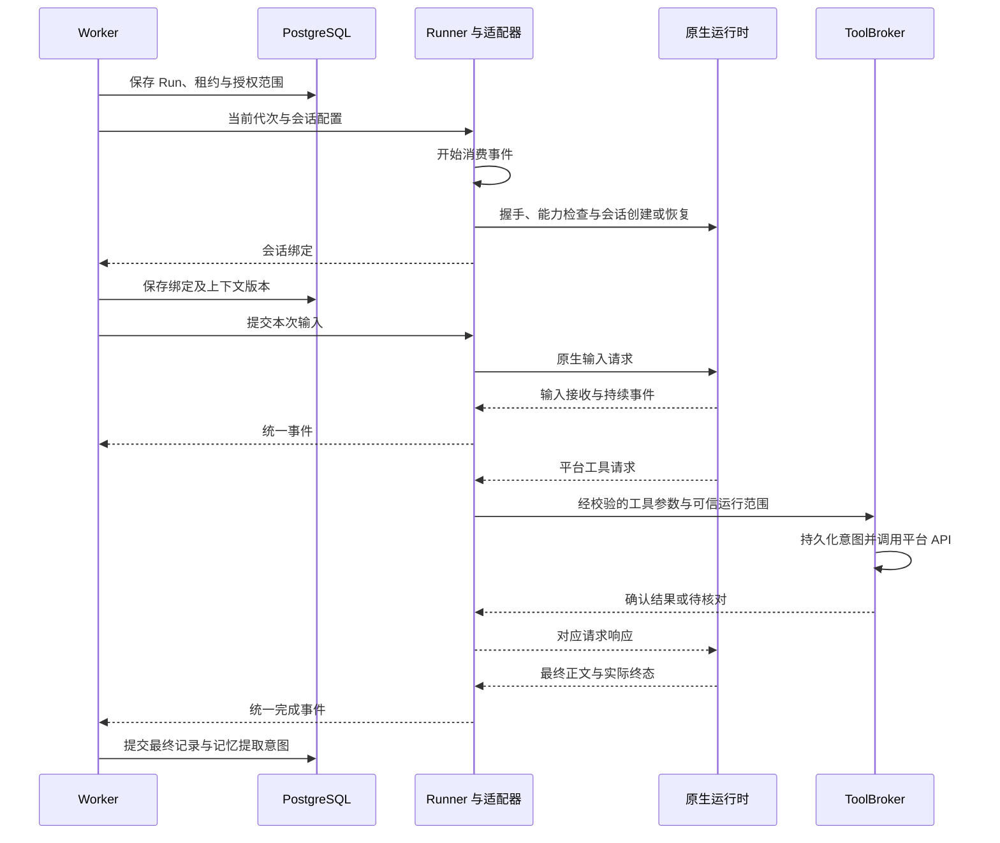

# Bots 运行时适配契约与示例

Bot 控制面管理身份、PostgreSQL 长期记忆与任务，Runner 通过统一端口接入 Codex app-server、Claude Agent SDK 与 pi RPC。接入方向已确定，以下内部契约与控制顺序仍为设计草案，实际适配器和真实运行验收待实现。

## 1. 端口与原生协议

运行时分工、源码依据、完成判定和会话恢复规则统一维护在[主方案第 3.2、4.1 和 4.2 节](bots-architecture.md#32-openbot-的运行时边界)。该端口负责会话和事件转换，不负责项目业务规则、长期记忆权威或跨团队授权。

| 平台操作       | Codex app-server                          | Claude Agent SDK               | pi RPC                                        |
| -------------- | ----------------------------------------- | ------------------------------ | --------------------------------------------- |
| 建立通道       | 子进程 stdio，initialize/initialized 握手 | 初始化 SDK 并订阅 query 输出   | 子进程 `pi --mode rpc`，读取状态与版本能力    |
| 新建或恢复会话 | thread/start、thread/resume               | query 的新会话或 resume 参数   | new_session、switch_session、get_state        |
| 提交输入       | turn/start                                | query 的输入流                 | prompt；不把 response 的 success 当成运行成功 |
| 最终结果       | turn/completed 的实际状态与完整输出       | SDK result 的 subtype 与正文   | agent_settled 加已收集的错误、取消和最终消息  |
| 中断           | turn/interrupt 并等待结果                 | SDK interrupt/取消并消费终态   | 清理待处理输入后 abort，核对空闲和终态        |
| 显式压缩       | 按能力调用 thread/compact/start           | 原生自动压缩，显式能力另行验证 | compact，按锁定版本核对结果                   |
| 平台工具       | 动态工具请求与原生响应                    | 自定义 MCP 工具回调            | 受控扩展或 MCP 桥接 ToolBroker                |

表中列的是映射方向，原生方法、参数和可用性以主方案列出的官方协议及锁定版本为准。所有原生消息进入适配器时使用 TypeBox 校验，从 `unknown` 收窄；不能把字符串强制断言为任意协议类型。

## 2. 统一内部契约

以下 TypeScript 展示端口边界，完整事件通过判别联合区分，调用方不能把“接收输入”和“执行完成”混用。类型仅用于内部设计，平台 HTTP 契约仍由 TypeBox/OpenAPI 定义。

```typescript
export type RuntimeKey = 'codex' | 'claude' | 'pi'

export interface RuntimeCapabilities {
  version: string
  resume: boolean
  interrupt: boolean
  explicitCompaction: boolean
  automaticCompaction: boolean
  platformTools: boolean
}

export interface RuntimeScope {
  sessionId: string
  runId: string
  leaseEpoch: number
  connectionEpoch: number
}

export interface SessionInput {
  scope: RuntimeScope
  workingDirectory: string
  model: string
  permissionRevision: number
  contextEpoch: number
}

export interface SessionHandle {
  sessionId: string
  nativeSessionRef: string
}

export interface TurnInput {
  scope: RuntimeScope
  prompt: string
  contextEpoch: number
}

export type RuntimeFailureCode =
  | 'RUNTIME_UNAVAILABLE'
  | 'RUNTIME_AUTH_FAILED'
  | 'RUNTIME_UNSUPPORTED'
  | 'RUNTIME_PROTOCOL_ERROR'
  | 'RUNTIME_SESSION_MISSING'
  | 'RUNTIME_TIMEOUT'
  | 'RUNTIME_RESULT_UNKNOWN'

export interface RuntimeFailure {
  code: RuntimeFailureCode
  safeMessage: string
}

export type RuntimePayload =
  | { type: 'session.bound'; nativeSessionRef: string }
  | { type: 'turn.accepted'; disposition: 'started' | 'queued' | 'handled' }
  | { type: 'output.delta'; messageId: string; text: string }
  | { type: 'output.completed'; messageId: string; text: string }
  | { type: 'tool.requested'; requestId: string; name: string; input: unknown }
  | { type: 'tool.started'; toolCallId: string; name: string }
  | { type: 'tool.completed'; toolCallId: string; isError: boolean }
  | { type: 'approval.requested'; requestId: string; summary: string }
  | { type: 'usage.updated'; inputTokens: number | null; outputTokens: number | null }
  | { type: 'context.compacted' }
  | { type: 'turn.completed'; status: 'succeeded' | 'failed' | 'cancelled'; error?: RuntimeFailure }
  | { type: 'runtime.exited'; expected: boolean; error?: RuntimeFailure }

export interface RuntimeEvent {
  scope: RuntimeScope
  sequence: number
  payload: RuntimePayload
}

export type RuntimeReply =
  | { kind: 'tool'; requestId: string; isError: boolean; result: unknown }
  | { kind: 'approval'; requestId: string; decision: 'approve' | 'deny' }

/** Runner 内部运行时端口；方法成功只说明控制操作完成，模型终态以事件为准。 */
export interface AgentRuntimeClient {
  readonly runtime: RuntimeKey

  /**
   * 启动通道并完成原生握手。
   * @param signal 含连接截止时间的取消信号。
   * @returns 握手完成时结束；启动、认证、协议或超时失败时抛出异常。
   */
  connect(signal: AbortSignal): Promise<void>

  /**
   * 读取锁定版本已验证的能力。
   * @returns 当前能力快照；连接尚未建立时抛出异常。
   */
  getCapabilities(): RuntimeCapabilities

  /**
   * 创建原生会话，返回值与 session.bound 使用相同绑定标识。
   * @param input 经控制面核验的运行范围与会话配置。
   * @param signal 本次控制操作的取消信号。
   * @returns 原生会话引用；配置不支持或创建失败时抛出异常。
   */
  startSession(input: SessionInput, signal: AbortSignal): Promise<SessionHandle>

  /**
   * 恢复已绑定且兼容的原生会话，不创建无关的新会话。
   * @param input 当前范围和配置。
   * @param nativeSessionRef 服务端保存的原生会话引用。
   * @param signal 本次控制操作的取消信号。
   * @returns 恢复后的引用；文件缺失、配置冲突或不支持恢复时抛出异常。
   */
  resumeSession(input: SessionInput, nativeSessionRef: string, signal: AbortSignal): Promise<SessionHandle>

  /**
   * 向空闲会话提交输入，不等待模型最终结果。
   * @param input 当前运行范围、用户输入与上下文代次。
   * @param signal 本次提交操作的取消信号。
   * @returns 接收后结束；已有活动运行或提交失败时抛出异常。
   */
  startTurn(input: TurnInput, signal: AbortSignal): Promise<void>

  /**
   * 持续消费统一事件，调用方须在 connect 和提交输入前开始订阅。
   * @param signal 消费连接的取消信号。
   * @returns 有界事件流；连接异常显式抛出，不把流结束当作模型成功。
   */
  events(signal: AbortSignal): AsyncIterable<RuntimeEvent>

  /**
   * 回答当前连接与当前运行的工具或批准请求。
   * @param scope 当前 Run 与代次。
   * @param reply 经 ToolBroker 或有权成员确认的响应。
   * @param signal 响应操作的取消信号。
   * @returns 发送完成时结束；过期请求、重复冲突或传输失败时抛出异常。
   */
  respondToRequest(scope: RuntimeScope, reply: RuntimeReply, signal: AbortSignal): Promise<void>

  /**
   * 请求中断当前轮次，调用方继续等待终态或确认进程退出。
   * @param scope 指定运行与代次。
   * @param signal 中断控制操作的取消信号。
   * @returns 请求处理后结束；不支持或传输失败时抛出异常，不撤销已发生的写入。
   */
  interruptTurn(scope: RuntimeScope, signal: AbortSignal): Promise<void>

  /**
   * 请求原生上下文压缩，不改变平台长期记忆。
   * @param scope 指定空闲会话与代次。
   * @param signal 压缩操作的取消信号。
   * @returns 请求处理后结束；不支持、会话忙或操作失败时抛出异常，完成以事件为准。
   */
  compactSession(scope: RuntimeScope, signal: AbortSignal): Promise<void>

  /**
   * 释放连接及其持有的进程或 SDK 资源。
   * @param signal 带退出截止时间的取消信号。
   * @returns 资源释放后结束；无法确认停止时抛出异常并交由编排层核对，不删除会话文件。
   */
  disconnect(signal: AbortSignal): Promise<void>
}
```

这些内部错误分类在实现时映射到集中登记的业务错误码，不直接生成另一套 HTTP 错误信封。`nativeSessionRef`、原始协议输入和批准令牌只在服务端使用；浏览器只得到经过筛选的平台视图。

## 3. 一次运行的控制顺序

Runner 先启动事件消费者，再建立连接、检查能力并创建或恢复会话。会话绑定与执行意图写入 PostgreSQL 后，才发送任务输入；原生原始事件不能直接作为 Web 消息广播。



所有业务工具只执行一次所属模块的用例。原生 `tool.completed` 事件只是观察结果，不再触发一次相同 API；重连后的请求重放通过 ToolBroker 的稳定幂等记录返回原结果。

平台完成判定需要已确认的终态与所需交付。`startTurn()` 返回、输出一段正文、流关闭或工具结束都不能单独将任务置为已验收；用量缺失保留未知，不以零代替。

## 4. 协议与工具适配边界

Codex app-server 与 pi RPC 都需要持续读取 stdout、按 LF 拆分完整 JSON 记录并关联请求 ID；stderr 只作诊断。解析器限制记录大小、排队请求与缓存，连接断开时使未完成请求显式失败。pi 的 prompt 接收回复与 session 事件分别处理，订阅早于提交以避免遗漏快速结束。

Claude SDK 的工具桥接在 SDK 自定义工具回调内调用同一 ToolBroker。批准回调只决定原生能力是否允许，不代替业务 API 的项目鉴权。Codex 动态工具需要相应实验握手能力；pi 的工具桥接通过受控扩展或 MCP 路径实现，具体参数以版本实验为准。

工具输入与回复均按工具契约校验。SDK/CLI 账号秘密由 Runner 配置层提供，不从聊天接受密钥、认证目录、任意可执行路径或原生会话文件位置。是否能使用本地 shell 或网络，由实际隔离环境和运行时策略共同约束。

## 5. 会话、记忆与更换运行时

PostgreSQL 保存 Bot 的稳定身份、长期记忆、来源范围、任务和原生会话绑定。原生会话文件只负责执行上下文恢复；运行时切换由控制面明确记录，使用获准记忆与任务交接新建会话，不把另一运行时的 session ID 当成可移植历史。

新运行按来源权限装配上下文，运行中遗忘或撤权按[主方案第 8 章](bots-architecture.md#8-长期记忆上下文与执行环境)中断并重建受影响会话。外部运行时不保证暴露每个内部模型请求，平台不得承诺已经送入模型的内容能被立即撤回。

首批不在生产应用内另加 pi agent-core 或 Codex TypeScript SDK 作为平行执行入口。记忆提取、摘要等后台模型用例若需要独立模型客户端，应按实际用例单独设计，不改变三个已确定的任务运行时通道。
