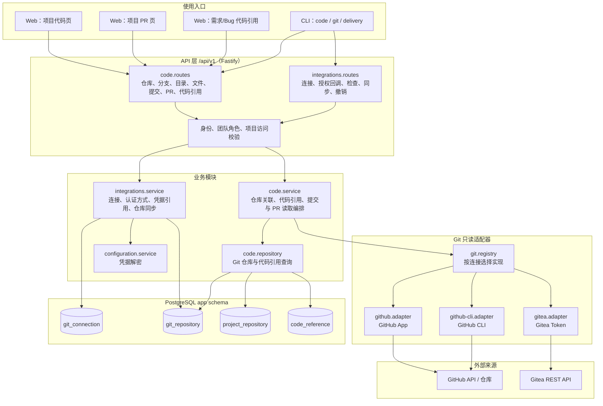
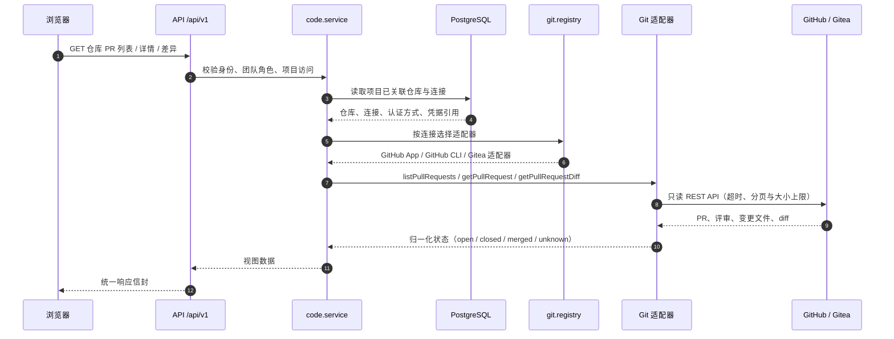
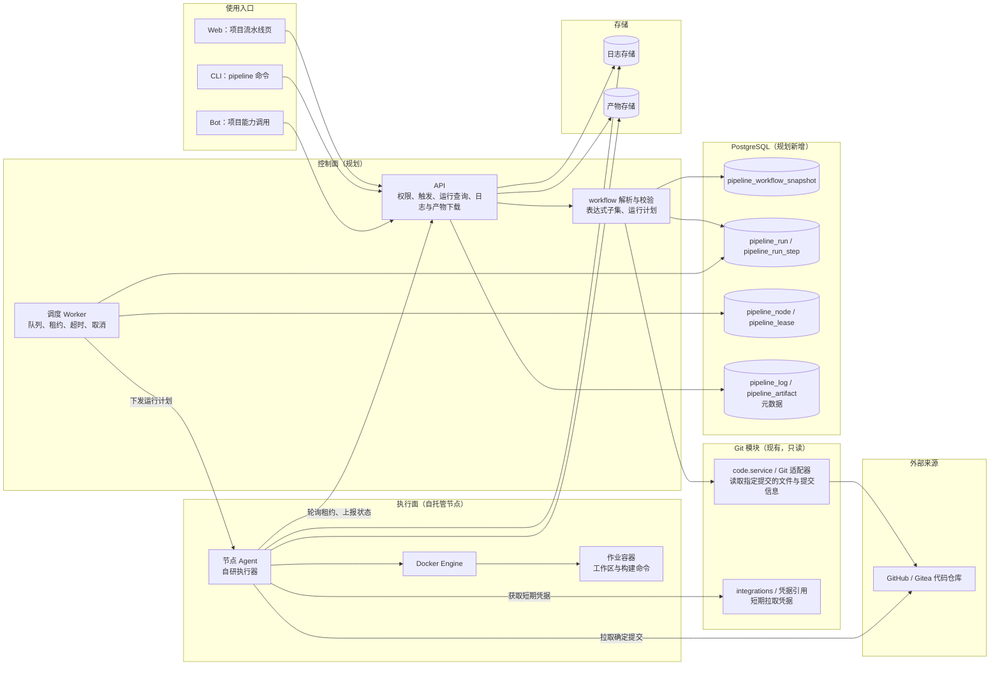
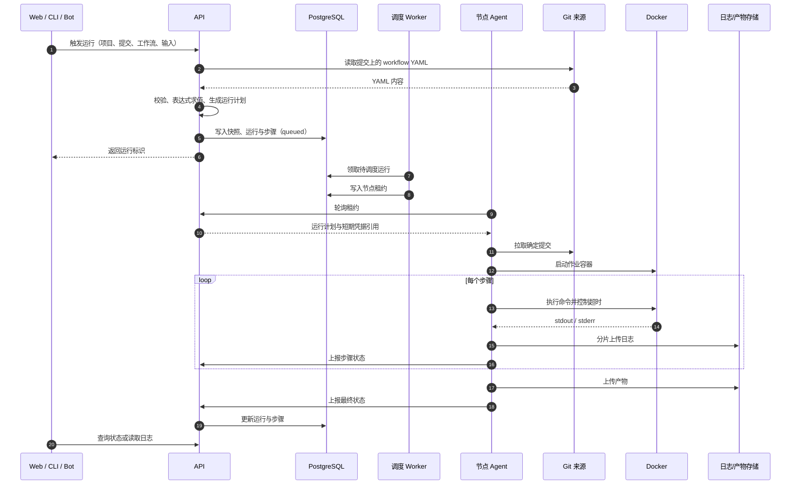
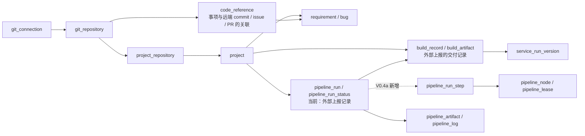

# Git、PR 与流水线架构

**Git 与 PR 以只读方式接入来源平台；流水线按控制面自研、自托管节点执行、执行器完全自研设计。**

| 属性 | 内容 |
| --- | --- |
| 状态 | 架构说明。第 2、3 章为当前实现核对，第 4、5 章为 V0.4a 目标设计，不代表已实现 |
| 核对时间 | 2026-11-10，基于工作区当前代码（含其他线程未提交改动） |
| 负责人 | 项目维护者 |
| 读者 | 项目维护者、研发与 AI 编码助手 |
| 范围 | Git 连接、仓库与分支、文件与提交读取、PR 读取、事项代码引用；流水线控制面、节点、执行器、日志与产物 |
| 关联 | [产品需求](../prd/mvp.md)、[版本规划](../prd/release-plan.md)、[流水线规划草案](../prd/pipeline-plan.md)、[外部仓库接入](external-repositories.md)、[后端架构](system-design.md) |

## 1. 范围与现状

当前代码已经具备 Git 连接与只读代码浏览：团队 Git 连接、项目关联仓库、分支、目录、文件、提交、PR 列表、PR 详情与 PR 差异读取，以及需求/Bug 对远端 Commit、Issue、PR 的引用与核对快照。

流水线部分有两层状态，阅读时需要区分：

| 状态 | 内容 |
| --- | --- |
| 当前已实现 | `delivery` 模块中的外部流水线运行上报：`POST /api/v1/projects/:projectId/pipeline-runs`、列表与详情读取，保存状态历史并与构建记录按来源运行标识关联；平台不触发、不执行 |
| V0.4a 目标 | 自研执行器：仓库内 YAML 定义、平台解析与运行计划、调度 Worker、自托管节点 Agent、Docker 执行、日志与产物存储 |

V0.2 规格已把 Phase 8 标注为暂缓，但工作区中外部上报的运行记录接口与表已经先落地。V0.4a 落地时，这部分可以作为“外部 CI 导入”兼容路径保留，也可以移除，属于待确认事项。

## 2. Git 与 PR 模块架构（当前）

| 组件 | 当前职责 | 代码位置 |
| --- | --- | --- |
| Web 代码页/PR 页 | 切换仓库与分支、浏览目录与文件、查看提交、PR 列表/详情/差异 | `apps/web/src/pages/project/code-page.tsx`、`prs-page.tsx` |
| `code.routes` | 仓库关联、分支、目录、文件、提交、PR 列表/详情/差异、代码引用 | `apps/server/src/modules/code/code.routes.ts` |
| `code.service` | 权限与项目归属校验、仓库关联、引用刷新、提交与 PR 读取编排 | `apps/server/src/modules/code/code.service.ts` |
| Git 适配器 | 按连接提供方与认证方式读取远端数据并归一化 | `apps/server/src/adapters/git/` |
| `integrations` | 团队 Git 连接、授权回调、连接检查、仓库同步与撤销 | `apps/server/src/modules/integrations/` |
| `configuration` | 服务端解密连接凭据，只向适配器提供必要材料 | `apps/server/src/modules/configuration/` |
| 数据表 | 连接、仓库快照、项目仓库关联、事项代码引用与核对快照 | `apps/server/src/modules/code/code.tables.ts`、`integrations.tables.ts` |

规则：

- PR 不落库。平台按需读取来源，返回归一化视图；`code_reference` 只保存事项与远端对象的关联及最近核对快照。
- 读取不克隆仓库，不依赖后台全量同步；来源分页、超时和截断上限由适配器处理。
- 来源失败映射为明确错误或 `unknown`，不能用空列表、缓存旧值或伪造成功代替。
- 读取不改写来源，也不自动推进需求、Bug 或发布状态。

## 3. PR 读取时序（当前）

失败与边界：

- 授权失效、来源不可用、超时、不支持与不存在必须可区分；来源不提供评审状态时返回 `unknown`。
- diff 或文件列表被来源截断时标记 `truncated`，不能用截断内容冒充完整结果。
- 读取 PR 不产生平台业务副作用；PR 合并也不会自动推进需求或 Bug 状态。

## 4. 流水线设计架构（V0.4a 目标）

| 组件 | 规划职责 | 当前状态 |
| --- | --- | --- |
| API 控制面 | 触发、运行查询、节点管理、日志与产物下载鉴权、权限校验 | 仅有外部上报的运行记录接口 |
| workflow 解析与校验 | 读取指定提交的 YAML，按平台 Schema 校验并生成运行计划 | 未实现 |
| 调度 Worker | 队列、租约、超时、取消、节点离线处理 | 未实现，预留 `entrypoints/worker` |
| 节点 Agent | 注册、心跳、领取租约、拉取代码、执行步骤、回传日志与产物 | 未实现 |
| 执行器 | 容器生命周期、步骤执行、超时、取消、清理 | 未实现，完全自研 |
| 运行数据 | 工作流快照、运行、步骤、节点、租约、日志与产物元数据 | 仅有外部上报的 `pipeline_run` 与状态历史 |
| 存储 | 日志与产物内容存储，按项目权限提供下载 | 未实现；当前只有结果链接 |
| Git 模块 | 读取 workflow 文件与提交信息，签发短期拉取凭据 | 代码/PR 读取已实现；工作流读取与拉取凭据待补 |

原则：

- 平台不调用 GitHub Actions、Gitea Actions 或其他第三方流水线 API，Git 只作为代码来源。
- 平台侧生成并固定运行计划，节点只执行计划，不自行解析 YAML。
- 运行、步骤、日志与产物都受项目权限约束；节点令牌、Git 凭据与运行时密钥分开管理。
- 流水线结果不自动改变需求、Bug、提测与运行版本。

## 5. 流水线运行时序（V0.4a 目标）

失败与取消：

- 超时或取消时，Agent 终止进程与容器并上报；平台不能显示为成功。
- 节点失联超过阈值时运行标记为 `interrupted`，已产生的日志与产物保留，重跑生成新运行。
- 触发幂等：同一幂等键重复提交返回同一运行，不产生第二次执行。
- 运行固定提交 SHA、YAML 快照与运行计划，保证可追溯。

## 6. 对象关系与当前/目标差异

| 能力 | 当前实现 | V0.4a 目标 |
| --- | --- | --- |
| PR 读取 | 列表、详情、diff、评审状态归一化 | 保持只读；流水线通过它读取 workflow 文件 |
| 流水线定义 | 无 | 仓库内 YAML，平台解析并校验 |
| 运行记录 | 外部上报，含状态历史 | 平台创建运行与步骤；外部上报可保留为导入 |
| 触发 | 无 | 手动触发；后续评估 push/标签/定时 |
| 执行 | 无 | 自研执行器 + 自托管节点 + Docker |
| 日志与产物 | 只有结果链接 | 平台日志存储、产物存储与下载权限 |
| 节点 | 无 | 注册、心跳、能力标签、租约、离线处理 |
| 权限与凭据 | 项目角色 + Git 连接凭据 | 增加节点令牌、触发权限、运行时密钥引用 |

## 7. 关键边界

- Git 与 PR 读取只读，不改写来源，不推进业务状态。
- 流水线结果不自动修改需求、Bug、提测与运行版本；部署与发布仍走变更计划。
- 权限按项目与服务端校验，前端隐藏按钮不构成授权。
- 密钥、短期 Git 凭据与节点令牌不进入日志、运行记录与错误详情。
- 工作流语法只支持平台声明的子集，不支持项明确报错，不做静默忽略。
- 待确认事项见[流水线规划草案第 12 章](../prd/pipeline-plan.md)：模块归属、外部上报去留、日志与产物存储、节点执行边界。
