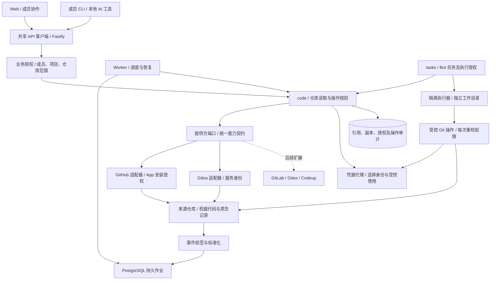
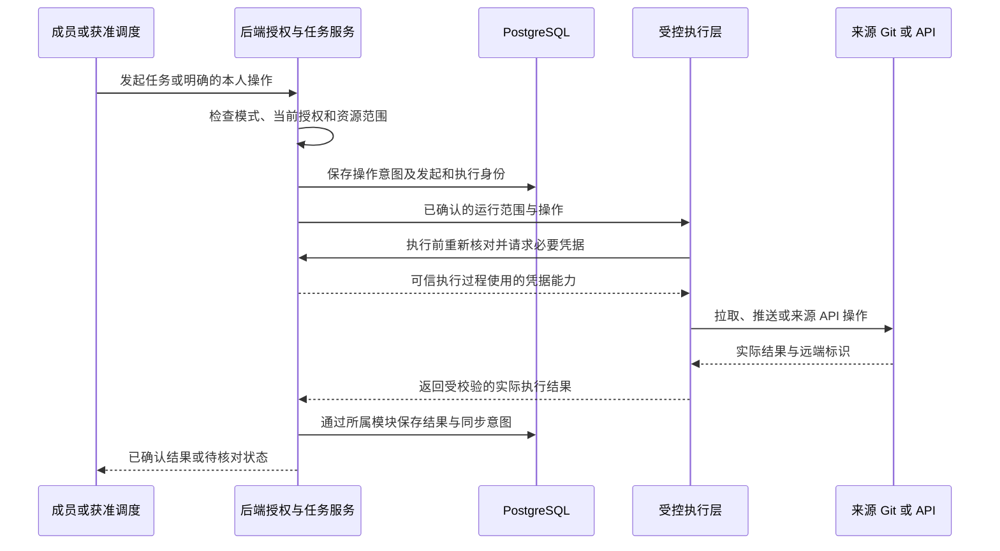

# 外部仓库集成架构

**GitHub 使用 GitHub App 授权，Gitea 使用受控服务身份；平台管理团队协作和 Bot 任务，代码保留在来源仓库，通过统一接口接入不同 Git 提供方。**

| 属性 | 内容 |
| --- | --- |
| 状态 | GitHub App 方案与首批 GitHub、Gitea 适配范围已确认；接口和执行流程待实施验证 |
| 负责人 | 项目维护者；研发负责适配、接入实验和验收证据 |
| 读者 | 项目维护者、Web、Server、CLI 与执行器开发者 |
| 范围 | 提供方接口、团队连接、成员与 Bot 权限、凭据使用、代码工作目录、同步及后续远端操作 |
| 关联 | [目标架构](system-design.md)、[V0.1 需求](../prd/v0.1.md)、[版本规划](../prd/release-plan.md)、[技术选型](../technical-selection.md) |

## 1. 设计结论与依据

仓库所有者或来源管理员授权平台访问指定仓库，平台管理员再决定团队和项目可以使用的范围。GitHub 以 App 安装授权接入，适用于个人和组织仓库；Gitea 按实例配置专用服务账号及受限 Token。普通业务协作和发起获准的 Bot 任务不要求每位成员绑定来源账号。

平台记录成员、项目权限、需求、Bug、提测、回归及任务。代码、提交和原生 PR/MR 以来源平台为准，平台保存引用及受控展示副本。默认不迁移主仓库，不部署内置 Gitea，不做双向镜像，也不以代码推送或 PR 合并自动推进本地业务状态。

首批适配目标为 GitHub 和 Gitea，GitLab、Gitee、Codeup 通过相同端口扩展。预留端口不表示所有来源具备同一种授权机制或 PR 语义，也不表示这些来源已能使用；平台流水线不依赖来源的流水线 API。

首版继续按 V0.1 交付真实连接和事项关联读取，暂不建设 PR 操作页面或内部评审系统。Bot 推送代码、创建 PR 与远端评论分步交付；流水线由平台内置执行，不调用来源平台的流水线 API；本文明确其权限与执行边界，不将目标架构描述为现有实现。

| 依据 | 已核对事实 | 设计采用方式 |
| --- | --- | --- |
| 当前工程 | `apps/server/src/bootstrap/create-http-app.ts` 仅注册健康路由；数据库聚合入口仅导出命名空间 | 业务模块、Git 适配器、后台作业和 Bot 执行仍待实现 |
| [目标架构](system-design.md#5-server-结构与职责) | 采用模块化单体、参数注入适配器、独立 Worker 与共享 API 客户端 | 不另建 Git 微服务或插件运行时 |
| [GitHub 安装身份](https://docs.github.com/en/apps/creating-github-apps/authenticating-with-a-github-app/authenticating-as-a-github-app-installation) | 安装 Token 可用于 API 和 HTTP Git，受安装授权范围约束 | 用于后台同步及显式批准的平台自动化 |
| [GitHub 用户身份](https://docs.github.com/en/apps/creating-github-apps/authenticating-with-a-github-app/authenticating-with-a-github-app-on-behalf-of-a-user) | 代表用户执行受用户与 App 权限共同限制 | 仅在明确采用本人来源身份时启用，不作为所有协作的前置条件 |
| [Gitea API](https://docs.gitea.com/development/api-usage/)、[OAuth2](https://docs.gitea.com/development/oauth2-provider/) | 提供 Token、用户授权及实例 API | 服务身份与可选个人身份分别配置，不模拟 GitHub installation 模型 |

工程核对基线为提交 `00e6390cb3b5a04308ac322662fe106d3e58a83f`；官方资料核对日期为 2026-11-09。平台权限和接入方向来自项目维护者的本次确认，具体来源能力仍需指定账号、仓库与 Gitea 版本的真实实验。

> **Why & What - 来源仓库保留权威代码**
>
> **选择：** 平台通过授权访问已有仓库，GitHub App 是 GitHub 的接入主方案。
>
> **理由：** 保留团队现有开发入口，避免额外维护主仓库迁移和镜像冲突；平台集中完成协作、任务及交付记录。
>
> **备选：** 内置 Gitea 能集中代码权限，但会增加账号映射、托管运维和外部镜像；为所有成员强制配置个人来源授权能保留远端个人身份，但增加非代码协作者的开通步骤。
>
> **代价与边界：** 平台必须承担自动化授权与审计，来源不可用时受保护代码操作暂停，本地业务继续使用。

## 2. 组件与模块边界

HTTP、Worker 和任务流程复用同一套业务授权。`code` 依赖小接口，具体提供方由 `bootstrap` 显式组装。Webhook 只触发技术同步，不直接流转需求、Bug 或 Bot 验收状态。

跨模块任务用例通过 workflow 核对 `tasks` 的执行授权，再调用 `code`；每次写入前仍由该用例重新核对任务状态。`code` 保持项目、连接和来源操作校验，不反向导入 `tasks` 内部实现，避免任务使用代码能力后形成循环依赖。隔离执行器只返回受校验结果，不直接连接平台数据库。

| 模块 | 负责内容 | 公开边界 |
| --- | --- | --- |
| identity | 平台身份、有效团队成员和可选来源账号绑定 | 来源 OAuth 不代替平台登录；不从 Bot 创建者继承来源权限 |
| projects | 项目归属和成员写入授权 | 负责人表示责任，不自动授予权限 |
| integrations | 提供方实例、团队连接、授权回调、连接状态和开放仓库 | 提供连接上下文，不包办所有 Git 业务操作 |
| configuration | App 私钥、服务 Token、可选用户授权的加密存储与受控使用 | 首次仅建设 Git 必需切片，不下发秘密给 Web、业务 CLI 或模型 |
| code | 仓库关系、读取、操作规则、同步和操作审计 | 声明仓库与变更请求能力端口，跨模块只导出业务接口 |
| tasks | Bot、任务执行授权、运行状态及交付验收 | 通过公开接口使用 Git 能力，不直接读取连接秘密 |
| adapters/git | GitHub、Gitea 的来源协议和数据转换 | 不维护平台成员或项目权限，不判断需求是否完成 |
| 执行模块 | 隔离工作目录、受控 Git 过程和后续项目命令执行 | 调度进程及 API 宿主机不直接运行项目代码 |
| platform/jobs | 持久调度、领取租约、有限重试和恢复 | 不成为第二套用户任务或业务状态 |

Web 的代码交互进入 `features/code`，连接管理进入 `features/integrations`。Web、CLI 和 Bot 工具只调用同一后端业务接口，复用 TypeBox/OpenAPI 生成的客户端；不分别实现权限和来源 SDK。

## 3. 成员、Bot 与凭据

### 3.1 平台权限和执行身份

成员的“可读”和“写入”是平台项目权限，团队管理员另有成员及连接管理职责。正常成员默认可读本团队获准业务资料；仓库区域只显示管理员明确批准共享的最小状态，不默认开放代码正文、diff、PR 评论或敏感摘要。写入资格允许使用本版已开放的项目功能，不能扩大来源授权。

| 场景 | 平台检查 | 来源执行身份 |
| --- | --- | --- |
| 创建需求、Bug、提测及本地评论 | 正常成员、项目写入及业务条件 | 无需来源账号 |
| 查看获准的仓库基础状态 | 项目可读、有效仓库关系、明确共享范围 | 后台同步身份；只返回获准的最小状态 |
| 发起 Bot 代码任务 | 项目写入、连接允许自动化、Bot 与任务授权均有效 | 后端确定的自动化身份，无需发起人绑定 GitHub |
| Bot 拉取、推送和后续远端操作 | Bot 授权、任务范围、当前连接能力和来源规则 | GitHub App 安装身份；Gitea 专用服务身份 |
| 以本人身份查看私有代码或操作远端 | 平台权限、本人来源绑定及实际来源权限 | 本人的来源用户授权 |
| 管理连接或来源协作者 | 平台管理资格与对应来源管理资格分别检查 | 对应管理身份；不随普通 write 自动开放 |

平台可以把自动化任务的结果开放给获准成员，但代码、diff 等受保护结果还需仓库所有者明确批准团队使用及相应展示范围，不因用户能读取任务记录就全部返回。未批准共享时，仅返回安全状态；需要交互式读取来源私有内容时走本人来源授权。

所有者安装 App 仅建立来源能力上限。接入时还需明确委托哪个团队、哪些仓库、哪些自动化动作及结果使用范围。自动化请求必须绑定实际 Bot 运行和已批准的任务能力，不能只附一个任务 ID 就代理任意来源 API。执行身份模式固定为 `platform_automation` 或 `source_user`；以本人身份进行的动作始终采用本人授权，失败不切换为应用或所有者身份。

### 3.2 Bot 授权与责任归属

Bot 创建者、任务发起人、平台内执行 Bot 和远端认证身份分别记录。Bot 不自动继承创建者、项目负责人或发起人的全部权限；任务使用的权限是连接委托、项目范围、Bot 授权和本次任务授权的交集。

同一个 GitHub App 可以服务多个平台 Bot，PR 和远端评论归属于应用身份。平台审计记录实际 Bot、发起人、任务及输出；Git 提交的 author、committer 元数据不作为已验证的平台身份。需要不同远端机器人身份时，再配置独立执行身份，不为每个逻辑 Bot 强制注册 GitHub 账号。

受控任务至少固定团队、项目、仓库、Bot、运行标识、操作集合、基准提交、允许的工作分支和授权有效期。发起人无权时拒绝创建任务；排队期间停用成员、撤销 Bot、移除仓库或撤销执行授权，未开始的写操作应被阻止。定时任务必须关联有效的自动化授权，不能因没有交互发起人而跳过检查。

### 3.3 凭据来源与保管

| 凭据 | 归属与用途 | 使用限制 |
| --- | --- | --- |
| GitHub App 私钥及 Webhook secret | 平台服务端配置；签发安装 Token、验证事件 | 私钥不保存到团队普通业务记录，不传给 Bot 或执行脚本 |
| GitHub 安装 Token | 按安装、仓库和必要权限生成，用于同步或自动化 | 官方当前有效期为一小时；按实际到期时间缓存和续取，签发前重检授权 |
| Gitea 服务 Token | 来源管理员批准的专用服务账号，限定 API scope 及账号可访问仓库 | 不假定能像 GitHub 一样动态生成按仓库缩权的短期 Token；必要时使用隔离服务账号 |
| 可选来源用户授权 | 当前平台成员明确绑定的来源身份 | 只用于该成员的本人身份模式，刷新或撤销失败时不改用其他身份 |
| 平台 CLI/任务访问凭据 | 证明平台调用者或当前执行上下文 | 不包含来源 Token，不能由客户端自报其他用户或 Bot 身份 |
| 执行节点令牌与流水线凭据 | 平台向自托管执行节点派发任务、回传结果与解析运行时密钥引用 | 与 GitHub App、仓库写入权限分别管理 |

来源秘密加密保存，加密密钥与数据库分离。后端凭据代理以连接、执行身份和操作上下文选择秘密，只向可信适配器或受控 Git 执行过程提供必要材料；业务 API 返回凭据引用和状态，不返回秘密值。

对 Gitea 等长期 Token，任务租约只是平台授权记录，不会把来源 Token 自动变成任务级短期凭据。因此不把此类 Token 注入模型可读取的环境、仓库配置、命令行 URL 或任意脚本；每次来源写入都经过后端或受控执行层。取消任务不能保证撤回已经发出的远端请求，已完成写入仍需保留审计。

GitHub Token 可以缩小仓库及 API 权限，但不能据此声称它原生只允许某个任务分支。分支、操作次数和任务有效期由平台执行层检查，来源分支保护继续生效。[安装 Token 范围](https://docs.github.com/en/apps/creating-github-apps/authenticating-with-a-github-app/authenticating-as-a-github-app-installation)、[身份使用建议](https://docs.github.com/en/apps/creating-github-apps/about-creating-github-apps/best-practices-for-creating-a-github-app#use-the-appropriate-token-type)

GitHub App 权限按交付能力申请，运行时 Token 再缩小至本次必要范围。首版仅申请实际读取所需权限；后续扩展 App 权限需来源所有者接受，平台管理员不能代替这一批准。

| GitHub 能力 | 必要来源权限 | 交付边界 |
| --- | --- | --- |
| 仓库、提交及代码读取 | `Metadata: read`、`Contents: read` | 按本版实际读取接口启用 |
| 原生 Issue、PR 关联读取 | `Issues: read`、`Pull requests: read` | 不产生远端写入 |
| Bot 推送工作分支 | `Contents: write` | 后续受控执行能力，仍受任务分支和来源保护约束 |
| Bot 创建 PR、PR 普通评论及行评论 | `Pull requests: write` | 后续逐项开放；普通讨论也可由 `Issues: write` 授权，不为此默认扩大到 Issue 管理 |
| 仓库设置、协作者及 CI 工作流变更 | 对应来源管理或工作流权限 | 不包含在默认代码写入授权内，实际交付时单独核对 |

> **Why & What - 自动化身份与本人身份分开**
>
> **选择：** 默认 Bot 使用明确委托的应用或服务身份，本人来源身份是独立、可选的操作模式。
>
> **理由：** 普通业务成员可以参与任务与验收，后台自动化不依赖某位 Bot 创建者的个人 Token；同时保留远端个人协作的正确归属。
>
> **备选：** 所有成员强制绑定来源账号有利于逐人来源鉴权，但增加平台业务协作门槛；统一使用所有者个人 Token 会混淆实际执行身份。
>
> **代价与边界：** 平台承担 Bot 与任务授权、结果共享及操作审计，不向成员提供任意调用应用全部权限的代理接口。

## 4. 接入与协作操作流程

### 4.1 GitHub App 接入

1. 平台管理员发起连接操作，服务器保存绑定当前用户、团队、提供方实例的一次性授权上下文。
2. 来源仓库所有者或有权管理员在 GitHub 安装或配置 App，选择实际仓库及所需权限；仅提交仓库 URL 不产生访问权。
3. 回调由服务器验证上下文，并核对来源身份、安装归属和实际可管理范围，不能凭 installation ID 认领连接。
4. 管理员在来源安装范围内明确平台开放仓库、自动化操作和结果共享范围；默认只读接入不请求代码写入或仓库管理能力。
5. 项目选择获准仓库，服务器解析稳定仓库 ID、检查连接和关系，记录首次核对结果并安排元数据同步。

后台只从配置取得 App 标识、私钥、事件验证材料及接入身份核验所需客户端信息。接入管理员按来源协议证明自己有权绑定安装，这不要求全体成员绑定 GitHub；普通成员的本人模式另行启用用户绑定流程。平台登录仍采用已有身份方案，未批准扩权的连接不能使用新增能力。

### 4.2 Gitea 接入

管理员配置实例 API 基址与专用服务账号的 Token，服务器核对实例版本、实际身份和仓库能力，再按第 4.1 节的开放范围和项目关系流程接入。来源凭据持有人必须有权批准其仓库用于团队自动化。

服务账号只保留必要仓库访问及接口 scope。若实例无法满足所需隔离，连接只能开放能验证的操作，不能仅靠 UI 隐藏其他仓库；也不启用服务端管理员 impersonation 作为默认业务执行方式。成员本人模式后续通过该实例的 OAuth2 单独绑定。[Gitea API](https://docs.gitea.com/development/api-usage/)、[OAuth2](https://docs.gitea.com/development/oauth2-provider/)

### 4.3 团队成员协作

成员使用平台身份维护获准业务记录，write 成员可以发起本版已开放的自动化任务。普通成员无需获得 App 私钥、服务 Token 或被批量加入远端仓库。创建任务不等于本人直接取得 GitHub/Gitea 的克隆或推送资格。

成员在自己电脑直接使用 Git 时，仍使用自己的来源凭据和访问权。后续若提供本人远端 PR 操作，先完成来源账号绑定和权限核对；平台不自动把该动作切换为 Bot 操作。来源协作者邀请作为独立管理功能后置，不作为团队业务协作的开通前提。

### 4.4 Bot 拉取、推送与后续 PR 操作

1. 成员或获准调度规则创建任务，后端固定第 3.2 节的执行范围及真实发起上下文。
2. 执行前重新核对授权，受控 Git 过程取得读取能力并拉取明确提交，创建每次运行独立的工作目录。
3. Bot 在隔离环境修改代码及自测；模型和项目脚本不持有来源写入凭据。
4. Bot 请求提交结果，后端校验目标仓库、工作分支及预期提交，受控 Git 过程按需取得写入能力并推送。不得默认强推、修改主分支或携带凭据跟随跨来源重定向。
5. 后续开放创建 PR 时，推送成功后由后端使用该任务的明确执行身份调用来源 API，保存远端编号；未开放该能力时只交付提交及工作分支。
6. 后续开放评论时，后端检查目标 PR 归属、任务授权和评论类型，再发表普通评论或行评论，记录结果及远端身份。

同一仓库的多个任务使用独立目录和不同工作分支。对同一目标分支的写入串行核对，拒绝过期状态；来源分支保护、Token scope 或权限拒绝不能通过重试或换身份绕过。Bot 可以创建 PR，不因此自动取得合并或批准自己变更的业务资格。

GitHub 的创建 PR 及普通评论接口支持安装 Token，评论以应用身份发表；Gitea 用专用执行账号归属。行评论还需要明确提交、路径和行范围，具体语义由提供方适配器转换。[创建 PR](https://docs.github.com/en/rest/pulls/pulls#create-a-pull-request)、[普通评论](https://docs.github.com/en/rest/issues/comments#create-an-issue-comment)

### 4.5 撤权与任务取消

团队停用、项目撤权、Bot 停用、仓库移除或连接失效后，后续请求和待执行写入都重新判断并拒绝失效范围。取消未开始的任务，清理受影响查询和私有内容缓存；历史活动不得继续返回失去授权的代码或远端正文。

平台撤权不自动删除成员原有来源协作者资格，也不能收回其已复制的代码。仅管理明确由本平台建立、且无其他有效使用关系的来源授权；来源撤权失败记录未完成状态并可重试。已经完成的远端写入和无法取消的在途操作保留真实审计。

## 5. Git 工作目录与提供方扩展接口

### 5.1 Git 协议与来源 API 分开

目录、文件和引用按来源能力读取，缓存使用确定的提交标识。代码浏览不要求全仓克隆；任务执行借鉴 Jenkins 的 clone/fetch/checkout 工作目录方式，不使用背景自动 pull 覆盖进行中的修改。拉取缓存不反向自动推送，PR/MR 元数据也不从 Git 拉取结果中推断。

Git 检出、分支及推送由通用受控执行器负责；来源适配器提供经验证的仓库地址、认证方式和来源能力。平台 API、CLI 或 Bot 不能提交任意远端地址、refspec、Git 参数或凭据引用绕过固定范围。当前优先验证 HTTPS Git，其他传输协议在有实际需求时实现。

携带来源凭据的 Git 过程使用可信配置和远端地址，不加载 Bot 可修改的认证配置、credential helper 或仓库钩子。Bot 可写文件与可信 Git 元数据、凭据使用过程隔离，不能仅靠隐藏环境变量就声称项目脚本无法取得执行凭据。

流水线由平台内置执行：定义保存在仓库的 YAML 文件中，格式参考 GitHub Actions 与 Gitea Actions 的工作流文件；平台读取确定提交上的定义，在注册到平台的自托管执行节点上用隔离容器运行，不调用来源平台的流水线 API。执行节点使用与 Bot 不同的工作目录，按已推送的确定提交构建，不能使用 Bot 未提交文件。提测不触发或等待流水线，流水线成功不自动通过测试。[流水线边界](../prd/mvp.md#6-流水线执行节点与提测的独立边界)

### 5.2 首批与后续提供方

| 提供方 | 接入状态与方向 | 认证及差异 |
| --- | --- | --- |
| GitHub | 首批实现目标 | App 安装身份用于同步与自动化；本人身份作为可选独立能力 |
| Gitea | 首批实现目标，支持多个来源实例 | 专用服务身份及 Token；实例版本、接口 scope 和来源操作分别验证 |
| GitLab | 预留，未实现 | 后续适配认证、项目标识及 MR，不假定兼容 GitHub App |
| Gitee | 预留，未实现 | 后续核对版本、认证、事件及代码平台接口 |
| Codeup | 预留，未实现 | 后续核对实际服务形态、组织/项目归属、认证及接口 |

`providerKey` 是提供方类型，`instanceId` 是实际服务实例；同类型可以有多个实例，实例基址包含合法基础路径。数据库保存受校验的提供方键，不用一个 GitHub 专属枚举或必填 installation ID 限制所有连接。

首批实现时组合根只注册 `github`、`gitea` 工厂，未注册的提供方不能建立连接或显示为可用。增加来源时添加适配器、声明能力、注册工厂并运行公共契约测试，不为未来来源建立空目录、占位实现、动态插件加载或任意 HTTP 转发配置。

### 5.3 后端端口契约

下表是待实现的后端接口边界，明确调用参数和输出语义；不是已经存在的 TypeScript 导出。契约定义归属业务模块公开入口，具体实现进入 `adapters/git`，由 `bootstrap` 注入。凭据获取在受控服务端完成，不成为 Web/CLI 可调用的取 Token 接口。

| 端口与归属 | 最小方法 | 输入、输出与约束 |
| --- | --- | --- |
| `GitConnectionProvider`，integrations | `getCapabilities`、`checkConnection`、`completeAuthorization` | 输入实例、连接及经校验的授权上下文；输出来源身份、安装或服务账号引用、授权范围和有效能力。授权数据按提供方校验，不强制统一为 OAuth |
| `GitRepositoryProvider`，code | `listRepositories`、`getRepository`、`resolveCommit` | 输入已授权执行上下文及分页、仓库或提交引用；输出规范仓库、不可变提交和分页结果，原始来源响应不直接出模块 |
| `GitContentProvider`，code | `listRefs`、`readTree`、`readFile`、`compareCommits` | 输入仓库、明确版本及安全路径；输出引用、文件或差异和版本定位，正文按读取范围授权，按对应产品能力实现 |
| `GitEventProvider`，integrations | `verifyAndNormalizeEvent` | 输入来源实例、原始请求体及必要请求头，输出已验签的事件标识、仓库、类型和受控变化标识；不能由客户端声明验签成功 |
| `GitChangeRequestReader`，code | `resolveChangeRequest`、`readChangeRequest` | 输入仓库及 PR/MR 引用，输出统一变更请求摘要、原生状态、来源链接与提交；首版只实现事项关联实际需要的读取 |
| `GitChangeRequestWriter`，code | `createChangeRequest`、`addDiscussionComment` | 后续能力；输入执行上下文、已推送分支及目标或远端记录，输出来源记录。普通讨论与行评论分开，不承诺各来源全功能一致 |
| `GitCredentialProvider`，configuration | `withAuthorizedCredential` | 输入后端确认的执行范围及必要来源能力，在可信回调中使用凭据；业务结果不含秘密。支持到期、撤销及安全失败，不假定所有来源可动态缩权 |
| `GitWorkspaceExecutor`，执行模块 | `prepareWorkspace`、`pushTaskBranch` | 输入已授权运行、确定提交、受控目录及分支；输出工作目录引用、提交和推送结果。实际 Git 过程每次重检，禁止任意命令或跨任务目录 |

连接授权、凭据和事件端口的定义由所属模块维护，使用方通过公开能力调用，不通过适配器反向导入业务内部表。通用 Git 执行器不会因新增 GitLab、Gitee 或 Codeup 而复制一套 clone/push 业务规则。

### 5.4 统一模型与能力差异

统一模型保留来源稳定 ID、原生状态及原生类型。仓库信息至少包含平台仓库 ID、提供方、实例、远端仓库 ID、命名空间、展示名和无凭据链接；变更请求包含来源 ID/编号、`nativeKind`、原生状态、源/目标提交及必要摘要。GitLab 等来源的 MR 可以映射为变更请求，但不能通过改名丢失其原生语义。

执行上下文由后端构造，包含团队、项目、连接、仓库、操作者或调度授权、执行身份模式、Bot/任务/运行引用及本次操作。输入的字符串 ID、来源响应和提供方授权配置在边界校验；调用方不能用上下文字段伪造其他用户身份。

适配器分别声明“已实现能力”，实例核对“版本支持能力”，连接记录“实际来源授权”；再由平台权限和本次任务限制决定是否可执行。界面可用性与后端检查使用同一能力结果，不能把“支持 push”当作“每个成员都能 push”。

认证失效、权限不足、记录不可用、来源不支持、限流、超时和结果不确定分别转换为统一安全错误，保留可用的重试时间及来源追踪标识。未实现能力明确返回不支持，不能返回空列表、伪造成功或自动使用另一连接。评审、线程、合并、协作者和 CI 在实际交付时增加对应小端口，不提前做一套全量来源 SDK。

> **Why & What - 小端口与显式适配器**
>
> **选择：** 统一业务语义、执行上下文和错误，按能力声明小接口，首批只落地两个提供方。
>
> **理由：** 新增来源时可复用权限、任务与 Git 执行规则，同时保留不同授权和 PR/MR 的差异。
>
> **备选：** 每个来源贯穿页面到数据库开发更直接，但会重复业务授权；预建通用插件引擎利于动态安装，当前会增加生命周期和调试成本。
>
> **代价与边界：** 每个来源需要独立能力验证和契约测试，不能因为方法名相同就宣称完整兼容。

## 6. 同步、写入与故障恢复

同步使用初始分页读取、Webhook 更新和定期补偿查询。按提供方验证原始事件签名和连接归属，持久保存接收记录及作业后再确认成功。支持 Webhook 的连接分别配置；来源无法发送或当前未启用事件时，使用有界补偿查询，不伪装为实时同步。[Gitea 事件机制](https://docs.gitea.com/usage/repository/webhooks/)

事件按来源投递标识去重，来源没有稳定投递标识时由适配器明确去重策略。按仓库或记录限制并发，事件触发重新读取权威状态，避免旧事件覆盖新状态。删除、来源拒绝和网络失败不能一律解释为对象已删除。

后端外部请求限定已验证实例，设置超时、响应大小与并发上限，私有内容核对失败不返回离线缓存。来源 URL 只能解析为已配置实例中的资源；Gitea 内网地址由管理员显式配置，普通任务不能临时指定主机。跨来源重定向不转发凭据。

写入采用以下流程，业务状态和外部请求不放进同一数据库事务：

本次提交标识按团队、项目、操作者和动作隔离，并校验输入一致性。它防止本地重复派发，但不能让缺少幂等支持的来源接口获得恰好执行一次语义。推送、创建 PR 和评论超时后先核对远端结果；无法唯一确认时保留待核对状态，不盲目重放。

PostgreSQL 持久作业记录领取租约、尝试次数和安全错误，中断后恢复领取；来源读取有限重试，限流遵守来源反馈。日志及观察指标覆盖同步滞后、作业积压、授权失效、来源限流和结果待核对，不记录 Token 或原始敏感正文。

## 7. 数据模型与平台 API

平台标识和来源标识分开保存，用户、仓库及远端记录使用来源稳定 ID。仓库唯一性采用团队、来源实例和远端仓库 ID，对象再加类型及远端 ID；更换凭据或来源账号改名不复制仓库及历史。一个项目可以关联多个仓库，同一仓库可以被多个项目明确使用，请求始终绑定发起项目。

| 记录组 | 权威内容 | 归属及约束 |
| --- | --- | --- |
| 来源实例与团队连接 | 提供方键、实例基址、来源安装或服务身份、开放范围及连接状态 | integrations；提供方专有标识使用经该适配器 schema 校验的配置，其他来源不必有 installation ID |
| 项目仓库关系 | 稳定仓库引用、项目和明确使用的连接 | code；项目与仓库关系唯一，跨团队和实例隔离 |
| Bot 与任务执行授权 | 仓库、动作、分支、有效期、授权人及运行归属 | tasks；不能因创建 Bot 自动取得权限 |
| 来源秘密与可选用户绑定 | 加密秘密引用、归属、到期、撤销及来源用户 ID | configuration 与 identity 各自维护所属记录，不把秘密放进通用 JSON 响应 |
| 代码与变更请求副本 | 远端标识、确定版本、原生状态、共享范围和核对时间 | code；随实际能力增加所需表，缓存不是权威来源 |
| 操作审计 | 发起人、Bot、任务、执行身份、范围、输入摘要及远端结果 | code；不保存明文凭据或把活动摘要当作受保护正文旁路 |
| 技术作业 | 调度、租约、重试及结果引用 | platform/jobs；与 Bot 业务任务分开 |

业务表和关系表遵循项目规范：稳定主键、审计时间、中文说明、必要唯一约束、版本化迁移和无外键一致性控制。共同变化的数据使用短事务和一致的父记录锁定，外部调用在事务外；API 标识按字符串传输。

以下是拟新增的 API 分组，不代表当前已有路由。TypeBox 定义契约，Web 与 CLI 生成客户端，不公开任意提供方 URL 或取来源 Token 的通用接口。

| API 分组 | 建议路由范围 | 访问规则 |
| --- | --- | --- |
| 可用提供方 | `/api/v1/git-providers` | 返回已注册提供方及能力描述；首批仅返回 GitHub、Gitea，预留来源不能伪装为可接入 |
| 团队连接 | `/api/v1/teams/:teamId/git-connections` | 接受已支持的 providerKey、实例及对应授权方式；管理员创建、检查和开放范围 |
| 授权回调 | `/api/v1/git-authorizations/:providerKey/callback` | 校验一次性 state、发起人、团队、实例及真实来源归属，拒绝未知提供方 |
| 项目仓库 | `/api/v1/projects/:projectId/repositories` | 只允许选择开放且来源仍授权的仓库，按项目返回有效能力 |
| 可选本人绑定 | `/api/v1/me/git-accounts` | 后续本人来源模式，当前用户只能绑定自己 |
| 任务代码操作 | 任务运行下的代码准备与推送操作 | 由后端任务范围确定身份、仓库、分支和凭据，不信任客户端自报执行身份 |
| 变更请求 | 项目仓库下的 `change-requests` 及讨论接口 | 统一平台资源，保留来源 PR/MR 类型；首版只开放关联所需读取，写入逐项启用 |
| 操作结果 | `/api/v1/operations/:operationId` | 校验当前资源访问，返回实际结果或待核对状态 |
| Webhook | `/api/v1/webhooks/git/:connectionId` | 提供方验签及事件归属认证；连接 ID 不是认证凭据 |

平台 CLI 使用成员平台凭据；Bot 工具使用受限执行上下文，两者不能互相冒充。CLI 错误、日志、活动和缓存都不能泄露来源 Token，写入响应不确定时查询同一操作记录，不重复创建另一项操作。

## 8. 交付顺序与验收

先验证 App 和服务身份，再交付 GitHub、Gitea 的真实读取。后台同步、Bot 推送及后续 PR 各自定义可观察结果；其他提供方只保留第 5 章的契约要求，不生成空壳实现，也不扩大 V0.1 范围。

| 交付内容 | 完成标准 |
| --- | --- |
| 接入实验 | GitHub 个人与组织仓库的 App 安装、缩权和撤销可验证；指定版本 Gitea 的服务 Token、仓库范围及拒绝路径可验证 |
| 双平台真实读取 | GitHub/Gitea 公有和私有仓库分别通过；本人绑定不成为业务协作前提，未批准共享内容不泄露 |
| 端口公共契约测试 | 两个适配器通过相同仓库、提交、分页、错误及能力判定用例；使用测试提供方替身可验证选择和不支持路径，无需为未来来源建立产品适配器 |
| 同步与恢复 | 事件验签、重复投递、乱序、漏事件和 Worker 重启可恢复，未知来源事件不推进业务状态 |
| Bot 工作目录与推送 | 多 Bot 和多运行目录、分支隔离；创建者权限不自动继承，实际来源身份和本地审计一致 |
| 可选本人模式 | 两名成员各自授权，来源按本人身份执行；本人失败不回退为应用身份 |
| 后续 PR 与评论 | 先推送再创建 PR，评论目标与任务授权匹配；远端结果不确定不盲目重试，不支持能力明确反馈 |
| 后续流水线 | 平台内置流水线按确定提交在自托管节点执行，运行记录、日志与产物可追溯；提测与发布继续显式分开 |

真实实验覆盖跨团队、跨项目、同名多实例、App 卸载、用户取消授权、Token 到期、来源服务账号权限变化、成员停用、Bot 授权撤销、任务取消、目标分支变化和远端成功后本地保存失败。重点验证原始 Gitea 服务 Token 不进入不可信脚本、GitHub Token 不被误认为原生按分支限制，以及未来提供方不可用时不会静默切换到其他连接。

当前目标 Gitea 实例与版本由研发在接入实验前记录，项目维护者提供有权用于验证的测试仓库。未通过实验的能力保持未开放，失败证据用于修订适配策略。工程实现后执行 `pnpm check`，涉及持久化时执行 `pnpm test:db`；本轮为架构文档更新，未执行功能、数据库或真实来源测试。

## 实施状态（2026-11-10）

V0.1 已落地只读关联链路：GitHub App / GitHub CLI / Gitea 适配器、团队 Git 连接、仓库同步、项目仓库关系、代码引用核对与撤权拒绝。stg 使用 `GITHUB_AUTH_MODE=cli` 与 `GITHUB_ALLOWED_REPOS` 白名单；生产方向使用 GitHub App 安装身份。V0.1 不执行远端写操作，GitHub/Gitea 真实网络验收与历史摘要权限过滤仍按 quickstart 检查。
