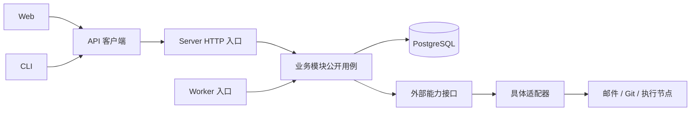

# DevOps 平台目标架构

**统一工作区，Web 按业务功能组织，Server 采用模块化单体；后台任务与 HTTP 复用业务实现。**

| 属性 | 内容 |
| --- | --- |
| 状态 | 目标方案已确认；工作区和基础工程已实施，业务模块按需加入 |
| 负责人 | 项目维护者 |
| 读者 | 项目维护者、前后端与 CLI 开发者 |
| 范围 | 应用划分、目录职责、模块依赖、数据归属、接口契约及搭建顺序 |
| 关联 | [产品需求](../prd/mvp.md)、[版本规划](../prd/release-plan.md)、[V0.1 需求](../prd/v0.1.md)、[技术选型](../technical-selection.md) |

## 1. 架构结论

建议采用 pnpm Monorepo，将 Web、Server、CLI 放在同一工作区。Web 负责页面和交互，Server 集中维护业务规则与数据，CLI 通过与 Web 相同的 API 操作平台。Server 内部按业务划分模块，HTTP 和 Worker 使用独立进程入口，共享模块实现。

这套结构服务于需求、Bug、Git 关联和提测，也为后续 Bot、任务、交付与运维留出明确归属。首次搭建集中在工程基础与研发流程需要的模块，其他目录在对应功能开发时加入。

目标是让一个功能的修改集中在所属模块，让模块间调用可检查，让新增入口复用现有规则。本文维护完整产品的目标目录；已实施范围和运行命令见各应用 README。当前仅迁移现有基础功能，尚未建立新业务模块、后台作业或外部适配器。

> **Why & What - 模块化单体**
>
> **选择：** 业务模块先部署在同一个 Server 中，耗时工作通过独立 Worker 进程执行。
>
> **理由：** 项目当前由一人配合 AI 开发，需求、Bug、项目权限和任务又存在共同业务流程。集中部署能减少发布单元和跨服务协调，但仍需约束模块依赖。
>
> **备选：** 微服务可以独立扩容和发布，适合已经有独立维护团队或隔离需求的模块；当前会先增加接口、部署和跨服务一致性的维护成本。
>
> **代价与演进：** 单体内的业务变更共同发布，共用数据库也需要协调迁移。某个模块出现明确的资源瓶颈或独立发布需求后，再沿其公开接口拆出服务。

## 2. 依据与术语

业务规则由 PRD 维护，本方案只确定它们在工程中的位置。以下材料用于核对产品范围和技术基础，不能据此认定规划中的业务已经实现。

| 依据 | 可核对内容 | 对架构的影响 |
| --- | --- | --- |
| [版本规划第 1、3、4 章](../prd/release-plan.md) | 一人配合 AI 开发、研发优先、完整模块范围 | 首先完成研发流程，按功能扩展模块 |
| [V0.1 已确认决定](../prd/v0.1.md#73-已确认决定) | 两级邮箱邀请、首次设置密码、后续邮箱密码登录 | 账号、团队、成员和邀请统一归入 identity |
| [产品需求](../prd/mvp.md) | 提测、交付、任务验收和发布的业务边界 | 各模块分别维护状态，显式执行跨模块操作 |
| [技术选型](../technical-selection.md)及其源码链接 | React、TypeScript、Vite、Fastify、TypeBox 与 PostgreSQL、Drizzle 的基础 | 沿用技术方向，重新组织应用和业务模块 |
| [项目规范](../../AGENTS.md) | 接口校验、CLI 访问边界、无外键关联一致性和验证要求 | 用模块边界、事务及测试承接工程约束 |

源码核对基线为提交 `066101f2ac66c32d4633fcf920a8fc20aaba71e1`，核对范围包含 2026-11-09 工作区已有文档和前端修改。外部官方资料同日核对，DSH 链接固定到所读提交。完整业务目录仍按版本逐步建立，不能将目标清单视为业务完成状态。

本文中，应用是可运行入口；业务模块拥有自己的规则、数据和公开接口；适配器负责连接外部能力。Worker 指执行后台作业的进程，后台作业是技术调度记录，与用户可见的 Bot 任务分别建模。

## 3. 工作区结构

建议统一依赖安装与锁文件，同时保留各应用自己的 package.json 和构建入口。内部共享包先限定为 API 客户端，工程配置直接放在 tooling 中。

```text
dev-ops/
├── apps/
│   ├── web/                       # 浏览器应用
│   ├── server/                    # HTTP、Worker 和业务模块
│   ├── pipeline-agent/            # 自托管流水线执行节点（主动外连平台）
│   └── cli/                       # 命令行入口
├── packages/
│   ├── api-client/                # 从后端契约生成的客户端与接口类型
│   └── pipeline-protocol/         # Server 与 Agent 共用的流水线协议类型
├── tooling/                      # 共享编译配置、依赖边界检查和工程脚本
├── tests/
│   └── e2e/                      # 跨 Web、Server、CLI 的完整流程
├── docs/
│   ├── prd/                      # 产品规则与版本范围
│   └── architecture/             # 架构方案与具体决策
├── deploy/                       # 本地依赖环境和实际部署配置
├── package.json                  # 工作区统一命令
├── pnpm-workspace.yaml
├── pnpm-lock.yaml
├── .nvmrc
├── AGENTS.md
└── README.md
```

工作区声明 apps 与 packages 中的实际项目，内部包使用明确的 workspace 依赖。pnpm 原生支持工作区及 workspace 协议，根目录清单负责定义成员。[pnpm 工作区文档](https://pnpm.io/workspaces)

> **Why & What - 统一工作区**
>
> **选择：** 应用分别声明依赖，仓库共用锁文件、工程检查和内部包版本。
>
> **理由：** Web 和 CLI 需要跟随后端契约变化，同一变更可以覆盖接口、调用方和测试。
>
> **备选：** 独立仓库或独立锁文件有利于各产品自行发布依赖版本；当前应用属于同一平台，会增加同步契约的步骤。
>
> **代价与演进：** 工具链升级需要一起检查各应用。先由 pnpm 脚本组织构建，出现可测量的重复构建成本后再评估缓存编排工具。

只有一个 Web 应用时，基础 UI 放在 Web 内。以后出现第二个实际使用者，再评估提取 UI 包。业务代码先保留在 Server 模块中，只有出现独立消费或发布需求时才提取为工作区包。

## 4. Web 结构与职责

Web 采用 app、pages、features、shared 四个层次。页面表达访问入口，功能模块表达业务能力；同一个需求详情可以被项目页面和任务上下文复用。

### 4.1 目录

下面展示完整产品的目标分布。尚未进入开发范围的业务目录按需创建，页面清单以原型和 PRD 为准。

```text
apps/web/
├── src/
│   ├── app/
│   │   ├── router/               # 路由注册、懒加载和路由错误边界
│   │   ├── providers/            # Query、主题和会话上下文的组装
│   │   └── layouts/              # 应用主框架、全局导航和内容出口
│   ├── pages/
│   │   ├── auth/                 # 登录、接受邀请等路由页面
│   │   ├── projects/             # 项目列表
│   │   ├── project/              # 项目布局及需求、Bug、代码等子页面
│   │   ├── collaboration/        # 全局会话、群组、任务、待处理
│   │   ├── operations/           # 变更、事件与值守页面
│   │   ├── capabilities/         # Bot、Skills、模板与连接入口
│   │   ├── credentials/          # 凭据库入口
│   │   └── settings/             # 个人、团队及成员设置
│   ├── features/
│   │   ├── identity/             # 会话、账号、团队、成员和邀请
│   │   ├── projects/
│   │   ├── requirements/
│   │   ├── bugs/
│   │   ├── code/
│   │   ├── delivery/
│   │   ├── pipeline/             # 流水线页、运行详情与执行节点管理
│   │   ├── bots/
│   │   ├── collaboration/
│   │   ├── tasks/
│   │   ├── knowledge/            # Skills、模板与记忆
│   │   ├── configuration/        # 凭据、环境变量和配置请求
│   │   ├── integrations/
│   │   ├── operations/
│   │   ├── monitoring/
│   │   └── notifications/
│   ├── shared/
│   │   ├── api/                  # 浏览器 API 客户端的初始化
│   │   ├── ui/                   # 无业务归属的基础控件
│   │   ├── lib/                  # 有实际复用者的通用函数
│   │   └── styles/               # 主题、设计变量、全局样式
│   ├── test/                     # 测试初始化、网络模拟和公共夹具
│   ├── assets/
│   └── main.tsx
├── public/
├── package.json
└── vite.config.ts
```

app 组装应用所需的 Provider 和路由。pages 读取路由参数、组合功能组件、处理页面布局；需求状态的展示、交互提示和接口调用归入对应 feature，权威的状态转换规则由 Server 维护。shared 中的组件不感知项目、需求或 Bot，项目选择器等业务组件由所属 feature 导出。

导航分组不决定模块归属。例如“凭据库”和“项目环境变量”可以出现在不同页面，但共同使用 configuration 功能。完整产品的首页及项目默认页遵循 PRD，V0.1 的首页落点仍由原有 Q14 确认。

### 4.2 一个业务功能的内部结构

以需求管理为例，具备列表、详情和提测交互后，可以组织为以下结构。简单功能可先使用少量文件，随着职责增加再展开目录。

```text
features/requirements/
├── public.ts                     # 页面和其他功能可以使用的公开导出
├── api/
│   ├── queries.ts                # 查询键、查询函数和读取缓存
│   └── mutations.ts              # 写入动作及对应缓存更新
├── model/
│   ├── filters.ts                # 筛选条件与 URL 参数之间的转换
│   └── form.ts                   # 表单状态与交互校验
├── ui/
│   ├── requirement-list.tsx
│   ├── requirement-detail.tsx
│   ├── requirement-form.tsx
│   └── submit-for-testing-dialog.tsx
└── README.md                     # 职责、公开入口及依赖
```

组件测试放在被测组件附近，查询与交互测试使用可控的 API 模拟。接口请求与响应类型来自 api-client；前端另建的模型只表达筛选、编辑等客户端语义。

业务模块的公开导出采用显式列表。跨功能组合优先放在页面层；确有复用需要时，通过对方 public.ts 单向引用，并加入依赖检查。功能模块不能导入 pages、app 或其他模块的内部文件。

### 4.3 状态归属与依赖规则

状态按来源分配，减少页面、查询缓存和全局 store 同时保存同一份记录的情况。TanStack Query 使用查询键标识数据，本方案要求查询键覆盖实际影响结果的身份、团队、项目及筛选条件。[Query Keys 文档](https://tanstack.com/query/latest/docs/framework/react/guides/query-keys)

| 状态 | 建议归属 | 示例 |
| --- | --- | --- |
| 服务端业务记录 | feature 的 TanStack Query 查询 | 项目、需求列表、Bug 详情、任务结果 |
| 可分享和可恢复的页面选择 | URL | 当前项目、筛选、排序、分页、打开的详情 |
| 尚未提交的编辑内容 | 表单或组件状态 | 需求正文草稿、提测说明 |
| 局部交互 | 组件状态 | 弹窗、悬浮提示、单个展开区域 |
| 确需跨组件共享的客户端交互 | 所属功能的 store，按需引入 | 会话面板布局、编辑工作区选择 |

路由预取复用 feature 的查询定义。写入成功后，由 mutation 更新或失效相关缓存；页面不分别维护第二套列表和详情状态。退出登录或切换身份时，清理对应缓存。

后续流式消息和任务进度由所属 feature 接收，更新其缓存或运行状态。重连后从服务端恢复实际记录，界面中的流式片段不能直接决定任务验收或发布结果。

```text
app → pages → features → shared → api-client
app、pages 可以直接使用较低层能力
feature → 其他 feature/public 需要明确声明，依赖图保持无环
shared、api-client 不反向依赖业务 UI
```

> **Why & What - 功能组织前端**
>
> **选择：** 一个业务功能的交互、数据请求和客户端状态放在同一 feature 内。
>
> **理由：** 修改提测交互时，可以在需求模块中找到表单、请求和缓存行为；项目页与其他入口可以复用同一能力。
>
> **备选：** 全局 components、hooks、services 分类便于快速查找技术类型，但业务增长后，同一个功能的修改会分散到多个大目录。完整的前端分层体系适合需要更多独立组合层的产品，目前先保留上述四层。
>
> **代价与演进：** 需要为复用选择归属并维护公开导出。出现重复的跨功能组合后，再为该组合建立有业务名称的模块。

## 5. Server 结构与职责

Server 以业务模块为主要维护单位。进程启动、依赖组装、外部连接和业务规则分别有明确位置；模块内采用 routes、schema、service、repository 的职责划分。

### 5.1 目录

```text
apps/server/
├── src/
│   ├── entrypoints/
│   │   ├── http.ts               # 启动 HTTP 服务和关闭资源
│   │   └── worker.ts             # 流水线调度 Worker：领取运行、租约、超时与节点离线收口
│   ├── bootstrap/
│   │   ├── create-services.ts    # 创建模块、适配器并传入依赖
│   │   ├── create-http-app.ts    # 组装 Fastify、鉴权入口与路由
│   │   ├── create-worker.ts      # 流水线调度 Worker 的依赖组装与生命周期
│   │   └── database-schema.ts    # 汇总模块表定义供迁移工具使用
│   ├── modules/
│   │   ├── identity/
│   │   ├── projects/
│   │   ├── requirements/
│   │   ├── bugs/
│   │   ├── code/
│   │   ├── delivery/
│   │   ├── pipeline/             # 流水线定义解析、运行、日志、产物与执行节点
│   │   ├── bots/
│   │   ├── collaboration/
│   │   ├── tasks/
│   │   ├── knowledge/
│   │   ├── configuration/
│   │   ├── integrations/
│   │   ├── operations/
│   │   ├── monitoring/
│   │   ├── notifications/
│   │   └── health/
│   ├── workflows/               # 出现实际跨模块用例时加入
│   ├── platform/
│   │   ├── config/              # 进程配置的读取与校验
│   │   ├── database/            # 连接池、事务基础和数据库命名空间
│   │   ├── http/                # 请求上下文、错误响应及公共 HTTP 能力
│   │   ├── logging/
│   │   └── jobs/                # 持久化作业调度，按需加入
│   └── adapters/
│       ├── mail/                # 邮件发送实现
│       ├── git/                 # GitHub、Gitea 的具体实现
│       ├── execution/           # 后续执行节点连接
│       └── models/              # 后续模型连接
├── drizzle/                     # 按顺序执行的 SQL 迁移及元数据
├── test/
│   ├── http/                    # API 行为与跨模块权限测试
│   ├── integration/             # 真实数据库、事务与迁移测试
│   └── support/                 # 公共夹具和替代外部服务的测试实现
├── package.json
└── drizzle.config.ts
```

bootstrap 是依赖组装入口，可以读取各模块的构造入口和路由注册文件，但不承载业务判断。platform 提供通用运行能力，不导入任何业务模块。adapters 实现业务需要的外部能力接口，具体实现由 bootstrap 传入模块。

Fastify 的 register 可以封装路由和插件作用域。本方案另外通过静态依赖检查约束业务文件之间的导入，框架作用域与业务边界分别验证。[Fastify Plugins 文档](https://fastify.dev/docs/latest/Reference/Plugins/)

### 5.2 一个业务模块的内部结构

需求模块拥有需求记录、需求状态及提测动作。模块变复杂后，按独立用例拆分 service；每层有实际职责时才增加文件。

```text
modules/requirements/
├── requirements.routes.ts        # HTTP 输入、身份上下文与响应转换
├── requirements.schema.ts        # TypeBox 请求、响应和 OpenAPI 定义
├── requirements.service.ts       # 创建、修改、提测等业务用例及事务边界
├── requirements.rules.ts         # 状态转换、前置条件等规则
├── requirements.repository.ts    # 本模块持久化查询与写入
├── requirements.tables.ts        # 本模块拥有的 Drizzle 表定义
├── requirements.service.test.ts  # 业务行为、边界及失败路径
└── README.md                     # 数据归属、公开能力及依赖
```

routes 调用 service，并把结果转换成受契约约束的响应。service 接收明确的操作者、团队、项目上下文和依赖，不接收 Fastify request/reply，负责业务规则与 API 视图转换；repository 操作所属模块的数据，返回持久化 row 或明确命名的读模型，不把持久化结构直接当作接口响应。状态转换等有独立规则的逻辑可以放在 rules，简单模块无需建立同名空层。

接口类型尽量从 TypeBox 定义推导。数据库记录、API 响应和业务对象按语义转换，数据库字段不直接全部暴露给调用方。只有业务含义确有差异时才增加独立模型，避免机械复制相同字段。

后端按业务模块组织代码，模块用于组织代码而不是强制封装：跨模块可以直接导入其他模块的 service、read、repository 或表定义，也可以跨模块 SQL join。同一张表的写入逻辑优先留在数据所属模块，靠代码评审维持，不设 `public.ts` 门面和静态依赖限制。bootstrap 为了组装和迁移可访问明确列出的内部入口。所有相对导入写 `.ts` 扩展名（与源文件一致）；共享 tsconfig 开启 `rewriteRelativeImportExtensions`，`tsc` 构建时统一改写为 `.js`。

> **Why & What - 模块直接依赖**
>
> **选择：** 模块只做代码组织，不强制公开门面；跨模块读取和 join 直接使用目标模块的实现。
>
> **理由：** 去掉额外的门面、纯转发层和依赖规则后，列表查询可以直接用 SQL join 解决，代码更短、路径更直观；数据关系没有外键，一致性仍由业务事务负责。
>
> **代价与演进：** 表结构会跨模块传播，改名和拆服务时需要重新收口访问边界；由评审和“表写入归属”约定控制，而不是依赖检查器。

### 5.3 跨模块用例与外部能力

业务模块可以单向依赖其他模块的公开能力。例如需求操作依赖项目访问校验，项目模块无需了解需求详情。多个模块共同参与的流程在确有需要时放入 workflows，并由 bootstrap 将该用例注入调用入口。

“从 Bug 创建 Bot 任务”可以由 workflow 读取 Bug 的公开摘要、调用 tasks 创建任务，并按产品规则写入关联。Bug 和 task 各自维护自己的状态，workflow 负责这一次操作的顺序和共同成功条件。需要原子提交的本地写入共用显式事务上下文，由数据所有者完成各自写入。

Git 读取接口由 code 模块定义，GitHub 和 Gitea 适配器实现该接口。code 使用传入的能力，不直接选择具体实现。integrations 保存连接实例、状态和执行节点配置；业务读取与修改规则继续由 code、tasks、operations 等所属模块维护。

连接授权、仓库与变更请求读取、事件和受控 Git 执行分别使用小接口，具体边界及成员、Bot 身份规则见[外部仓库集成架构](external-repositories.md)。GitHub 使用 App 安装授权，Gitea 使用受控服务身份；首批仅实现这两个提供方，GitLab、Gitee、Codeup 后续通过相同契约扩展，不预建插件运行时。

```text
entrypoints → bootstrap → 模块构造入口、workflows、adapters、platform
workflows → modules/*/public
module → 本模块内部实现、允许依赖的其他模块/public、platform
adapter → 所实现能力的公开接口、platform
module 不导入具体 adapter，也不反向导入 workflows 或 bootstrap
platform 不导入 modules、workflows、adapters 或 bootstrap
```

> **Why & What - 能力接口与适配器**
>
> **选择：** 有真实外部接入需求的能力定义小接口，通过普通工厂函数和参数注入实现。
>
> **理由：** GitHub 与 Gitea 可以共用业务规则，测试可以替换外部请求；新增实现只需满足已使用的能力。
>
> **备选：** 统一插件运行时适合动态安装、卸载或由第三方扩展的产品，但会增加注册、生命周期和调试成本。目前接入由平台代码明确组装。
>
> **代价与演进：** 接口需要表达各提供方的能力差异，不能把不支持的动作伪装为支持。出现真实动态扩展需求后，再评估插件运行时。

DSH 的包约定区分能力定义、提供方和使用方，并要求扩展依赖能力定义。本方案借鉴这项边界，通过显式模块接口落实；DSH 的其他运行机制仍按具体功能评估。[DSH 包职责与依赖约定](https://github.com/deepseek-ai/deepseek-harness/blob/fcc0ad462172522aaf5c93a7b2e01f6b9f0b0159/packages/README.md#dependencies)

## 6. 业务模块与数据归属

下表将[产品模块](../prd/release-plan.md#3-模块全景与优先级)映射到建议的代码边界。Web 可以按交互复杂度进一步拆分 feature，Server 可以在模块内细分子目录，二者不要求文件结构一一对应。

| 代码模块 | 拥有的业务记录或规则 | 边界 |
| --- | --- | --- |
| identity | 账号、会话、团队、成员、邀请、团队角色 | root 邀请职责与团队成员角色分别表达 |
| projects | 项目资料、成员可见范围、服务与环境目录 | 不维护实际部署版本 |
| requirements | 需求、提测和测试活动、需求的代码关联 | 不执行构建、部署或自动判定 Bug 回归 |
| bugs | 缺陷、复现信息、修复和回归、需求及代码关联 | 本地 Bug 状态与远端 Issue 状态分别保存 |
| code | 仓库、Git 对象引用、来源信息与代码操作规则 | Git 内容以来源平台为准 |
| delivery | 交付、构建记录、产物引用、已确认的运行版本及审核结果 | 最新产物与环境实际版本分别表达 |
| pipeline | 流水线定义解析、运行与步骤、日志与产物、执行节点、令牌与租约 | 只保存运行事实与元数据，日志/产物正文在受控存储；不执行用户代码于 API 进程 |
| bots | Bot 定义、配置、负责人及能力授权 | 不保存另一套任务运行状态 |
| collaboration | 会话、群组、消息、工作标签和资源引用 | 项目入口复用原会话记录 |
| tasks | 任务、每次运行、交接、结果及验收 | 技术作业重试与任务业务状态分开 |
| knowledge | Skills、模板、版本和记忆 | 不成为实时权限或业务状态的来源 |
| configuration | 凭据、环境变量、使用授权和配置请求 | 与 platform/config 的进程配置分开 |
| integrations | 连接实例、连接状态、执行节点和工具配置 | 不吸收所有模块的外部业务操作 |
| operations | 变更计划、人工放行、发布执行和验证 | 任务验收与发布授权分别维护 |
| monitoring | 事件、聚合规则、值守规则和触发记录 | 通过公开用例创建 Bug 或任务 |
| notifications | 投递、阅读状态和原记录引用 | 待处理结果由原业务模块决定 |

每张业务表由一个模块负责写入。关联由表达该关系的业务模块维护，例如需求的代码关联属于 requirements，Git 对象来源信息属于 code。跨模块读取可以直接查询或 join；写入由所属模块提供用例函数，避免同一张表的写逻辑散落到多个模块。

共享连接池和迁移机制不会改变数据归属。表定义与所属模块放在一起，bootstrap/database-schema.ts 只汇总迁移输入；platform/database 不导入这些业务表，避免基础设施与业务模块循环依赖。

## 7. API 契约与调用路径

Server 的 TypeBox schema 是业务 HTTP 接口的权威定义，从中导出 OpenAPI，再生成 api-client 的接口类型和必要请求封装。Web 和 CLI 只依赖 api-client，不导入 Server 的业务代码、Drizzle 表或数据库对象。



图中表示运行时调用；源码依赖中，适配器实现模块声明的接口，由 bootstrap 负责连接。API 客户端的构建顺序为 Server 契约导出、客户端生成、Web 和 CLI 构建。Server 不依赖生成的客户端。

客户端保留浏览器和 CLI 所需的传输差异，例如服务地址、会话携带和取消信号，UI 与退出码由各自应用处理。生成类型只提供编译期约束，实际响应仍在客户端边界校验；校验器从同一契约生成或构建，覆盖成功和错误响应。生成文件属于可重建产物，CI 从源码生成并检查调用方兼容性。

以提测为例，页面组合需求详情和提测表单，requirements feature 提交动作，Server 校验身份、项目范围和业务条件，在同一事务中保存状态与活动，成功后客户端刷新相关查询。Git 关联只提供依据，调用路径遵循 PRD 已确定的提测边界。

> **Why & What - 后端契约生成客户端**
>
> **选择：** 由后端接口定义生成 Web 和 CLI 共同使用的客户端。
>
> **理由：** 两个入口需要一致理解请求和响应，接口调整时可以一起发现调用方的不兼容。
>
> **备选：** TypeScript RPC 可以减少类型映射，但会强化调用方对服务端技术组合的依赖。手写各端类型起步快，随后需要重复维护同一契约。
>
> **代价与演进：** 构建增加生成步骤，运行时校验和旧客户端兼容仍需验证。当前使用 openapi-typescript 生成类型，Ajv 在构建时生成独立校验器；应用运行时不加载校验编译器。生成器与依赖分析工具使用 TypeScript 5 的编译器 API，应用保持 TypeScript 7。

## 8. 运行进程与数据边界

HTTP 进程负责及时完成的请求，Worker 承接邮件投递、同步和后续 Bot 执行等需要持久记录与恢复的作业。两者先保留在同一个 Server 包内，复用 service、repository 和适配器，独立启动并管理连接生命周期。

流水线（V0.4a）按控制面与执行面分离：HTTP 进程负责工作流解析、触发、权限与日志/产物读取；`entrypoints/worker` 作为独立进程用 PostgreSQL 行锁与租约调度运行、监控超时并收口节点离线；`apps/pipeline-agent` 运行在团队自托管 Docker 主机上，主动外连平台领取租约，用短期 Git 凭据拉取固定提交，在单容器内执行平台固定后的运行计划并回传状态、日志与产物。API 进程不执行用户代码，Agent 不解析 YAML，两者通过 `packages/pipeline-protocol` 的同一份 TypeBox 契约交互。节点令牌、Git 短期凭据与运行时密钥只在内存短暂使用，不进入日志、运行记录与产物元数据。

首个需要可靠投递的功能出现时加入持久化作业设施，优先评估复用 PostgreSQL。业务写入与作业意图共同提交，Worker 在提交后执行外部请求并记录结果。调度机制放在 platform/jobs，具体邮件或任务处理逻辑放在所属模块；队列实现随首次真实用例验证，不先建立通用工作流引擎。

需求和 Bug 采用当前状态加活动记录；任务运行追加过程记录，同时维护可查询的当前结果。前端读取服务端状态，后台重试次数不能直接代表任务完成或业务验收。

数据库使用同一 PostgreSQL 和按顺序执行的迁移记录。共同成功或失败的本地写入由一个业务用例界定事务；外部邮件、Git 和执行调用放在数据库事务之外。关联完整性、并发更新和删除策略遵循[数据库规范](../../AGENTS.md#postgresql-数据库规范)，在模块内落实并使用真实数据库测试。

Worker 进程增加了部署、停机恢复和任务观察的维护成本。出现耗时或可恢复作业前，HTTP 可以独立运行；后续只有 Worker 的资源使用或发布周期确实不同，才考虑进一步拆分部署包。执行不受信任的项目命令交给专用执行环境，Worker 负责业务编排与结果接收。

## 9. 搭建范围与架构验收

首次搭建覆盖能够验证分层的最小路径，再按[版本规划](../prd/release-plan.md#4-版本路线)增加真实业务。目录和接口随使用者建立，完整模块清单用于确定归属。

| 交付范围 | 需要形成的工程结果 | 核对方式 |
| --- | --- | --- |
| 工作区基础 | 统一锁文件、应用构建入口、共享工程配置、依赖边界检查 | 从干净安装运行各应用检查；验证越界导入和循环依赖会失败 |
| Web 基础 | 应用布局、路由、查询与 UI 基础、API 客户端接入 | 刷新和前进后退保留 URL 状态；查询错误可被页面处理 |
| Server 基础 | HTTP 组装、配置、数据库连接、健康检查、OpenAPI 导出 | 启动与关闭可验证；客户端从契约生成后可以调用代表接口 |
| V0.1 业务 | identity、projects、requirements、bugs、code，以及 Git 所需的 configuration、integrations 切片 | 依照 V0.1 已确认需求完成邀请、登录、代码关联、提测和回归流程 |
| 后续产品范围 | 交付结果、Bot 协作、执行、运维和值守的所属模块 | 每次复用已有模块能力，补充对应模块与跨模块测试 |

模块规则和组件交互采用就近测试，Server 的 HTTP 与数据库集成测试检查边界，仓库 tests/e2e 验证完整业务路径。新增共享包时，其检查进入根级构建顺序，不能只验证某个应用能够编译。

以下结果用于验收架构落实情况，具体业务条件仍由对应需求决定。

1. Web feature 导入页面层、循环依赖，或 platform 反向依赖业务模块时，依赖检查失败。
2. 修改代表接口后，重新生成客户端能够暴露 Web 或 CLI 的不兼容调用；响应校验不会被 TypeScript 类型替代。
3. 替换测试用 Git 实现时，需求和 Bug 的业务规则无需修改。
4. 提测写入失败时，需求状态和活动记录一起回滚；成功提测不会创建构建或发布操作。
5. HTTP 与 Worker 调用同一业务用例时，执行相同的资源归属和业务权限检查。
6. 模块拥有的表只由该模块写入，关联建立及删除的并发场景通过数据库集成测试。
7. 空库初始化与已有数据升级都经过迁移验证，所有应用的构建和测试均进入统一检查。

本方案不新增业务确认项。账号恢复、邀请细则、可见范围、事项状态与首页落点等继续由项目维护者按 [V0.1 待确认问题](../prd/v0.1.md#7-需要项目维护者确认的问题)逐项决定。工程扩展时同步维护 AGENTS.md 和运行说明，使路径、工作区命令及验证要求与实现一致。

## 补充：CLI 认证（2026-11-10）

Web 登录仍由 Better Auth 邮箱密码/会话负责。业务接口额外接受个人 API Token（`Authorization: Bearer devops_pat_...`），由 identity 模块的 actor 解析统一转换为当前用户；Token 管理接口只接受登录会话，Token 不能自举。CLI 使用 Token 调用现有 API，不直连数据库。详见 002 规格与契约。

## 补充：V0.4b 写能力与运维变更模块（2026-11-11）

- 新增 `tools` 模块：`project_capability_grant`（按项目 × 用户 × 能力授权）、`tool_invocation`（幂等调用记录）、`code_change`（受控代码修改）。模块只负责授权、幂等与调用编排，Git 读写仍由 `code` 模块与 `adapters/git` 承担。
- 新增 `operations` 模块：`change_plan`、`change_plan_approval`、`change_execution`、`change_plan_event`。计划为团队级对象，放行绑定修订与快照；同一服务 + 环境通过部分唯一索引保证同时只有一条活动计划。
- `pipeline` 增加平台运行用例（受控代码修改）与按目标环境解析 secret；`pipeline_run` 新增 `run_kind` 与 `secret_environment`。`delivery` 公开“验证通过后写入运行版本”用例，供 `operations` 与计划完成同事务执行。
- 依赖方向：`operations` → `pipeline`/`delivery`；`tools` → `code`/`pipeline`；`bootstrap` 负责装配；不新增跨进程边界。

## 补充：附件与储存桶（006）

- 新增 `storage` 模块：平台级储存桶配置、凭据加密、适配器（本地目录 / S3 兼容）与配置审计；只回答"写到哪里、能否写入"。
- 新增 `attachments` 模块：附件上传、下载、删除与业务绑定（需求/Bug），事务内绑定、提交后删除对象；只回答"附件是什么、绑定给谁"。
- 需求与 Bug 模块在各自事务中调用附件的绑定/解绑用例；平台管理员标记通过 `GET /me/teams` 返回，桶管理接口由 `requirePlatformAdmin` 兜底。
