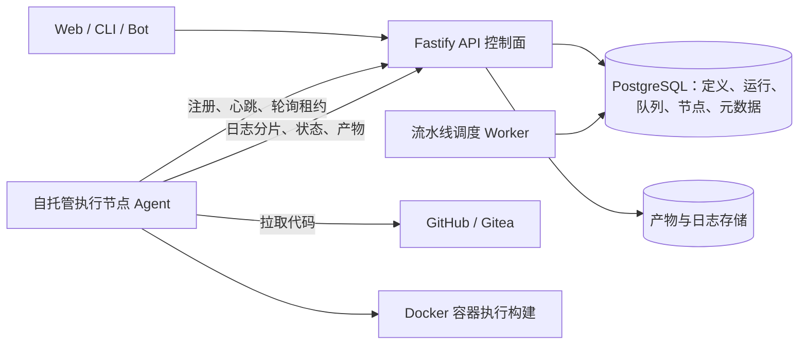
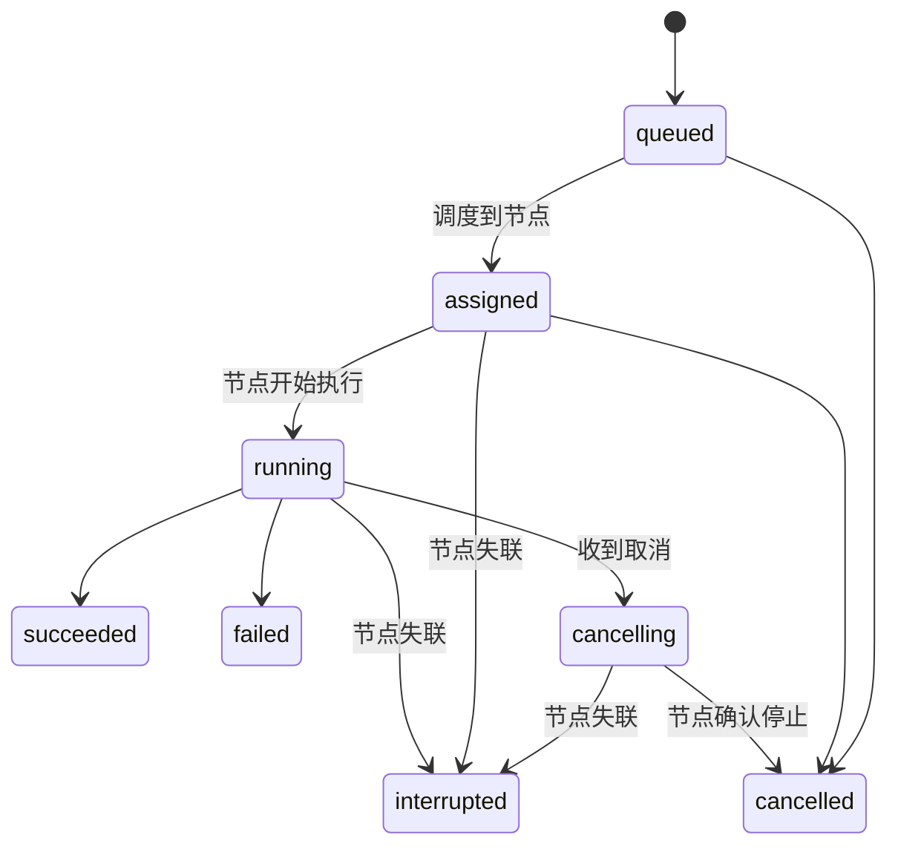

# 流水线功能规划草案

**平台内置流水线：平台拥有流水线定义、触发、运行、日志、产物与权限，构建在注册到平台的自托管执行节点上完成；不再以外接第三方 CI 作为主路径。**

| 属性 | 内容 |
| --- | --- |
| 状态 | 规划草案（平台内置方向）。2026-11-10 已确认：完全自研执行器、仓库内 YAML 定义、P1 使用本地开发机 Docker 节点、V0.4 拆 V0.4a／V0.4b；其余架构与决策待确认 |
| 负责人 | 项目维护者（产品取舍与验收） |
| 读者 | 项目维护者、参与 V0.2 至 V0.4 的研发与 AI 编码助手 |
| 范围 | 方向变更依据、平台内置流水线架构、执行节点、数据对象、构建目标、安全与凭据、页面、版本路线、待确认决策 |
| 关联 | [产品需求](mvp.md)、[版本规划](release-plan.md)、[V0.2 规格](../../specs/003-v02-code-delivery/spec.md)、[外部仓库接入](../architecture/external-repositories.md)、[后端技术选型](../architecture/server-foundation.md)、[项目图](project-maps.md)、[Git、PR 与流水线架构](../architecture/code-pr-pipeline-architecture.md) |

本文按 2026-11-10 项目维护者确认的方向编写：**流水线内置到平台，执行使用平台注册的自托管执行节点，首批覆盖 Web/Node、Docker 镜像、Flutter/Android、iOS 与小程序**；流水线定义使用仓库内 YAML 文件，格式参考 GitHub Actions 与 Gitea Actions 的工作流文件；P1 执行节点先用本地开发机 Docker；执行器完全自研，不引入 act 等第三方执行内核；版本拆分为 V0.4a 与 V0.4b。V0.2 其余范围照常，流水线部分（Phase 8）暂缓。

现有需求文档原先将“内置流水线编辑器与执行引擎”列为排除项，2026-11-10 已按第 3 章修订。第 1 至 2 章记录方向与现状，第 3 章记录已修订的条款，第 4 至 9 章是架构提案，第 10 至 13 章是代价、影响、决策与下一步。

## 1. 已确认的方向

1. **流水线归平台所有**：定义、触发、运行编排、状态、日志、产物、权限与审计都在平台内，不把外部 CI 的页面与状态当作主界面。
2. **执行使用自托管节点**：平台注册执行节点（自建 agent），任务下发到节点，由节点用 Docker 隔离执行；平台不直接把用户代码跑在 API 进程里。
3. **首批构建目标**：Web/Node（前端与后端服务）、Docker 镜像、Flutter/Android 安装包、iOS 构建、小程序构建与上传。
4. **V0.2 处置**：交付、产物、运行版本等其余范围照常；流水线 Phase 8（外部运行上报）暂缓，等内置方案确定后按新规格实现。
5. **与 Git 平台的关系**：GitHub/Gitea 继续作为代码来源，平台读取仓库、分支、提交并在节点上拉取代码；不再调用 GitHub Actions、Gitea Actions 等第三方流水线 API。
6. **定义放在仓库**：流水线使用仓库内 YAML 文件定义，格式参考 GitHub Actions 与 Gitea Actions 的工作流文件，随代码评审与版本管理；平台不提供绕过代码评审的线上编辑器。
7. **P1 节点**：最小闭环先注册本地开发机的 Docker 作为执行节点，后续再替换为长期在线的团队服务器。
8. **版本**：V0.4 拆分为 V0.4a（内置流水线执行）与 V0.4b（受控执行与发布）。
9. **执行器完全自研**：workflow 解析、表达式子集、运行计划与节点执行都由平台实现，不引入 act、Gitea Runner 等运行时。

> **Why & What - 控制面内置，执行面自托管**
>
> **What:** 平台自建流水线控制面（定义、调度、状态、日志、产物、权限），执行交给注册到平台的执行节点，使用 Docker 容器隔离。
>
> **Why:** 这是“平台内置”与“可落地”的交点。控制面决定产品归属和数据一致性；执行面复用团队已有机器，不需要平台自建云构建集群，也不需要为每家 CI 写适配器。执行节点可以在内网访问私有依赖与部署目标，移动端构建也能放在对应操作系统的机器上。
>
> **Alternatives considered:**
> - *平台完全自建云构建集群：* 最彻底，但要为构建资源、扩缩容、安全隔离和镜像维护长期投入，单人配合 AI 开发不现实。
> - *继续外接第三方 CI：* 最省力，但产品归属仍在第三方，与本次方向冲突。
> - *只在开发机本地跑：* 不需要节点，但无法多人共享、无法保留可追溯的统一运行记录。
>
> **Fallback:** 若执行节点短期无法到位，可以先在单台开发服务器上注册一个 Linux 节点完成最小闭环，后续再扩展节点与操作系统。

## 2. 现状：V0.2 没有接入第三方流水线

先回答一个容易混淆的问题：**V0.2.0 的实现没有把流水线接到 GitHub API 上**。

| 事实 | 依据 |
| --- | --- |
| V0.2 的流水线是“接收上报”：CI 或研发通过 CLI/HTTP 上报运行记录，平台存表并展示，不调用第三方流水线 API | [V0.2 规格用户故事 8 与 FR-074 至 FR-079](../../specs/003-v02-code-delivery/spec.md) |
| V0.2 明确不内置编辑器与执行引擎，不做触发、重跑、取消，也不自动拉取 CI 结果 | [V0.2 规格非目标](../../specs/003-v02-code-delivery/spec.md) |
| 2026-11-10 核对时，工作区的 `delivery` 模块只有构建记录、更正、产物、事项关联四张表，没有 `pipeline_run` 表，也没有流水线路由 | 工作区 `apps/server/src/modules/delivery/` |
| 流水线在 V0.2 计划中属于 Phase 8，2026-11-10 核对时尚未开始实现 | V0.2 计划中的交付切片 |
| V0.2 里的 GitHub/Gitea API 接入在 `code` 模块，用于读取仓库、提交与 PR；服务端没有 Actions/Workflow 调用 | 工作区 `apps/server/src/modules/code/` 与 `apps/server/src/adapters/git/` |
| 运行记录里的 `source: github_actions` 只是上报方自报的来源标签，平台不会反向调用 GitHub API | V0.2 数据模型 |

结论：现在既没有内置流水线，也没有第三方流水线集成，只有一层尚未实现的“被动记录”设计。因此**此时调整方向的返工成本最低**，需要处理的主要是文档口径与 V0.2 Phase 8 的暂缓，而不是删除已有代码。

## 3. 已修订的现有需求条款

以下条款原本与平台内置方向冲突，已于 2026-11-10 按确认口径修订。修订结果如下，供实现与评审核对。

| 文档位置 | 原条款 | 修订后 |
| --- | --- | --- |
| [产品需求第 6 章](mvp.md#6-流水线执行节点与提测的独立边界) | 研发自行配置流水线，平台收集归档展示结果，不在 MVP 中重建流水线编辑器 | 平台内置流水线；定义保存在仓库 YAML 中，执行在平台注册的自托管节点上；不调用第三方流水线 API |
| [产品需求第 11.1 节](mvp.md#111-github-与-gitea-适配) | CI/CD 通过独立运维操作对接执行系统，不内置流水线编辑器 | GitHub/Gitea 只承担代码来源；平台参考两边工作流文件格式，但不接 Actions API，也不承诺完全兼容 |
| [版本规划第 8.1 节](release-plan.md#81-收益成本与范围限制) | 内置流水线编辑器、提测自动构建部署继续排除 | 内置流水线移出排除项，写入 V0.4a；排除项改为平台托管云构建集群与弹性构建资源；提测与流水线仍保持独立 |
| [后端技术选型第 4.1 节](../architecture/server-foundation.md#41-代码平台-api-接入) | 不引入 Dagger 或自建 Runner 作为本次选型要求 | 改为自托管执行节点与容器隔离列入技术方案；执行节点、队列、日志与产物存储选型在规格阶段确定 |
| [外部仓库接入](../architecture/external-repositories.md) | 流水线由研发在现有 CI 中配置，平台接收结果 | 改为平台内置流水线；Git 连接只负责代码来源与拉取授权 |
| [V0.2 规格非目标](../../specs/003-v02-code-delivery/spec.md) | 不内置编辑器/执行引擎，不触发外部流水线 | Phase 8 与 US8 标注暂缓；V0.2 不实现流水线运行记录，由后续内置流水线规格承接 |
| [V0.4 范围](release-plan.md#63-v04a-内置流水线与-v04b-受控执行与发布) | 流水线主动调用是独立动作，生产影响进变更计划 | 拆为 V0.4a 内置流水线执行与 V0.4b 受控执行与发布；生产影响仍进入变更计划与人工放行 |

**V0.2 处置已执行**：V0.2 规格、计划与数据模型已标注 Phase 8 暂缓，用户故事 8 与 FR-074 至 FR-079 移出本版验收；实现方已收到通知。不新建 `pipeline_run` 表、不上报接口、不做页面与 CLI 命令。`delivery` 模块已建的构建记录与产物表与流水线无冲突，继续保留。外部 CI 上报模型可以在后续版本作为“导入”能力重新评估，不作为本期必做。

> **Why & What - 先改文档口径，再写代码**
>
> **What:** 在实现内置流水线之前，先修正需求、版本规划与 V0.2 规格中的排除条款。
>
> **Why:** 多线程并行开发时，AI 会以文档为权威依据。旧条款不修改，后续实现会继续走外部 CI 方向，造成返工和两套数据模型并存。
>
> **Alternatives considered:**
> - *先写代码再补文档：* 短期快，但会让并行实现方依据冲突的口径工作。
> - *只改 V0.2 规格不动需求：* 只能挡住本期，后续版本仍会按旧需求实现。
>
> **Fallback:** 若后续再调整方向，保留“先改文档、再改实现”的顺序，避免两套数据模型并存。

## 4. 产品形态与范围

### 4.1 平台负责与不负责

| 平台负责 | 第一版不负责 |
| --- | --- |
| 仓库内 YAML 流水线解析、触发与运行结果 | 云端构建集群、弹性扩缩容与托管构建资源 |
| 手动触发、运行编排、状态与超时控制 | 第三方 CI 平台的编排与同步（后续可作为可选导入） |
| 运行日志的采集、留存与查看 | 全量日志的长期归档（按保留策略保留） |
| 构建产物的上传、下载与权限 | 产物安全扫描、签名与合规审计 |
| 执行节点注册、心跳、能力匹配与停用 | 节点的自动扩缩容与自动升级 |
| 流水线权限、审计与凭据引用 | 生产发布放行（沿用运维变更计划） |

### 4.2 首批构建目标

| 构建目标 | 节点要求 | 主要工具链 | 产物与结果 | 建议阶段 |
| --- | --- | --- | --- | --- |
| Web/Node | Docker（P1 先用本地开发机） | Node 24、pnpm | 构建输出归档、测试报告、测试地址（可选） | P1 |
| Docker 镜像 | Linux + Docker/BuildKit | Dockerfile、镜像仓库 | 推送后的镜像标签（不托管镜像仓库） | P2 |
| Flutter/Android | Linux + Docker + Android SDK | Flutter、JDK、Gradle | APK/AAB 安装包 | P2 |
| 小程序 | Linux + Docker + Node | miniprogram-ci、上传私钥 | 上传后的版本号与体验码/二维码 | P2 |
| iOS | macOS + Xcode | Xcode、签名证书与描述文件 | IPA/归档产物 | P3 |

iOS 与小程序涉及证书、私钥与外部平台账号，凭据处理与签名流程单独设计，不能把证书明文放进流水线定义或日志。Windows 构建、GPU 任务、自动扩缩容不在第一版范围。

### 4.3 流水线定义的边界

流水线定义使用代码仓库内的 YAML 文件，格式参考 GitHub Actions 与 Gitea Actions 的工作流文件（2026-11-10 确认）。平台读取指定分支或提交上的定义，解析后执行；定义随代码评审、提交与回滚，平台不提供绕过代码评审的线上编辑器。

| 定义部分 | 内容 |
| --- | --- |
| 文件位置 | 仓库内工作流目录。是否同时支持 `.github/workflows`、`.gitea/workflows` 与平台自定义目录待规格确认（PL-Q01、PL-Q16） |
| 支持语法 | 平台定义的 Actions 风格子集：手动触发、jobs 与 needs、steps 的 `run`、`runs-on` 能力标签、`env`、简单条件与内置产物步骤；不承诺 Actions 全量语义 |
| 表达式 | 支持 `env`、`inputs`、`github`、`secrets` 的引用与简单条件；函数与复杂表达式后续评估 |
| 不支持项 | marketplace `uses`、matrix、services、缓存、reusable workflows 在 P1 明确报错，不静默忽略 |
| 运行固定 | 每次运行固定提交 SHA、工作流文件快照、步骤镜像版本与参数，保证可追溯 |
| 手动触发 | 参考 workflow_dispatch，支持分支或提交选择与有限输入参数 |
| 密钥 | YAML 中只引用平台密钥名称，不写明文；运行时由节点从平台获取短期值 |
| 版本与评审 | 定义变更通过 Git 提交与评审；平台展示文件路径、提交链接与解析结果 |
| 平台不做 | 不提供在线 YAML 编辑器，不保存可执行 YAML 的独立平台版本，不执行不受支持的语法与动作；自研执行器也不承诺 GitHub Actions 全量兼容 |

## 5. 架构：控制面与执行面

### 5.1 组件职责

| 组件 | 职责 |
| --- | --- |
| API（现有 Fastify） | workflow 文件读取、解析与校验、运行计划、触发、运行查询、节点注册管理、日志读取、产物下载鉴权、权限校验 |
| 调度 Worker（新增进程） | 从队列取待运行任务，按能力匹配节点，发放租约，处理超时、取消、节点失联与重试 |
| 执行节点 Agent（新增应用） | 注册与心跳、轮询租约、拉取代码、按运行计划启动容器与执行步骤、采集日志、上传产物、上报状态、响应取消 |
| PostgreSQL | 定义、版本、运行、步骤、队列、节点与产物元数据；第一版队列直接用数据库实现，不引入 Redis |
| 产物与日志存储 | 第一版本地磁盘目录（接口抽象），后续可切换 S3/MinIO 兼容存储 |
| Git 连接（现有） | 提供仓库与提交信息、签发短期拉取凭据；不承担流水线执行 |

### 5.2 一次运行的流程

1. 成员、CLI 或 Bot 在授权范围内触发，指定工作流、分支或提交、可选参数。
2. API 读取并校验工作流文件，解析表达式子集并生成运行计划；校验提交引用、权限与幂等键后创建运行与步骤记录，状态为 `queued`。
3. 调度 Worker 匹配在线节点能力，发放租约；节点轮询领取任务并开始心跳续约。
4. 节点获取短期 Git 凭据，拉取确定提交到隔离工作区，按运行计划启动容器与步骤。
5. 节点分批上传日志与步骤状态；平台即时更新运行状态，页面可实时查看。
6. 步骤完成后节点收集产物并上传，平台记录校验和、大小与保留期。
7. 全部步骤结束，运行进入成功、失败、取消或中断；页面与 CLI 返回最终结果。
8. 默认不自动改变需求、Bug、提测与运行版本；部署类步骤只在变更计划中启用。

### 5.3 调度与队列

- 第一版使用 PostgreSQL 队列（行锁与租约），不引入 Redis 或独立消息队列，避免新增运维组件。
- 调度按节点能力标签、节点并发上限、流水线并发上限与等待时间选择节点；节点离线时不派发。
- 租约需要续约，节点失联超过阈值后运行标记为 `interrupted`，已产生的日志与产物保留，重跑生成新的运行记录。
- 第一版不做自动扩缩容、优先级抢占与跨节点分片；并发上限由节点与项目配置控制。

### 5.4 执行节点协议（提案）

| 动作 | 方向 | 说明 |
| --- | --- | --- |
| 注册 | 节点 → 平台 | 使用一次性注册令牌换取节点身份与长期令牌；记录名称、操作系统、架构与能力标签 |
| 心跳 | 节点 → 平台 | 周期上报状态、负载与版本；超时视为离线 |
| 领取任务 | 节点 → 平台 | 长轮询或短轮询领取租约，平台返回运行、步骤、运行计划与短期凭据引用 |
| 上报状态 | 节点 → 平台 | 步骤开始、结束、退出码、错误摘要 |
| 上传日志 | 节点 → 平台 | 按序分片上传，平台负责脱敏与存储 |
| 上传产物 | 节点 → 平台 | 通过受控上传地址写入存储，返回校验和 |
| 取消 | 平台 → 节点 | 通过任务状态与轮询结果下发；节点尽力停止容器并确认 |
| 轮换与撤销 | 平台侧 | 节点令牌轮换、停用与删除；撤销后不再派发新任务 |

节点默认主动外连平台（HTTPS 轮询），不要求平台反向访问内网节点；后续如有实时性要求再评估长连接。

### 5.5 安全与隔离

- 平台 API 进程不执行用户代码；执行只发生在节点容器内。
- P1 每个任务在一个隔离容器中执行，步骤在容器内按序运行；限制 CPU、内存、进程数与磁盘，工作区按运行隔离并在结束后清理。后续如需更强隔离，再评估每步骤独立容器。
- 容器默认以非 root 运行，不使用特权模式；镜像构建类节点单独授予 Docker 能力，不把 Docker 套接字暴露给普通构建步骤。
- 拉取代码使用短期 Git 凭据；运行结束或撤销后凭据失效。
- 密钥在步骤启动时由节点从平台获取并注入，任务结束后清理；日志、错误摘要、活动记录与通知一律不出现明文。
- 平台记录每次触发、定义变更、节点操作与凭据使用，历史不可覆盖。
- 生产部署与生产环境访问不在普通流水线步骤内开放，后续通过变更计划与人工放行接入。

### 5.6 执行内核：完全自研（2026-11-10 确认）

结论：项目维护者已确认**完全自研执行器**，不引入 act、Gitea Runner 或其他 CI 引擎作为运行时依赖。执行器用 TypeScript 实现，代码放在节点 Agent 内；平台侧负责 workflow 读取、解析、校验与运行计划生成，节点负责容器与步骤执行。

开源实现只作为设计与能力参考，不进入运行时：

| 项目 | 可以参考什么 | 不引入的原因 |
| --- | --- | --- |
| [nektos/act](https://github.com/nektos/act) | workflow 文件组织、平台镜像映射、事件与输入上下文、产物收集方式 | 不提供节点协议；取消、超时等语义缺失，扩展受上游模型限制 |
| [Gitea Runner](https://gitea.com/gitea/runner) | 节点注册、能力标签、内置步骤、secret masking、产物与缓存服务设计 | 协议绑定 Gitea，需要 fork 并维护 Go 代码 |
| [GitHub Actions Runner](https://github.com/actions/runner)、[GitLab Runner](https://gitlab.com/gitlab-org/gitlab-runner) | 执行状态、日志流、取消与超时的产品表达 | 只对接各自控制面 |
| [Woodpecker CI](https://github.com/woodpecker-ci/woodpecker)、[Dagger](https://github.com/dagger/dagger) | agent 与引擎分层、容器调度与缓存抽象 | 控制面或流水线模型与平台不一致 |

自研范围（P1）：

1. workflow 读取与校验：读取指定提交上的 YAML，按平台 Schema 校验，不支持项明确报错。
2. 表达式子集：支持 `env`、`inputs`、`github`、`secrets` 的引用与简单条件；不支持任意函数与复杂表达式。
3. 运行计划：解析 jobs、needs 与 steps，固定提交与 YAML 快照，生成可执行计划；P1 任务串行，P2 再评估并行。
4. 节点执行：拉取代码、按计划启动容器与步骤、采集日志、收集产物、执行超时与取消、清理工作区。
5. 平台侧：运行状态机、日志与产物存储、权限与审计、Web 与 CLI。

明确不做（P1）：GitHub Actions 全量语义、marketplace `uses`、matrix、services、缓存、reusable workflows。需要时按版本单独评估，不在“兼容”名义下隐含实现。

技术方向：Node.js 24 与 TypeScript；平台侧与 Agent 共用的 YAML Schema 与表达式解析；YAML 解析库、Docker Engine 客户端、日志与产物打包库在规格阶段按项目依赖规范评估后确定，不为假设需求预建抽象。

验证方式：解析器与表达式子集做单元测试；容器执行、超时、取消、日志与产物用真实 Docker 集成测试；触发到产物的完整链路用端到端测试；取消后容器与工作区清理、日志脱敏、资源限制作为安全测试项。

> **Why & What - 完全自研执行器**
>
> **What:** 平台自己实现 workflow 解析、表达式子集、运行计划、容器执行、日志、产物、超时与取消，不依赖第三方执行内核。
>
> **Why:** 执行能力完全归平台所有，后续扩展不受上游语义与协议约束；Docker、Android、iOS、小程序与发布门禁可以作为平台一等步骤实现，而不是靠外部动作或适配绕行。
>
> **Alternatives considered:**
> - *act 内核加薄 Agent：* 上线更快、Actions 兼容更好，但取消、超时、`continue-on-error` 等语义缺失，扩展仍受上游模型限制。
> - *fork Gitea Runner：* runner 能力完整，但需要维护 Go 代码并替换 Gitea 协议层。
> - *部署现成 CI：* 控制面再次外置，与平台内置方向冲突。
>
> **Fallback:** 先锁定平台需要的 YAML 子集，不追求 Actions 全兼容；若后续确有直接运行现有 workflow 的硬需求，再在自研执行器之外增加 act 适配器，而不是替换自研主体。

### 5.7 自研执行器的边界与扩展方式

自研不等于重写 GitHub Actions。必须自研与明确不承诺的范围分开：

| 分类 | 内容 |
| --- | --- |
| 必须自研 | 解析与校验、表达式子集、运行计划、容器执行、日志、产物、超时与取消、节点协议、平台专属步骤 |
| 明确不承诺（P1） | Actions 全量语法、marketplace 动作、matrix、services、缓存、reusable workflows、复杂表达式函数 |
| 后续可加 | 并行任务、矩阵、缓存、更多内置步骤、K8s 或云端执行后端、act 兼容适配器 |

扩展方式：

- 新构建目标：新增节点镜像与能力标签，平台增加 `runs-on` 映射和平台步骤，不改执行内核。
- 新步骤类型：平台内置步骤（checkout、upload-artifact、docker-build、deploy 等）通过注册表扩展，YAML 写法保持稳定。
- 新执行后端：节点 Agent 与平台协议不变，后续可增加 K8s 或云端节点实现。
- 新语义：先扩展表达式与运行计划模型，再扩展执行器；不为未确认需求预建插件系统。

扩展性的关键不是把每一行代码都写成可配置，而是：运行计划是平台自有模型、节点协议稳定、内置步骤有注册表、日志与产物存储有接口。做到这四点，后续加语言、加步骤、加执行后端都不需要改控制面。

### 5.8 社区 runner 的策略对照

主流自托管 CI 的共同做法是“控制面 + 主动外连的 agent/runner”，平台不执行用户代码，代码在任务执行时由 agent 从 Git 拉取。差异主要在任务获取方式、隔离方式和扩展形态。

| 项目 | 控制面与执行面 | 任务获取 | 代码与工作区 | 隔离与扩容 | 可借鉴 |
| --- | --- | --- | --- | --- | --- |
| [GitHub Actions self-hosted runner](https://docs.github.com/en/actions/concepts/runners/self-hosted-runners) | GitHub 控制面，runner 在用户机器 | runner 主动轮询；注册令牌换 runner 身份 | workspace 在 runner，checkout 时拉取 | Docker 容器或宿主机；runner group/标签；临时 runner 与 ARC 扩容 | 注册令牌、标签路由、一次性工作区、临时 runner |
| [GitLab Runner](https://docs.gitlab.com/runner/executors/) | GitLab 控制面，runner 在用户环境 | runner 注册后轮询任务 | workspace 在 runner；`CI_JOB_TOKEN` 拉代码 | Docker、Kubernetes、Instance 等 executor；并发槽位与 autoscaler | executor 抽象、并发槽位、工件与缓存 |
| [Buildkite agent](https://buildkite.com/docs/agent) | Buildkite 控制面，agent 在用户环境 | agent 连接队列领取任务 | checkout 拉代码；agent hooks 扩展 | Docker、K8s agent stack；队列与优先级 | 队列路由、钩子扩展、agent 生命周期 |
| [Gitea Runner](https://gitea.com/gitea/runner) | Gitea 控制面，runner 在用户环境 | 注册后 daemon 轮询 | 任务工作区；`builtin:checkout` | Docker、Kubernetes、host；`runs-on` 标签；同类缓存与产物服务 | 标签映射、DinD 隔离、日志脱敏、内置动作 |
| [Jenkins](https://www.jenkins.io/doc/book/managing/nodes/) | controller 调度，agent 执行 | agent 连接 controller，或 controller 主动连接 | 节点工作区 | executors 并发槽位；K8s/云动态节点 | 把 agent 视为不可靠、executor 并发模型、节点健康检查 |
| [Woodpecker](https://woodpecker-ci.org/docs/administration/general) | server 解析 YAML，agent 执行 | agent 通过 gRPC 连接 server | agent 本地执行，Docker/K8s/local 后端 | Docker、Kubernetes、local；可选 autoscaler | 控制面解析 YAML、agent 只执行、autoscaler 后置 |
| Tekton/Argo（K8s 原生） | 控制器创建 Pod | 无长期 agent，控制器直接建 Pod | 工作区挂载或从 Git 拉取 | 每任务一个 Pod | 执行环境即容器；我们可先 Docker，后续再加 K8s 后端 |

共同策略：

1. 控制面与执行面分离，平台 API 不运行用户代码；agent 主动外连，避免平台反向访问内网。
2. 注册令牌换长期身份，配合心跳、标签或能力路由、队列与租约；节点被视为不可靠。
3. 代码不进入平台存储；agent 在任务时拉取确定提交，工作区临时且按任务隔离，失败或完成后清理。
4. 隔离优先用容器或 Pod；共享宿主机与长期工作区只在受控环境使用；临时 runner 更安全。
5. 日志分片上传、产物独立上传，密钥脱敏；取消和超时由控制面下发，节点尽力停止并上报真实结果。
6. 扩容与升级后置：先固定节点池与并发槽位，再评估 autoscaler、K8s、临时 runner 和版本自动升级。
7. 现成项目通常绑定自己的控制面；社区里“自研 runner”的团队大多长期维护 agent 生命周期、升级、日志与安全，不把 runner 当作短期附属品。

对我们的启示：当前“平台控制面 + 自托管 Agent + 平台侧解析 YAML”的方向与 Woodpecker 等实现一致；差异是我们把平台专属步骤与 YAML 子集作为一等能力，不引入现成 CI 引擎。P1 保持单节点、长驻 agent 与单任务容器；临时 runner、K8s 后端与 autoscaler 等扩展项按 P2/P3 评估。

## 6. 业务对象与状态

### 6.1 对象

| 对象 | 关键内容 | 说明 |
| --- | --- | --- |
| 执行节点 | 团队、名称、操作系统、架构、能力标签、状态、并发上限、心跳时间、Agent 版本 | 节点属于团队，可被多个项目复用 |
| 流水线定义 | 仓库、工作流文件路径、展示名称、默认分支 | 定义保存在代码仓库的 YAML 中，随提交变化 |
| 定义快照 | 提交 SHA、工作流文件内容、解析后的步骤与镜像、参数 | 每次运行固定提交与快照，保证可追溯 |
| 运行 | 工作流快照、运行计划、提交 SHA、分支、触发方式、发起人、状态、节点、时间、超时 | 一次执行一条记录，重跑生成新记录 |
| 运行步骤 | 序号、名称、状态、退出码、开始结束时间、日志引用 | 步骤状态独立于运行汇总 |
| 日志 | 运行、步骤、分片序号、存储位置、大小 | 数据库只存元数据，正文放存储 |
| 产物 | 运行、步骤、名称、类型、大小、校验和、存储位置、保留期 | 平台托管文件；与 V0.2 外部引用产物分开表达 |
| 任务租约 | 运行、节点、租约标识、过期时间 | 队列与调度的最小单元 |

以上为草案，字段、表名与约束在规格与计划阶段确定，并遵守项目数据库规范（无外键、中文注释、`timestamptz`、无 `SELECT *`）。

### 6.2 状态机

运行状态：

- `interrupted` 表示节点失联或平台重启等非正常结束，保留已有日志与产物，不能显示为成功。
- 取消是尽力而为，已发生的外部副作用（例如推送的镜像、上传的小程序版本）不能声称撤回。
- 节点状态：`pending`（待激活）、`online`、`draining`（排空）、`offline`、`disabled`。
- 流水线定义没有平台侧草稿、发布与归档状态，版本由 Git 提交决定；运行固定提交快照。

## 7. 页面与交互

| 入口 | 内容 | 关键操作 |
| --- | --- | --- |
| 项目／流水线 | 仓库内工作流列表、最近运行、运行历史 | 刷新解析定义、手动触发、查看运行；编辑跳转代码页或原仓库 |
| 运行详情 | 步骤时间线、实时日志、产物、提交与发起人、耗时 | 取消、重跑、下载产物、查看日志 |
| 工作流详情 | 文件路径、提交、支持语法与解析告警、最近运行 | 查看 YAML 文件、从指定分支或提交触发 |
| 能力／执行节点 | 节点列表、在线状态、能力标签、并发与版本 | 注册节点、查看安装命令、排空、停用、轮换令牌 |
| 产物与版本 | 运行产物下载、最新产物与环境运行版本 | 下载产物；运行版本仍由明确动作确认 |
| 运维／变更 | 部署类流水线的计划、放行与验证 | 后续版本接入 |
| Bot／CLI | 触发与查询同一套项目能力 | 触发需项目能力授权，结果回到会话 |

交互要求：不显示不能执行的按钮；节点离线、队列等待、日志中断与失败原因必须可区分；日志支持搜索与按步骤定位；桌面 1440×1000 与移动 390×844 核对；现有“外部流水线”原型页面需要按内置方案重新出设计稿。

## 8. 权限、凭据与审计

| 操作 | 浏览者 | 开发者 | 管理员 | 已授权 Bot | 执行节点 |
| --- | --- | --- | --- | --- | --- |
| 查看流水线与运行 | 可 | 可 | 可 | 可 | 仅授权任务 |
| 修改流水线定义 | 不可 | 通过 Git 提交与评审 | 通过 Git 提交与评审 | 不可 | 不可 |
| 刷新解析定义 | 可 | 可 | 可 | 可 | 不可 |
| 手动触发 | 不可 | 可 | 可 | 可（按项目能力） | 不可 |
| 取消运行 | 不可 | 本人触发或建议可 | 可 | 需单独能力 | 仅执行中任务 |
| 管理执行节点 | 不可 | 不可 | 可 | 不可 | 不可 |
| 下载平台托管产物 | 按项目可见性 | 可 | 可 | 按授权 | 不可 |

凭据分四类，分别管理：Git 拉取凭据（短期、按仓库授权）、项目环境变量与团队凭据引用（步骤运行时注入）、镜像仓库与外部平台凭据（如 Docker Registry、小程序上传私钥、Apple 签名证书）、执行节点令牌。平台只保存引用与元数据；明文只在运行时短暂使用，不进入数据库、日志、活动与通知。撤销后阻断后续运行，已运行任务按节点能力停止或报告仍在运行。

审计必须覆盖：定义解析与刷新、触发（含发起人、参数摘要、幂等键）、取消、节点注册与停用、凭据引用解析、运行结果与产物下载。历史记录不可覆盖。

## 9. 版本路线

| 阶段 | 内容 | 验收代表 | 依赖 |
| --- | --- | --- | --- |
| P0 需求与设计 | 修改需求与版本规划；产出内置流水线规格、数据模型与接口设计；确定首个节点环境、YAML 子集与表达式范围 | 文档口径一致，无排除条款冲突 | 本次方向确认 |
| P1 最小闭环 | 本地开发机 Docker 节点注册与心跳；自研 workflow 解析、表达式子集与运行计划；手动触发；拉取确定提交；容器执行；日志查看；产物下载；超时与取消；权限与审计 | 一个真实 Web/Node 项目在平台内完成构建，日志、产物与记录可追溯；节点离线时显式失败 | 调度 Worker、节点 Agent、存储 |
| P2 构建矩阵 | Docker 镜像构建与推送；Flutter/Android；小程序上传；节点能力匹配；多节点与并发上限 | 五类目标中的四类在对应节点完成构建，产物可下载 | P1 |
| P3 macOS/iOS | macOS 节点接入、Xcode 构建、签名与证书管理 | 一个 iOS 构建通过；证书不明文出现 | P1 与 Mac 机器 |
| P4 部署与发布 | 部署步骤、环境访问控制、与运维变更计划、人工放行、执行后核对运行版本 | 一次测试环境部署可完整追踪 | P2、凭据运行时、变更计划 |
| P5 体验与增强 | 自动触发（push/标签/定时）、通知、矩阵构建、缓存与并发优化、外部 CI 导入 | 按需排期 | P1 至 P4 |

版本归属已于 2026-11-10 确认：V0.4 拆成 **V0.4a 内置流水线执行**（P1、P2）与 **V0.4b 受控执行与发布**（P4），P3 视 Mac 资源与证书准备情况插在两者之间；V0.5 的原值守与通知范围不变，流水线失败可作为事件来源接入。

## 10. 收益与代价

收益：

- 流水线、运行记录、产物、权限与审计都在平台内，成员不需要在 CI 页面和平台之间切换。
- 内网依赖、私有部署目标与移动端构建可以直接在团队自己的节点上完成，不受第三方 CI 的网络与配额限制。
- 触发、定义、日志与产物使用平台既有权限、凭据与活动记录，不重复建设账号体系。
- Git 平台只作为代码来源，不需要为每家 CI 实现执行适配器。
- 流水线定义使用仓库内 YAML，开发者可以在原有编辑器与评审流程中维护。

代价与风险：

- 这是一个完整的执行系统：调度、队列、节点协议、容器隔离、日志、存储、取消与恢复，工作量明显大于“接入外部 CI”。
- 自研执行器需要长期维护 YAML 解析、表达式子集与兼容边界；不支持的写法要显式报错，避免“看起来像支持”。
- 执行器的质量与安全由平台自己承担：解析错误、容器逃逸、取消竞态与日志泄露都需要自己测试与修复，不能依赖上游项目兜底。
- 运行用户代码有安全风险，必须做好容器隔离、资源限制与凭据保护，否则会带来比外部 CI 更大的安全责任。
- 团队需要维护执行节点与构建镜像；iOS 与 Android 的工具链、证书和升级成本持续存在。
- 日志与产物需要平台存储，和 V0.2“产物只存引用、不托管文件”的暂定口径冲突，需要重新决策保留、容量与权限。
- 验收依赖真实节点与真实项目，模拟数据不能替代。
- 单人配合 AI 开发时，建议严格按 P1 至 P4 分期，每期形成可验收闭环，不要并行铺开五类构建目标。

明确不做：平台托管云构建集群、执行不受支持的任意 YAML、无隔离的宿主机执行、生产部署不经变更计划、自动把流水线结果写回需求与 Bug 状态。

## 11. 对现有实现与并行开发的影响

1. **V0.2**：Phase 8 暂缓；不建 `pipeline_run`、不做上报接口与流水线页面。已完成的交付、产物、运行版本部分继续。
2. **V0.2 规格**：Phase 8 已在规格、计划与数据模型中标注暂缓，用户故事 8 与 FR-074 至 FR-079 移出本版验收；实现方已收到通知。
3. **V0.3**：不受影响；Bot 在本版仍不能触发流水线，读取执行结果要等内置流水线落地后接入。
4. **V0.4**：拆分为 V0.4a 内置流水线执行与 V0.4b 受控执行与发布；V0.4a 范围按第 4 至 9 章重写。
5. **产物口径**：V0.2 的“只保存受控引用”继续适用于外部上报的产物；内置流水线的产物是平台托管对象，需要新增存储与下载权限设计，二者在数据模型上分开表达，不能混用。
6. **页面与原型**：现有原型流水线页是外部调用演示，需要按内置方案重新设计；不能直接复用演示数据与“运行流水线”按钮。

## 12. 待确认决策

| 编号 | 待确认问题 | 建议方向 | 最迟时点 |
| --- | --- | --- | --- |
| PL-Q01 | 仓库内 YAML 的支持范围：文件位置、Actions 语法子集、`uses` 动作、表达式与密钥引用 | 已确认使用仓库内 YAML（参考 GitHub Actions 与 Gitea Actions）；第一版只解析受支持子集，`uses` 先只支持平台内置动作，其余明确报错 | V0.4a 规格前 |
| PL-Q02 | 执行节点来源与维护责任 | 已确认 P1 使用本地开发机 Docker；P2 前评估长期在线的团队服务器，Mac 节点按 P3 准备 | P1 规格前 |
| PL-Q03 | 队列与调度实现：PostgreSQL 队列加独立 Worker，还是引入 Redis/消息队列 | 第一版 PostgreSQL 队列加独立 Worker，不新增组件 | P1 计划前 |
| PL-Q04 | 日志与产物存储：本地磁盘、S3/MinIO 兼容存储或混合 | 第一版本地磁盘加接口抽象，容量或多人使用后切对象存储 | P1 计划前 |
| PL-Q05 | 产物模型：与现有构建产物记录统一还是分开表达 | 平台托管产物与外部引用产物分开，统一由“产物”页面按类型展示 | P1 数据模型前 |
| PL-Q06 | 容器隔离与资源限制：每步骤独立容器、镜像构建的 Docker 权限、网络策略 | 每步骤独立容器并限制资源；镜像构建需单独能力标签，不使用特权容器 | P1 计划前 |
| PL-Q07 | 凭据注入：Git 拉取、项目环境变量、镜像仓库、小程序与 Apple 凭据的处理 | 全部以引用方式由节点在运行时获取，短期有效，日志脱敏 | P1 规格前 |
| PL-Q08 | 运行超时、取消、节点失联与重跑的语义 | 运行与步骤各自超时；取消尽力而为；节点失联标记中断并保留日志产物 | P1 规格前 |
| PL-Q09 | 触发方式：第一版是否只做手动触发；push、标签、定时何时加入 | 第一版只做手动，避免与提测、业务状态产生隐式联动 | P1 规格前 |
| PL-Q10 | 小程序上传与 iOS 签名的外部副作用与凭据管理 | 小程序上传在 P2 评估；iOS 签名与证书在 P3 单独设计 | P2、P3 前 |
| PL-Q11 | 自动触发与通知：是否允许推送即构建、失败通知 | 自动触发在 P5 评估；失败通知接入 V0.5 通知中心 | P5 前 |
| PL-Q12 | 版本安排 | 已确认 V0.4 拆分为 V0.4a 内置流水线执行与 V0.4b 受控执行与发布 | 已确认 |
| PL-Q13 | 需求文档修订 | 已于 2026-11-10 修订 mvp、release-plan、server-foundation、external-repositories 与 V0.2 规格 | 已完成 |
| PL-Q14 | 是否保留外部 CI 上报作为导入通道 | 保留为后续可选导入，不在第一版实现 | P5 前 |
| PL-Q15 | 本地开发机作为 P1 节点的安全边界：Docker 权限、节点令牌、休眠与离线处理 | 专用目录与账号隔离；节点令牌可撤销；休眠或离线时运行显式阻塞，不自动改派到未知环境 | P1 规格前 |
| PL-Q16 | 工作流文件的发现方式：固定目录、默认分支或指定分支解析、刷新时机与缓存 | 第一版支持一个固定目录，按触发时选择的提交解析；定义变化通过重新解析生效 | V0.4a 规格前 |
| PL-Q17 | 执行内核选型 | 已确认（2026-11-10）：完全自研执行器，TypeScript 实现，不引入 act 或 Gitea Runner 作为运行时 | 已确认 |
| PL-Q18 | 自研执行器的 YAML 子集与表达式范围：支持哪些字段、条件与内置步骤；不支持项如何报错 | 第一版只支持手动触发、jobs/steps、`run`、`runs-on`、`env`、简单条件与内置产物步骤；marketplace、matrix、services、缓存、reusable workflows 明确不做 | V0.4a 规格前 |
| PL-Q19 | 自研执行器的阶段边界与扩展方式：P1 是否串行、容器复用、镜像映射、平台步骤注册方式 | P1 串行任务、单容器执行、固定镜像映射；并行、缓存与更多步骤类型后置；不为未确认需求预建插件系统 | P1 规格前 |

## 13. 下一步

1. 确认 PL-Q01、PL-Q15、PL-Q16、PL-Q18、PL-Q19：YAML 文件位置、本地开发机节点的安全边界、工作流发现与刷新方式、YAML 子集与表达式范围、执行器阶段边界。
2. 编写内置流水线 V0.4a 规格，依次产出规格、计划、契约与任务。
3. P0 期间完成最小技术验证：自研解析器读取真实 workflow、表达式子集求值、本地开发机 Docker 节点注册、容器内执行构建、回传日志与一个产物、取消与超时。
4. 重新设计项目流水线页、工作流详情页、运行详情页与执行节点管理页。
5. V0.4b 的发布与变更计划沿用 M13，不并入流水线第一版。

本文第 1 章是确认的方向，第 2 章是工作区核对事实，第 3 章是已修订的条款，第 4 至 9 章是架构与版本提案，第 12 章记录已确认与仍待确认的决策点。

## 14. V0.4a 实现现状（2026-11-10）

V0.4a 已按第 12 章 PL-Q01、PL-Q03、PL-Q04、PL-Q06、PL-Q07、PL-Q08、PL-Q09、PL-Q15、PL-Q16、PL-Q17、PL-Q18、PL-Q19 的确认方向实现：仓库内 `.devops/workflows/` 的 YAML 子集在平台侧解析与校验、平台生成并固定运行计划、PostgreSQL 队列 + 独立 Worker + 租约调度、自托管节点 Agent 在单 Linux 容器内串行执行、日志分片与产物本地存储 + 鉴权下载、超时/取消/节点失联显式收口。执行器完全自研，不引入 act、Gitea Runner 或其他 CI 运行时。

本轮落地与提案的差异：

- PL-Q05 产物模型：平台托管产物独立成 `pipeline_artifact`，与 `delivery` 的外部引用产物分开表达，未做跨模块合并展示。
- PL-Q14 外部 CI 上报：按 spec A-05 决策直接下线（迁移 0020 删除旧表），未保留导入兼容路径；共享环境升级前需先导出确认。
- 表达式、`runs-on` 镜像映射、隐藏限制与内置步骤以 `specs/005-v04a-pipeline-runner/contracts/workflow-yaml.md` 为准；Agent 内部协议以 `contracts/agent-protocol.md` 为准，不进入公开 OpenAPI。

V0.4b（受控执行与发布：代码写操作、远端 PR、变更计划、人工放行、部署与版本验证）仍未实现，需单独建立规格；本文第 12 章的 PL-Q10、PL-Q11 等后续决策不随 V0.4a 完成而关闭。验收证据与未验证项见 `specs/005-v04a-pipeline-runner/evidence.md`。
