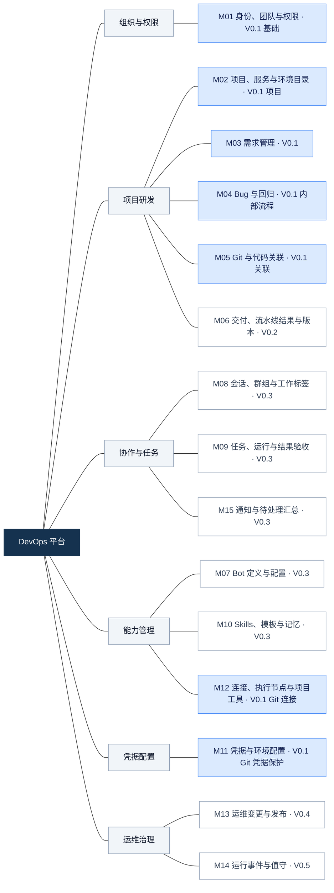
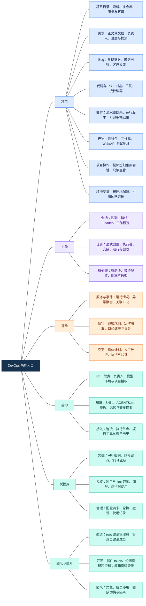
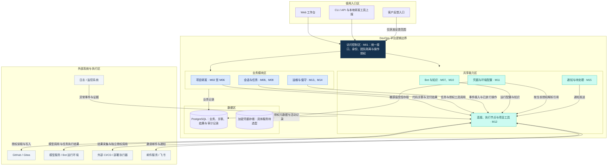

# DevOps 项目模块与功能图

本文用三张图整理整个项目的模块职责、功能入口和逻辑区域，供需求确认与开发拆分使用。范围覆盖完整 MVP，版本分配沿用规划草案；图中的功能不代表已经实现。

业务规则以[产品需求](mvp.md)为准，模块编号和版本范围以[需求版本规划](release-plan.md)为准，首版细节见 [V0.1 需求细化](v0.1.md)。图内 Mermaid 文本可直接编辑，在支持 Mermaid 的阅读器中预览。

## 1. 模块全景图

全项目分为 15 个业务模块。连线表示分类归属，不表示调用关系或开发顺序。蓝色模块在 V0.1 交付全部或部分基础功能；各节点标出的版本是规划中的首次交付版本。

V0.1 先完成团队、项目、需求、内部 Bug、真实 Git 关联及人工提测回归。服务与环境、完整代码浏览和交付在 V0.2 补齐；Bot 协作在 V0.3，受控执行在 V0.4，事件值守与外部协作在 V0.5，V1.0 核对完整 MVP。凭据保护和权限校验随首次接入交付，不等待完整管理页面。

## 2. 功能分解图

按用户使用入口展开功能。连线表示“包含”，不表示功能自动触发后续动作。一级导航为项目、协作、运维、能力、凭据库；团队与账号位于全局管理入口。功能分组用于阅读，不新增或重排现有页面页签。

项目内页签继续使用“需求、协作、代码、Bug、PR、流水线、产物与版本、环境变量”。项目协作复用原会话；项目环境变量复用凭据引用；通知返回原任务或业务记录。相同业务对象跨入口展示，不建立第二份状态。

## 3. 模块区域架构图

按使用入口、访问控制、业务、共享能力、数据以及外部系统分区。箭头表示主要访问和集成方向，双向箭头表示调用与结果交换；这里只画主要关系，不列出所有模块间接口。区域是逻辑职责，进程数量、服务拆分、部署节点和队列方案另行设计。

访问控制与审计覆盖每次操作，包括 Bot 工具调用和外部结果上报。M12 表示接入职责，不代表必须建设通用插件系统。加密凭据存储是安全职责边界，不预设独立服务部署；产物存文件还是存引用仍按需求待定项确认。技术方案见[技术选型与集成方案](../technical-selection.md)和[后端架构](../../server/docs/architecture.md)。

阅读三张图时保持以下业务边界：

- **提测与流水线独立。** 提测不触发、等待或重试构建部署；流水线结果不自动改写需求和 Bug 的业务进度。
- **最新产物与运行版本分别记录。** 服务可独立交付；运行版本需有实际依据。
- **开发验收与发布放行分开。** 变更需绑定具体计划，执行后验证健康与实际版本；数据库变更、服务器清理和云资源调整遵守同一框架，具体连接器另行确认。
- **聊天与任务分开。** 普通发言不自动变成任务；项目标签和资源引用不扩大会话、项目或凭据权限。
- **外部系统保留职责。** Git 系统托管代码，研发配置流水线；外部商店与小程序平台由成员人工提审，平台记录审核及发布结果。
- **已确认规则与待定细节分开。** 邮箱邀请及邮箱密码登录已确定；root 初始化、邀请有效期、资料必填项等继续在 V0.1 文档逐项确认。
