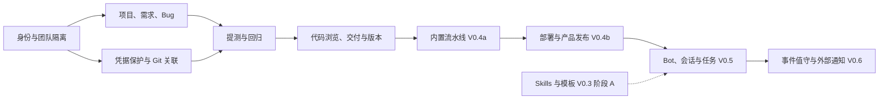

# DevOps 模块与需求版本规划

**以项目研发为首个可用场景，按业务成果划分版本，适用于一人配合 AI 逐项开发。**

| 属性 | 内容 |
| --- | --- |
| 状态 | 规划草案（2026-11-10 调整版本顺序：V0.4b 前置，Bots 与运维后移）；版本分配和新增建议尚未作为已确认产品要求 |
| 负责人 | 项目维护者，兼产品范围与版本验收负责人 |
| 读者 | 项目维护者、参与开发与核对需求的 AI |
| 范围 | 模块边界、功能优先级、版本范围、依赖、验收及待决策事项 |
| 关联 | [产品需求](mvp.md)、[交互原型说明](../desgin/interactive-prototype-v1/README.md)、[后端技术规划](../architecture/server-foundation.md) |

## 1. 规划结论

首个可用版本已完成“需求建立 → 开发跟进 → Git 关联 → 提测 → Bug 修复 → 回归”的研发流程；随后补齐代码浏览、交付结果、能力底座与内置流水线。按 2026-11-10 调整，下一阶段先完成项目管理写操作、流水线部署与产品发布（V0.4b），Bot 协作后移至 V0.5，值守与外部协作后移至 V0.6，仍属 MVP 最终范围。

项目维护者已明确：优先解决项目研发需求，开发方式为一人配合 AI。版本编号表示可验收的产品范围，不代表发布日期，也不改变 `/api/v1` 的接口版本。

[产品需求](mvp.md)继续维护业务规则；本文维护交付顺序。本文的模块划分、优先级、版本切片及默认处理建议均为提案。与原型表现或待定需求存在差异的地方，集中列在第 7 章，实施前再确定对应规则。

完整 MVP 对应本文的 V1.0。V0.1 至 V0.6 是逐步可用的内部版本，不能因为某项功能安排较晚，就将其从现有 MVP 范围中删除。

> **Why & What - 先交付项目研发流程**
>
> **选择：** 首版集中实现项目、需求、内部 Bug、Git 关联和人工维护的业务流转。
>
> **理由：** 这直接对应项目维护者选择的首要使用场景，也为后续 Bot 提供真实事项和交付记录。
>
> **备选：** 先做 Bot 对话与任务，可以更早验证智能体体验，但会推迟需求、提测和回归管理的实际使用。
>
> **代价与退路：** Bot 入口在后续版本开放。Git 接入可逐个平台开发验证，但 V0.1 的完整验收仍覆盖 GitHub 与 Gitea；暂未通过的一方明确标为未完成，不以手填链接替代真实接入验收。

## 2. 当前基础与规划依据

下表按 2026-11-10 的实现与已提交证据核对；本轮为文档调整，未重新运行全部检查。原型仍使用本地模拟数据，不代表已实现。

| 对象 | 核对结果 | 依据 |
| --- | --- | --- |
| 产品范围 | 覆盖项目研发、流水线、交付、凭据、能力（Skills／模板）等；Bot 与运维按本次调整后移 | [需求第 1 至 12 章](mvp.md) |
| 原型 | 使用本地演示数据，AI 回复、执行轨迹和外部操作为模拟 | [原型说明](../desgin/interactive-prototype-v1/README.md) |
| Web | 项目列表与项目工作区（需求／Bug／代码／PR／流水线／产物与版本／环境变量）、能力（Skills／模板）、凭据库、团队设置、节点管理、系统状态已实现；协作、运行事件、智能体页面未实现 | [路由](../../apps/web/src/app/router/routes.tsx)、[页面](../../apps/web/src/pages) |
| 后端 | identity、projects、requirements、bugs、code、collaboration、delivery、pipeline、configuration、integrations、knowledge、health 已注册，含流水线调度 Worker；公开 OpenAPI 133 个路径 | [业务模块](../../apps/server/src/modules)、[数据库 schema](../../apps/server/src/bootstrap/database-schema.ts) |
| 数据库 | PostgreSQL 18 + Drizzle 迁移已建立业务表（迁移至 0021）；尚无 Bot、会话、任务、通知、事件与变更计划相关表 | [迁移目录](../../apps/server/drizzle) |
| CLI | `devops` 已实现配置、健康检查、团队、项目、需求、Bug、Git／代码与交付上报命令 | [CLI 说明](../../apps/cli/README.md) |
| Bot | `apps/bot` 独立个人 Bot（DeepSeek + SQLite）可用；平台内 Bot 子系统尚未实现 | [Bot 说明](../../apps/bot/README.md) |
| 流水线 | V0.4a 控制面、调度 Worker、执行节点 Agent 与三个 Web 页面已交付，并完成本机 Gitea + Docker 现场验收 | 见文末实现现状补充、[验收证据](../../specs/005-v04a-pipeline-runner/evidence.md) |
| 验证 | V0.4a 记录：根目录 `pnpm check` 通过，服务端 85/85、Agent 59/59、协议 6/6、`test:db` 94/94、`test:e2e` 11/11（含真实 Docker 4/4）；真实 GitHub／Gitea 与非本机节点仍未验证 | [验收证据](../../specs/005-v04a-pipeline-runner/evidence.md) |

V0.1、V0.2、V0.3 阶段 A 与 V0.4a 的完成状态存放在文末补充章节；未验证的外部接入不能按通过处理。

## 3. 模块全景与优先级

页面导航沿用需求第 3 章：项目、协作、运维、能力、凭据库，以及团队管理和设置。导航负责组织入口；下面的模块负责划分业务职责，同一个模块可以出现在多个入口。

优先级用于解释交付顺序：P0 是首个研发版本必须具备的能力；P1 是研发日常使用及 Bot 协作的后续核心能力；P2 是自动化、外部渠道或增强能力。P2 中已经写入现有 MVP 的需求仍须在 V1.0 验收。权限、凭据保护、审计和失败处理随实际功能一起交付，不能因所属完整页面较晚上线而后移。

| 编号 | 业务模块 | 功能边界 | 主要入口 | 优先级与版本 |
| --- | --- | --- | --- | --- |
| M01 | 身份、团队与权限 | root 邀请管理员、邮件邀请及首次开通、邮箱密码登录、团队归属、团队三个角色、停用、最后管理员保护和团队隔离 | 团队管理、设置、全局鉴权 | P0：V0.1 基础、V0.2 团队资料与多团队切换（已交付） |
| M02 | 项目、服务与环境目录 | 项目资料与负责人、项目状态、多仓库关联、服务与环境标识 | 项目列表、项目工作区 | P0：V0.1 项目、P1：V0.2 服务和环境（已交付） |
| M03 | 需求管理 | 内置正文、外部文档链接、研发及测试负责人、业务进度、讨论、活动、筛选 | 项目／需求 | P0：V0.1（已交付） |
| M04 | Bug 与回归 | 内部建单、复现证据、需求关联、修复、回归、外部 Issue 关联；客户反馈渠道 | 项目／Bug、外部反馈入口 | P0：V0.1 内部流程（已交付）；P2：V0.4b 远端 Issue 关联、V0.6 客户入口 |
| M05 | Git 与代码关联 | GitHub／Gitea 连接、仓库授权、Commit／Issue／PR 关联、代码浏览及来源状态 | 项目／代码、PR，事项详情 | P0：V0.1 关联、P1：V0.2 完整读取（已交付）；P2：V0.4b 授权写入 |
| M06 | 交付、流水线与版本 | 开发交付、仓库内 YAML 流水线定义解析与运行记录、产物引用、服务环境运行版本、外部审核结果记录 | 项目／流水线、产物与版本，CLI/API | P1：V0.2 交付与版本、V0.4a 内置流水线执行（已交付）；V0.4b 部署执行与版本联动 |
| M07 | Bot 定义与配置 | 独立 Bot、职责、负责人、启停、模型、运行环境、项目能力授权 | 能力／智能体 | P1：V0.5（2026-11-10 后移） |
| M08 | 会话、群组与工作标签 | 私聊、群组、Leader、消息、资源引用、标签归集、项目只读协作 | 协作、项目／协作 | P1：V0.5（2026-11-10 后移） |
| M09 | 任务、运行与结果验收 | 显式建任务、单一当前执行者、交接、补充要求、运行轨迹、停止、结果、验收和待处理 | 协作／任务、待你处理 | P1：V0.5（2026-11-10 后移） |
| M10 | Skills、模板与记忆 | 团队技能启停、项目 AGENTS.md 模板、版本与作用范围、可修订的记忆和交接摘要 | 能力／Skills、模板、记忆 | P1：V0.3 阶段 A 已交付；P1 剩余与记忆：V0.5；P2：V0.6 记忆自动处理 |
| M11 | 凭据与环境配置 | 连接凭据保护、团队凭据引用、环境变量、Bot 授权、轮换撤销、配置请求和使用记录 | 凭据库、项目／环境变量 | P0：V0.1 Git 连接凭据（已交付）；P1：V0.5 完整配置流程；V0.4a／V0.4b 补齐流水线与执行侧行为 |
| M12 | 连接、执行节点与项目工具 | 连接状态、执行环境、调用权限、异步结果、取消与恢复；Web、CLI、Bot 共用业务能力 | 能力／连接与节点，项目工具 | P0：V0.1 Git 连接（已交付）；P2：V0.4a 执行节点与流水线执行（已交付）、V0.4b 代码与发布写操作；P1：V0.5 执行适配与平台业务工具 |
| M13 | 运维变更与发布 | 具体计划、人工放行、执行、状态核对、验证、失败处理与恢复方案 | 项目／流水线、运维／变更 | P2：V0.4b（下一版本，先验证一条部署链路） |
| M14 | 运行事件与值守 | 异常聚合、Bug 与任务关联、规则启停、定时触发、离线阻塞及恢复 | 运维／事件、值守规则 | P2：V0.6（2026-11-10 后移） |
| M15 | 通知与待处理汇总 | 待验收、配置请求、阻塞、发布结果、飞书通知和原记录跳转 | 协作／通知、待你处理、飞书 | P1：V0.5 站内（依赖任务）；P2：V0.6 外部通知 |

M12 是接入和执行职责，不要求建设通用插件平台。活动记录和审计随业务模块实现；CLI 是同一后端的操作入口，不另建一套业务状态。

### 3.1 业务记录的边界

以下边界来自需求第 4 至 10 章，详细规则仍由[产品需求](mvp.md)维护。开发时应先确认对象归属，再确定页面和接口。

| 对象 | 权威来源或维护者 | 与其他对象的边界 |
| --- | --- | --- |
| 需求、内部 Bug | 平台业务记录，成员维护业务进度 | Git 事件提供依据，不替代测试和回归结论 |
| 代码、Commit、远端 Issue、PR | 对应 Git 平台及实例 | 平台保存关联；来源状态与本地业务状态分别表达 |
| 开发交付、构建产物 | 实际上报或采集的结果与证据 | 可关联事项；构建成功不代表已部署 |
| 服务环境运行版本 | 经确认的运行版本来源，接入前按第 7 章确定 | 与最新产物分别展示，未知或过期结果不能伪装为当前版本 |
| Bot 任务、运行、验收 | 平台任务记录及真实执行结果 | 一次任务可有多次运行；任务验收与发布授权分开 |
| 会话和工作标签 | 原会话及其可见权限，标签负责归类 | 项目入口复用同一记录；标签和资源引用均不授予访问权 |
| 凭据及使用授权 | 受控凭据服务与当前授权记录 | 角色、群成员、Skill、项目引用不能替代使用授权 |
| 模板、Skills 与记忆 | 指令定义和有来源、范围的知识记录 | 不承担实时权限、业务状态或运行版本的权威来源职责 |
| 运维变更 | 具体计划、放行记录、外部执行及验证结果 | 验收开发结果不自动批准发布 |

## 4. 版本路线

每个版本交付一条可独立检查的业务路径。表中的验收是该版本的代表场景，仍需满足对应需求和权限边界。后续版本继承前序版本，不重复开发相同业务记录。

| 版本 | 状态 | 业务目标 | 本版交付范围 | 代表验收场景 |
| --- | --- | --- | --- | --- |
| V0.1 研发流程试用 | 已交付（截至 2026-11-10） | 用平台跟进一项需求和一次缺陷修复 | 身份与团队基础、项目、需求、内部 Bug、GitHub／Gitea 最小关联、人工提测和回归 | 创建需求、关联真实提交或 PR、指定测试负责人；提测后提出 Bug、修复并回归，刷新后记录与活动仍存在 |
| V0.2 代码与交付可用 | 已交付（2026-11-10，真实外部接入待验证） | 找到代码依据、可测产物和环境版本 | 代码与 PR 完整读取、服务和环境、交付上报、CLI、三类产物入口、外部审核结果记录 | 一项需求可追到提交和具体测试产物；新构建不覆盖正在运行的版本，提测仍可独立进行 |
| V0.3 能力底座（阶段 A） | 阶段 A 已交付（2026-11-10）；Bot 使用与阶段 B 后移 V0.5 | 让团队沉淀可复用的技能与模板 | 团队 Skills 目录、AGENTS.md 模板管理、版本与留痕；不依赖 Bot | 团队可发布／启停技能、维护模板并按项目选用；快照链接可预览 |
| V0.4a 内置流水线执行 | 已交付（2026-11-10，含本机 Gitea + Docker 现场验收） | 用平台自己的流水线完成构建与测试 | 仓库内 YAML 定义解析、执行节点注册与调度、手动触发、运行状态、步骤日志、产物、容器隔离、执行侧凭据 | 在注册的 Linux 节点上完成一次 Web/Node 构建，日志、产物与运行记录可追溯；节点离线或语法不支持时显式失败 |
| V0.4b 流水线部署与产品发布 | 下一版本（规划中，尚未建立规格） | 将项目管理结果变成可核对的部署与发布 | 项目写操作（受控代码修改、远端 Issue／PR／评论）、变更计划、人工放行、部署执行（可调用执行节点）、运行版本验证、凭据运行时使用 | 开发结果验收后单独建立部署计划，批准后执行，验证健康和实际版本后才完成变更 |
| V0.5 Bot 协作可用（后移） | 未开始（原 V0.3 剩余） | 让 Bot 围绕真实项目事项完成工作 | Bot、私聊和群组、显式任务、单一真实执行适配、验收、标签、项目只读协作、基础记忆、配置请求、站内待处理，以及 Skills／模板阶段 B | 从 Bug 创建 Bot 任务，Bot 读取授权资料并提交结果；人员验收或退回，转交保留历史，越权调用被拒绝 |
| V0.6 值守与外部协作（后移） | 未开始（原 V0.5） | 自动发现问题并交给已有业务流程 | 日志事件聚合、值守调度、自动建 Bug 与任务、飞书通知、客户反馈入口、经确认的记忆自动处理 | 重复告警归到同一问题；离线显示阻塞，恢复不重复执行；客户只能访问获准反馈范围 |
| V1.0 完整 MVP 验收 | 未开始 | 按现有需求形成可持续使用的内部产品 | 补齐已确认范围、连接器边界、保留与恢复规则，完成跨模块验收和真实接入核对 | 按需求第 13 章逐项留存证据，所有范围缺口均已实现或由产品负责人明确调整，不能用模拟成功通过验收 |

V0.4 拆分为 V0.4a（内置流水线执行）与 V0.4b（流水线部署与产品发布）两个可独立验收的阶段，共享 V0.4 标签，不改变 `/api/v1` 接口版本。2026-11-10 调整：V0.4b 前置为下一版本，原 V0.3 的 Bot 主线后移 V0.5，原 V0.5 后移 V0.6；MVP 范围不变。

> **Why & What - 分开关联与完整浏览**
>
> **选择：** V0.1 支持已授权仓库和事项的真实代码关联，V0.2 补齐目录、文件、分支浏览及完整 PR 详情。
>
> **理由：** 需求提测首先需要可追溯的代码依据。完整浏览增加页面与外部接口范围，可以在业务流程已可用后补充。
>
> **备选：** 将所有代码页面一起放入 V0.1，能更早覆盖原型，但会扩大首版验收面。
>
> **代价与退路：** 首版查看完整代码和评审时跳转来源平台。两种代码平台的公私有仓库、授权和实例隔离仍从首次接入开始验证。

### 4.1 版本依赖

V0.1、V0.2、V0.3 阶段 A 与 V0.4a 已交付。按 2026-11-10 调整，V0.4b 紧随 V0.4a；V0.5 的 Bot 复用 V0.1／V0.2 业务接口、交付记录与 V0.4b 的执行和授权框架，V0.6 再复用 Bot 任务与通知能力。

图表示 2026-11-10 调整后的主要交付顺序，不表示所有模块必须相互调用。单人开发按可验收切片推进，每完成一条前后端业务路径，再进入下一条。

## 5. V0.1 首版范围与交付顺序

**状态：已交付（2026-11-10）。** 以下保留首版范围与验收记录。

V0.1 的终点是团队能在平台内跟进一次真实需求提测和 Bug 回归。正式发布、Bot 执行和自动告警不作为这个试用版本的完成条件。

各模块的功能清单、业务流程、验收标准及待确认问题见 [V0.1 需求细化](v0.1.md)。本文保留版本范围，详细规则在该文档中逐项确认。

下面是需求切片顺序，不是代码实现任务。每一行都应形成可操作、可保存、可验收的结果；具体接口和数据表在该切片进入开发时再设计。

| 顺序 | 需求切片 | 首版范围 | 可观察的验收结果 |
| --- | --- | --- | --- |
| 1 | 身份和团队基础 | 按需求第 2.1 节实现 root 与管理员的邮件邀请链路、首次设置密码和资料、邮箱密码登录，以及团队角色、停用和归属 | 测试邮箱收到邀请，完成开通后进入首页并可用邮箱密码再次登录；浏览者写入被拒绝；最后管理员受保护；跨团队访问被拒绝 |
| 2 | 项目最小工作区 | 创建和编辑项目、负责人、项目状态、列表搜索和筛选；不要求先连接仓库才能创建项目 | 刷新后项目保留；状态按成员操作维护；创建项目不会在 Git 平台自动创建仓库 |
| 3 | 需求管理 | 内置正文或外部文档链接、研发主负责人、协作人员、测试负责人、状态、讨论与活动 | 创建需求后可重新打开和编辑；业务操作留存操作者与变化；外部链接的访问权限不因平台记录而扩大 |
| 4 | 内部 Bug 与回归 | 复现描述、必要证据引用、处理负责人、关联需求、修复和回归结果 | 可独立建 Bug，也可关联需求；回归失败可继续修复；外部 Issue 关闭不自动判定 Bug 已解决 |
| 5 | Git 最小真实关联 | 连接与凭据保护、选择已有授权仓库、关联 Commit／Issue／PR、来源标识和基础状态、打开原平台 | GitHub 与 Gitea 的公私有仓库分别通过验证；未授权关联被拒绝；不同实例记录不混淆；失效授权不返回缓存内容 |
| 6 | 研发流程串联 | 按确认的业务状态进行开发、提测、测试、修复和回归；明确每一步的负责人和结果 | 提测可以指定测试负责人；没有流水线也可提测；PR 合并和构建结果不自动推进业务状态 |
| 7 | 工作区使用验收 | 需求和 Bug 的组合筛选、右侧详情、关闭后保留列表条件、空状态、失败重试、只读反馈 | 同一记录不会因入口不同被复制；请求失败与无数据可区分；刷新、重新登录后结果一致 |

Git 基础状态只读取关联所需的标题、标识、来源状态等信息。V0.1 不承诺完整 diff、在线文件浏览、远端编辑或双向同步同一业务字段。远端字段的读取失败必须显示原因，不能用历史值冒充已同步。

首版 Git 连接已经涉及真实私有内容和凭据，因此受控存储、当前授权检查、日志脱敏与撤销处理随第 5 个切片交付。完整凭据库界面按第 3 章排期，不影响这些基础要求。

作为阶段性界面建议，V0.1 和 V0.2 登录后进入项目列表，未上线的模块隐藏入口或明确显示尚未开放。V0.5 具备真实 Bot 会话后，恢复需求第 3 章约定的默认协作首页。导航名称与最终产品结构保持可衔接，这项阶段性入口调整需要随首版范围一起确定。

### 5.1 首版端到端验收样例

使用一个测试团队、一项需求、一条 Bug 以及授权测试仓库进行核对。不同角色可由测试账号承担；开发人数不限制产品的多成员验收。

1. root 邮件邀请团队管理员，管理员再邮件邀请成员；首次受邀者设置密码及补全资料后加入，之后使用邮箱密码登录；浏览者只能读取获准信息。
2. 开发者创建项目与需求，填写研发负责人和验收内容。
3. 授权并关联已有仓库，关联真实 Commit 或 PR，能返回来源平台核对。
4. 将需求提测并指定测试负责人，确认没有因此创建构建或部署任务。
5. 测试人员创建关联 Bug，研发记录修复依据，测试人员记录一次回归失败，再记录通过结果。
6. 依据已确定的业务规则更新需求测试结论，活动历史能还原过程；不显示未发生的正式发布。
7. 刷新并重新登录，记录仍存在；切换为无权限身份或撤销仓库授权，受保护内容不能继续读取。

## 6. 后续版本的范围约束

各版具体模块分配以第 3、4 章为准。本章补充会影响验收的处理方式，以及可以延后但不能混淆的边界。

### 6.1 V0.2 的交付记录与真实版本

**状态：已交付（2026-11-10）；真实外部接入仍未验证。**

> **Why & What - 先上报交付结果**
>
> **选择：** 建议先通过统一 CLI/API 主动上报开发交付和构建结果，保存受控产物引用；手工录入使用同一后端业务入口。
>
> **理由：** 一种结果契约可以供人工和不同开发工具使用。现有交付过程继续负责生成、签名和存储文件，平台集中展示三类交付入口。
>
> **备选：** 拉取现有 CI 结果可以减少上报脚本，但需分别处理执行系统的认证、状态转换与失败核对；平台托管文件可以统一保留策略，但增加存储和访问控制范围。
>
> **代价与退路：** 研发需要接入上报步骤，未上报的结果不会自动出现。平台展示来源和采集时间并提供补报；后续按实际需要增加拉取或文件托管能力。

V0.2 不再包含外部流水线运行记录；流水线改为平台内置能力，由 V0.4a 承接。

验收至少包含以下场景：

- 同一结果重复上报不产生重复记录；错误项目、无权调用和非法产物引用被拒绝。
- 一个项目可以存在多个仓库与服务，各服务的测试、生产版本分别表达；映射规则在接入前确定。
- 已部署旧版本时出现新构建，运行版本保持原值；无法确认当前运行版本时明确显示未知或待核对。
- 产物访问受身份及来源授权约束，过期链接显示失效，不能由分享链接绕过权限。
- 外部提审、审核通过与实际发布分别记录。小程序或移动端提审仍由成员在外部平台操作。

PRD／Bug 是否固定关联某次产物属于待定产品规则。本文建议先允许可选关联，保留所测版本证据；未关联不阻止提测。该建议的最终结论写回需求第 12 章对应条目。

### 6.2 V0.5 的 Bot 协作与任务（原 V0.3 后移）

**状态：未开始。** 2026-11-10 调整：Bot 主线整体后移至 V0.5；Skills／模板阶段 A 已在 V0.3 交付，阶段 B 随本版交付。

Bot 使用已有项目业务能力，首批工具集中在读取资料、提交平台 Bug、添加平台评论和更新获准事项。普通聊天与显式任务分开，群组中的每个任务保留一位当前执行者，并记录明确交接。一次运行的模型、技能、执行者和结果需要可追溯。

执行适配先选择一种真实可用方案，统一任务及结果协议再供其他开发工具接入。浏览器关闭不丢失运行状态，失败、停止和执行者离线可区分；重启后能恢复待处理工作或明确标为待核对。能力缺失不能以演示回复代替执行结果。

验收至少包含以下场景：

- 无项目也能与 Bot 对话和完成通用任务；引用项目不会自动创建开发交付要求。
- 从事项进入已有活动任务，或显式新建任务；补充要求和转交保留既有结果及历史。
- 移出当前执行者后未完成工作受阻，转交对象受会话成员及实际能力约束。
- 项目协作按工作标签归集同一会话，并叠加原会话可见权限；仅引用项目不会让会话出现在该项目下。
- 成功交付后整理工作标签，优先复用现有分类；失败结果不自动归档，重复验收不重复创建标签，人工调整项目归属会同步影响归集。
- 技能停用后不能新调用；模板选择不写入远端仓库；记忆保留来源、范围、确认状态且可修订删除。
- 缺少配置时提出请求并进入等待，授权满足后才能继续；配置值不进入聊天和记忆。
- 任务结果可验收或退回；它与需求、Bug 的状态联动必须按第 7 章单独确定，不默认将关联事项全部标记完成。

### 6.3 V0.4a 内置流水线与 V0.4b 流水线部署与产品发布

**状态：V0.4a 已交付（2026-11-10）；V0.4b 为下一版本，尚未建立规格。** 2026-11-10 调整：V0.4b 前置，聚焦项目管理写操作、流水线部署与产品发布；运行事件、值守规则、服务监控与通知不属于本版。

V0.4a 交付平台内置流水线：定义保存在代码仓库的 YAML 文件中，格式参考 GitHub Actions 与 Gitea Actions 的工作流文件；平台解析定义，在注册到平台的自托管执行节点上用隔离容器执行，支持手动触发、运行状态、步骤日志、产物与并发限制。平台不调用第三方平台的流水线 API。执行节点、YAML 支持范围与日志产物存储由本版规格确定。

V0.4b 交付流水线部署与产品发布（受控执行与发布）：真实代码修改在独立执行环境中完成，保留工作分支、差异和验证结果，再调用远端 PR 能力。项目工具覆盖需求第 10.7 节的七类行为，由同一后端校验 Web、CLI 和 Bot 的权限。远端 Issue 创建另行授权，并与已有本地 Bug 建立关联。生产影响的操作进入具体变更计划，部署步骤可以调用平台执行节点或已接入的外部执行系统。本版保留“变更计划 → 人工放行 → 执行 → 版本验证”的发布主链路，不把运行事件、值守规则、服务监控与通知纳入范围。

建议先用一个真实部署目标验收计划、放行、执行和验证全过程。数据库变更、服务器清理和云资源调整也受相同操作框架约束，但每类实际执行仍需明确连接器和恢复办法。未接入的类型不能提供可执行按钮，也不能列为已完成；V1.0 前逐类记录支持范围和未决范围。

验收至少包含以下场景：

- 放行绑定具体版本、环境、资源和操作范围；计划变更后需重新确认，旧放行不能批准新内容。
- 每次调用检查当前授权；撤销后禁止后续使用，已经启动的外部操作如不能停止，明确报告仍在运行。
- 外部调用超时后先核对是否执行，避免盲目重试造成重复发布、重复 PR 或重复删除。
- 真实执行成功后仍验证健康与运行版本；验证失败不得标记整条变更完成。
- 运行时注入凭据与允许 Bot 读取明文分别控制，项目环境引用不能扩大团队授权。
- 仓库 YAML 语法不支持、执行节点离线、步骤超时与节点失联必须区分为显式失败或中断，不能显示为成功。

### 6.4 V0.6 的值守与外部渠道（原 V0.5 后移）

**状态：未开始。** 2026-11-10 由原 V0.5 后移，依赖 V0.5 的 Bot 任务与通知能力；自动触发（push／标签／定时）仍为 P5 评估项，不随本版承诺。

值守复用既有 Bug、任务与变更流程。日志系统提供聚合事件和必要证据，平台按约定规则去重、建单和分派；调度无需浏览器保持打开。飞书通知返回原记录，不另建业务状态。

客户反馈需确定身份、提交范围、可见内容及跟进方式。它进入平台 Bug 流程，但不授予内部成员权限或私有代码访问权。自动记忆处理应保留来源和作用范围，不能把推测直接写成已确认业务事实。

验收至少包含以下场景：

- 同一窗口内的重复事件增加次数和证据，不重复建立同一问题与任务；新事件按已确认规则识别。
- 暂停规则后不再触发，节点离线时保留阻塞状态；恢复与重复投递不产生重复执行。
- 任务、配置请求、发布结果的通知可回到对应记录，重复通知合并及失败重试按订阅规则执行。
- 客户不能枚举其他客户的反馈或读取内部讨论、仓库和凭据。
- 记忆修订和删除后的检索结果不继续将旧内容作为当前结论。

### 6.5 V1.0 的范围核对

V1.0 是完整 MVP 的验收标签，不承接没有定义的新功能。以[需求第 13 章](mvp.md)建立逐项核对表，记录目标版本、实际状态、证据及剩余差异。GitHub、Gitea 和各已承诺连接器必须分别验证，模拟数据和单一平台测试不能替代真实接入。

此前版本延期的需求继续保留在核对表中。2026-11-10 的版本顺序调整不缩减 MVP 范围：Bot 与运维仍属 V1.0 验收内容，只是分别后移至 V0.5、V0.6。需要缩减现有 MVP 时，由项目维护者明确修改需求范围；仅调整本文版本号不构成删除需求。备份恢复、已有数据升级、授权撤销、外部失败及后台任务恢复也应有实际验证证据。

## 7. 分版本收敛的需求决策

需求第 12 章仍是待定业务规则的权威清单。下表为这些问题安排决策时点，并给出可讨论的处理方向。项目维护者负责产品取舍和最终确认，AI 可以辅助对比、起草规则与核对一致性；这里的建议不等于已经确认。

“进入版本前”指相关需求切片开始实现前。后续版本的问题可以继续保留，不要求在 V0.1 开发前决定所有外部连接器和 Agent 技术细节。

| 需要确定的内容 | 最迟决策时点 | 建议处理方向与需要形成的结果 |
| --- | --- | --- |
| 账号开通、登录与邀请细则 | V0.1 身份切片前 | 主流程已按需求第 2.1 节确定；需继续明确 root 初始化及恢复、密码找回、资料要求、团队创建及邀请失效规则，确认记录见 V0.1 需求第 7.3 节 |
| 团队、项目和私有内容可见范围 | V0.1 项目及 Git 切片前 | 明确谁能读哪个项目及共享连接下的私有内容；沿用三个角色，不因该问题预建新的项目角色体系 |
| PRD、Bug 的状态和转换条件 | V0.1 事项切片前 | 为每个对象列出状态、操作者、前置条件和失败返回；技术调查、自测可先记录为过程信息，是否单独设状态由实际需要决定 |
| Bug 与远端 Issue 的权威关系 | V0.1 Bug／Git 切片前 | 建议本地维护 Bug 与回归、按需关联远端 Issue；明确分类和字段来源，避免默认双向覆盖 |
| Git 认证、实例版本和撤销时限 | V0.1 Git 切片前 | 确定两种平台的认证权限、目标 Gitea 版本、凭据存储和撤权检测时限；只读接入与后续写权限分别定义 |
| 事项列表与负责人规则 | V0.1 使用验收前 | 确定默认排序、稳定分页、负责人变更和首次项目选择；截止时间、提醒等未定功能单独列项，不作为隐式首版要求 |
| 多仓库与服务映射 | V0.2 服务切片前 | 明确服务对应仓库及部署单元的方式、跨仓事项引用与去重；保留一个项目关联多个仓库和服务的产品要求 |
| 产物采集、保存与事项关联 | V0.2 交付切片前 | 评审第 6.1 节的先上报、保存引用、可选关联建议；确定身份校验、有效期、保留及补报规则 |
| 运行版本、交付完成和审核结果 | V0.2 版本切片前 | 指定运行版本权威来源、核对证据和过期表达；定义多服务交付的完成条件，以及提审被拒后的处理 |
| 任务状态与业务状态联动 | V0.5 任务切片前 | 建议任务验收只直接改变任务，需求或 Bug 按独立业务动作推进；明确重复验收、退回、转交及项目通用任务的结果要求 |
| Agent 适配、资源引用与运行恢复 | V0.5 执行切片前 | 选定首个真实适配和运行环境；明确引用的团队、实例、仓库、版本标识，以及超时、用量边界、取消和中断恢复；Hook 以外保留主动上报 |
| Skills、模板与上下文 | V0.5 能力切片前（阶段 A 已按暂定口径交付） | 确定团队规则、项目模板和仓库规则的生效顺序、版本锁定及冲突处理；模板快照链接先限定访问范围，公开分享另行确定 |
| 凭据授权和记忆范围 | V0.5 配置切片前；执行侧凭据在 V0.4b 前 | 确定任务授权、限时授权、轮换撤销、审计保留及运行中凭据处理；记忆区分身份、项目约定和交接摘要，不记录密钥 |
| 流水线 YAML 与执行节点 | V0.4a 规格前 | 确定支持的 GitHub Actions／Gitea Actions 语法子集、文件位置、表达式与密钥引用方式；确定节点注册、能力标签、隔离与并发规则 |
| 日志与产物存储 | V0.4a 计划前 | 确定本地磁盘或对象存储、保留期、容量上限与下载权限 |
| 发布确认人与执行连接器 | V0.4b 对应操作实现前 | 明确既有角色中的谁可确认何种具体计划；逐类确定部署、数据库、清理、云资源的实际连接器与失败核对，不按按钮存在推定已接入 |
| 告警、值守与飞书通知 | V0.6 对应切片前 | 确定事件指纹、聚合窗口、触发条件、退避、通知订阅和连接身份；给出重复触发、节点离线和回传失败时的业务结果 |
| 客户反馈 | V0.6 外部入口前 | 确定客户身份、附件、可见范围、对外回复及关闭规则；与内部讨论、代码访问分别授权 |
| 业务附件与储存桶 | 已在 006 特性落地 | 内部需求/Bug 附件、本地默认桶与平台级 S3 兼容桶接入已实现；对外客户入口的附件支持与版本归属仍需确认 |
| 自动记忆与第三方技能来源 | V0.6 对应增强前 | 先确认是否进入本轮范围，再规定提取、确认、召回、删除、技能导入和更新方式；未确认不承诺自动化效果 |

### 7.1 原型与需求之间的口径核对

以下差异会影响开发验收，需要作为需求决策处理。本次保留原型与原需求文件，只在此记录建议。

| 口径问题 | 现有依据 | 建议收敛方式 |
| --- | --- | --- |
| 项目协作是否能发送或使用输入区 `@` | 需求第 3 章要求项目协作只读，第 13 章仍有“在项目会话用 `@` 选择执行者”的表述 | 项目入口保持只读；发送、管理及执行者选择在全局协作完成，并能返回同一会话 |
| Bot 任务验收是否代表需求完成 | 原型说明写有“验收通过后才将关联事项标记完成”；需求第 5、12 章仍要求确定业务完成判定 | 明确任务验收与业务测试、正式交付的独立条件，不能由统一“完成”动作覆盖全部状态 |
| 有项目的任务是否都必须提交开发产物 | [原型任务表单](../desgin/interactive-prototype-v1/workspace.js)按是否有关联项目选择开发交付，并要求产物；需求第 10.5 节区分通用结果与代码交付，涉及构建才附产物 | 按任务性质要求结果，有项目的资料调查仍可提交文本；开发交付仅在涉及构建时要求对应产物 |
| 原型中的增强交互是否全部进入 MVP | 原型还展示朗读、点赞点踩、页面框选批注等；需求正文未逐项确认其业务规则 | 单独登记为候选增强项，确认价值和验收规则后再安排版本；不自动扩大首版范围 |

## 8. 范围管理与版本验收

需求管理建议采用“模块 → 功能 → 验收场景”的层级。一个模块可以跨版本交付，版本应记录具体功能范围，不能只写“完成 Bot 模块”或“完成运维模块”。

每个进入开发的功能至少保存以下信息，直接放在需求文档或后续项目事项中即可，无需先建设新的管理系统。

| 字段 | 需要记录的内容 |
| --- | --- |
| 目标场景 | 谁在什么条件下完成什么工作 |
| 业务归属 | 所属模块、权威业务记录、对应需求章节 |
| 交付安排 | 优先级、目标版本、前置功能和待决策事项 |
| 范围 | 本次支持的操作、结果与明确延后的部分 |
| 权限及状态 | 可执行者、资源范围、状态前置条件和实际副作用 |
| 验收 | 正常、失败、越权、重复操作及恢复场景中可观察的结果 |
| 完成证据 | 可操作页面、真实 API 结果、持久化记录和相应验证结果 |

版本验收需要同时满足以下条件：

1. 本版范围逐项可操作，页面、后端和持久化使用同一业务记录。
2. 涉及外部系统的功能有实际授权环境验证；明确记录不支持和未验证的部分。
3. 服务端校验身份、归属和权限；错误、失效授权及重复请求有明确结果。
4. 新增持久化验证空库初始化和已有数据升级，关联一致性遵守项目无外键约定。
5. 按实际改动范围执行[项目验证要求](../../AGENTS.md#验证与交付)，不将未执行检查标记为通过。
6. 文档和需求反映实际支持范围，保留未完成项；试用版不会宣称完整 MVP 已交付。

### 8.1 收益、成本与范围限制

这条顺序先完成项目管理、流水线部署与产品发布，再让 Bot 操作已经存在的需求、Bug 和交付记录，最后接入值守与外部渠道。模块边界与验收场景也便于一人配合 AI 逐项推进，减少同时维护多个未完成流程的负担。

代价是 Bot 对话和自动值守较晚可用，首版仍依赖成员维护业务进度；两种 Git 平台仍需分别接入和验证；内置流水线需要团队维护执行节点与构建镜像。版本拆分还要求维护阶段性入口、前序数据兼容和跨版本回归，不能把这些工作转化为范围遗漏。

现有需求排除的平台 Git 托管、平台托管的云构建集群与弹性构建资源、提测自动构建部署、自动向外部平台提审、无限递归 Bot 调度继续遵循原范围。内置流水线改为平台能力（V0.4a），执行节点由团队自托管；公开技能市场、全量双向同步、面向所有客户的通用权限系统等未确认扩展需另立需求，不纳入本轮版本承诺。

版本顺序按 2026-11-10 调整执行：V0.4b 为下一版本，Bot 与运维分别后移至 V0.5、V0.6。本文仅形成规划，不表示后移功能已经实现；已完成版本以文末补充章节为准。

## 补充：CLI/API Token（2026-11-10）

v0.1.0 交付 `devops` CLI、个人页面 API Token 与本地配置；详细范围见 [002 规格](../../specs/002-cli-business-commands/spec.md)（工作区 `specs` 目录）。

## 补充：V0.2 实现现状（2026-11-10）

V0.2「代码与交付可用」服务端与 Web 主体已实现：代码/提交/PR 完整读取、服务与环境目录、交付上报与三类产物入口、运行版本确认与更正、外部审核与实际发布分离记录、团队凭据库与项目环境变量、团队资料维护、项目首页活动晴雨表；CLI 提供 `delivery` 与代码读取命令，`--json`/退出码/Token 规则沿用 CLI 契约。提测只做需求状态流转，不依赖产物、流水线或审核记录。

流水线范围存在规划调整待确认：本版实现保留了「外部流水线运行记录」以支撑产物与运行版本追溯；最新规划同时提出 V0.4a 平台内置流水线执行。两者不冲突，但 V0.2 是否继续保留外部运行记录入口、或收窄为只读展示，需要在 V0.4a 设计启动前确认并同步规格与实现。

验收证据与未验证项见 `specs/003-v02-code-delivery/evidence.md`。

## 补充：V0.3 Skills 与模板交付口径（2026-11-10）

V0.3 能力模块的 Skills 与 AGENTS.md 模板按两阶段交付：

- **阶段 A（已实现，可独立验收）**：团队技能目录、发布/编辑/启停、SKILL.md 与技能包资源、模板目录、新建/编辑/副本、项目选用、快照预览链接、版本与变更留痕；不依赖 Bot、会话与任务。
- **阶段 B（依赖 M07/M09，门禁未通过）**：技能进入 Bot 配置与调用候选、停用生效、项目模板在 Bot 运行中生效、运行记录固化技能与模板版本。依赖未交付前只保留知识侧解析接口，不宣称"已被 Bot 使用"。

已确认口径：V3-Q01/03/04/05/07/08/09/10 按规格暂定口径执行；V3-Q06（模板与仓库 AGENTS.md 合并/覆盖顺序、版本锁定）与 V3-Q11（运行中版本固化细节）在阶段 B 开工前确认。记忆、第三方技能导入、公开分享/公网发布、模板回滚与远端 `AGENTS.md` 写入不随本规格交付。详见 `specs/004-v03-skills-agents/spec.md` 与验收证据。

2026-11-10 调整：Bot 主线整体后移至 V0.5，阶段 B 随 V0.5 交付；阶段 A 保持已交付状态。

## 补充：V0.4a 内置流水线执行实现现状（2026-11-10）

V0.4a「内置流水线执行」主体已实现，拆分为控制面、调度 Worker、执行节点 Agent 与 Web 页面四部分：

- **控制面（`pipeline` 模块）**：读取仓库 `.devops/workflows/` 内 YAML、按平台声明子集校验并生成运行计划；手动触发时固定提交 SHA、工作流快照与运行计划；运行列表/详情、取消、日志读取、产物上传与鉴权下载、节点注册/排空/停用/令牌轮换；权限、审计、脱敏与幂等约束在服务端落实。
- **调度（`entrypoints/worker`）**：PostgreSQL 行锁 + 租约调度，按 `runs-on` 能力匹配在线节点，收口步骤/运行超时、节点心跳超时、租约过期与排队超时；同一运行至多一个活动租约，单节点并发上限内不超配。
- **执行节点（`apps/pipeline-agent`）**：主动外连平台，一次性注册令牌换节点令牌；用短期 Git 凭据检出固定提交，在单个非 root Linux 容器内串行执行步骤，回传状态、日志分片与产物；支持取消、步骤/运行超时、清理与内存态密钥脱敏。容器不挂载宿主机 Docker socket。
- **Web**：项目流水线页（工作流与解析状态、触发、运行历史与筛选）、运行详情（步骤时间线、日志轮询、产物、取消）、团队设置中的执行节点管理。

**决策与偏差**：旧 `delivery` 外部流水线上报按 A-05 下线，迁移 0020 删除旧表（本机旧表 0 行，无生产数据；共享环境升级前先导出确认）；Agent 内部协议端点不进入公开 OpenAPI，契约以 `specs/005-v04a-pipeline-runner/contracts/agent-protocol.md` 为准；日志 `afterSeq` 默认 `-1`（从 seq=0 返回）。

**验证与未验证**：真实 PostgreSQL 集成测试（触发幂等、调度租约、日志、产物、取消、安全矩阵）、真实 Docker 执行与取消/超时、Agent 协议端点联调；真实 GitHub/Gitea 私有仓库拉取、非本机 Linux 节点与镜像拉取网络路径未在本次环境验证，显式标记。验收证据与未验证项见 `specs/005-v04a-pipeline-runner/evidence.md`。

### 补充：V0.4a 现场验收（2026-11-10）

在自动化测试之外，另起一套真实环境完成 V0.4a 现场验收并通过：本地构建并运行真实 Gitea 28.3.0（私有仓库、真实 Token），平台以 Server、Worker、Agent 三个独立进程 + 真实 PostgreSQL/Docker 运行。

- 真实执行闭环：触发 → 调度 → Agent 容器执行 → 日志（首片 seq=0）→ 产物下载 SHA-256 一致；长运行（约 2 分钟）成功。
- 取消：运行中取消后 Agent 心跳收到指令并停止容器，终态 `cancelled`；带原因取消返回原因，无原因返回 null（D10）。
- 中断：强杀 Agent 后心跳超时，Worker 收口 `interrupted`/`NODE_OFFLINE`；遗留任务容器在 Agent 重启时被启动清理删除（D9）。
- 节点注册的操作系统/架构在节点视图正确展示（D8）。
- Web 经真实后端浏览器登录与三页操作通过；修复了日志首片、终态展示与「根路径/深链登录重定向」等真实联调缺陷。

仍未验证：真实 GitHub 接入、非本机 Linux 生产节点、镜像联网拉取、Web 浏览者视角。详见 `specs/005-v04a-pipeline-runner/evidence.md`。

## 补充：2026-11-10 版本顺序调整

项目维护者确认的交付顺序调整：先完成项目管理、流水线部署与产品发布，Bot 协作与运维值守后移；MVP 范围不变。

- **前置**：V0.4b 改为「流水线部署与产品发布」，为下一版本。保留变更计划、人工放行、执行与版本验证这条发布主链路；项目写操作（受控代码修改、远端 Issue／PR／评论）随本版补齐。
- **后移**：原 V0.3 未交付的 Bot 主线（M07、M08、M09，以及 M10 阶段 B、M15 站内待处理）移至 V0.5；原 V0.5 的事件、值守、通知与客户反馈移至 V0.6。延迟的“运维模块”仅指运行事件、值守规则、服务监控与通知，不含本次保留的发布放行链路。
- **已完成状态**：V0.1 研发流程、V0.2 代码与交付可用、V0.3 阶段 A（Skills／AGENTS.md 模板）、V0.4a 内置流水线执行均已交付；CLI 与独立个人 Bot 可用；平台内 Bot 子系统、运行事件与值守尚未实现。
- **未改变**：完整 MVP 仍对应 V1.0，后移模块继续列入 V1.0 核对；V1.0 前逐项记录真实接入证据。V0.4b 尚需单独建立 spec／plan／tasks。

## 补充：V0.4b 实现现状（2026-11-11）

V0.4b「流水线部署与产品发布」已建立规格（`specs/007-v04b-deploy-release/`）并完成主体实现：项目写能力与授权、受控代码修改与远端 PR/Issue/评论、变更计划与人工放行、部署执行与健康/版本验证、运行时凭据按环境解析、变更历史与事件，以及 Web 运维/变更页面、代码变更与远端写入口、CLI `change`/`tool` 命令组。

- 数据库迁移 `0022_v04b_deploy_release.sql` 已在本地 PostgreSQL 18 完成空库迁移验证；`apps/server` 113/113 单元与 HTTP 测试、99/99 数据库集成测试通过。
- **未验证**：真实 GitHub 写权限、真实 Gitea PR/Issue/评论现场验收、非本机执行节点、生产环境部署与自动回滚、外部执行系统连接器；上述项不得按已通过处理。
- 设计确认稿（规格 T026）仍待项目维护者确认；页面按既有设计模式与契约实现，确认后需复核视觉与交互细节。
- 本版不包含 Bot（V0.5）、事件值守与通知（V0.6）；外部执行系统仅保留计划记录，不提供可执行连接器。

## 补充：体验审计与自举迭代（2026-11-11）

以 dev-ops 平台自身作为自举项目，完成一次需求→开发→提测→测试验收，并修复全量体验审计问题。范围与证据见 `specs/008-platform-ux-iteration/`。

- 修复 P0：忘记密码链路、变更计划“部署版本”缺少服务选择。
- 修复服务端/CLI 关键缺陷：重复邀请 500、幂等跨团队误冲突、`team list` 恒为空、代码/PR 读取命令缺失、`--json` 参数错误、`--all` 静默失效。
- 修复 Web 明显体验问题：页签与晴雨表标签不可见、页头布局、长表单固定底栏、弹窗焦点归还、移动抽屉、搜索丢字、移动端代码页与登录布局、个人资料缺修改入口。
- 流水线新增 `platform-smoke` 工作流并完成真实运行；Agent 修复代理环境不透传导致无法检出代码的问题。
- 未完成与未验证项见 `specs/008-platform-ux-iteration/evidence.md`，不得按已通过处理。
