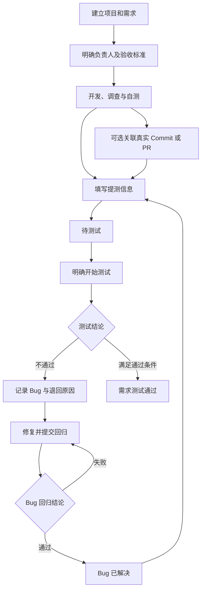

# V0.1 项目研发需求细化

**让内部团队完成需求管理、Git 关联、提测、Bug 修复和回归，并保留可追溯的业务记录。**

| 属性 | 内容 |
| --- | --- |
| 状态 | 需求细化中；Q01 的邀请开通及邮箱密码登录已确认，Q02 的邮件发送方式已确认，其余细则按第 7 章继续确认 |
| 负责人 | 项目维护者，负责范围、业务规则和验收口径 |
| 读者 | 项目维护者，以及后续参与开发和验证的人员或 AI |
| 范围 | V0.1 功能清单、字段要求、业务流程、验收标准和待确认问题 |
| 关联 | [产品需求](mvp.md)、[版本规划](release-plan.md)、[交互原型说明](../desgin/interactive-prototype-v1/README.md) |

## 1. 目标、边界与阅读方式

V0.1 交付一条真实研发流程：成员建立需求，关联开发依据，提交测试，记录缺陷，修复并回归，最后留下测试结论。代码开发继续在现有开发工具中进行。

本轮只细化需求，不实现代码、不设计数据库或具体 API、不估算工期。已确认部分见第 7.3 节；其余账号细则、状态、表单和权限仍属于建议，不能因为本文列出了验收场景就视为已确认。

本文采用产品需求中的既有约束及项目维护者的逐项确认。Q 编号用于追踪决定，确认状态以第 7 章为准；尚未确认的字段、列表和交互细节仍可修改，统一归入对应模块的 Q 项。

### 1.1 范围与依据

本次依据为 2026-11-09 工作区的需求与版本规划，工程参考提交为 `640350a8767a9f82921b6cd3261d71389e07aa27`。原型表现只作为交互参考，不替代业务规则；功能实现状态沿用[版本规划第 2 章](release-plan.md#2-当前基础与规划依据)，本次未验证业务运行。

| 依据 | 本文采用的范围或约束 | 对应内容 |
| --- | --- | --- |
| 产品需求第 2 章 | 管理员、开发者、浏览者；业务职责不等于额外角色；保护最后一位正常管理员 | 第 3、4.1 节 |
| 项目维护者于 2026-11-09 对 Q01 的确认，已同步产品需求第 2.1 节 | root 邀请团队管理员，管理员邮件邀请成员；首次设置密码和补全资料，以后邮箱密码登录 | 第 4.1、7.3 节 |
| 产品需求第 3 至 5 章 | 项目、事项详情、研发过程、内置正文与外部文档、Git 关联 | 第 4.2 至 4.5 节 |
| 产品需求第 6 章 | 提测不触发或依赖流水线，外部执行结果不自动推进业务状态 | 第 4.6、5 节 |
| 产品需求第 9、11.2、12 章 | Bug 修复与回归；本地 Bug 和远端 Issue 的权威关系仍待确认 | 第 4.4、7 节 |
| 版本规划第 4、5 章 | V0.1 包含两种代码平台的最小真实关联，完整代码浏览与交付管理后置 | 第 2、4.5、6 节 |

本版包含 Git 连接所需的凭据保护及授权管理。完整凭据库、服务环境、产物管理、CLI 业务命令、Bot、协作群聊、自动通知、运维执行和客户反馈入口按[版本规划](release-plan.md#4-版本路线)交付。

外部文档与测试入口可以先以普通链接和说明保存；本版不承诺抓取外部正文、托管安装包、上传业务附件或同步外部审核（V0.5 起支持业务附件与储存桶，见 Q09 修订）。账号开通包含头像设置，其方式及是否必须主动设置仍待确认，不与业务附件范围混为一项。正式发布不属于 V0.1 的完成判定。

### 1.2 业务术语

| 术语 | 含义 |
| --- | --- |
| root | 平台级账号，已确认可向邮箱邀请团队管理员；初始化及其他管理权限待确认 |
| 团队角色 | 管理员、开发者或浏览者，决定可执行的操作类别 |
| 业务负责人 | 项目负责人、研发主负责人或测试负责人，表示工作责任，不自动增加权限 |
| 事项 | 平台内的需求或 Bug，各自拥有独立状态和活动记录 |
| 提测 | 将需求交给指定测试负责人，记录当次测试说明；不执行构建或部署 |
| 回归 | 对一条 Bug 的修复结果再次验证；需求整体是否通过由另一项明确操作记录 |
| 代码关联 | 事项与已授权仓库中的 Commit、Issue 或 PR 的关系；不是复制或迁移代码 |
| Git 连接 | 某代码平台及实例的授权身份与允许访问的仓库范围 |
| 测试通过 | 需求达到约定验收标准；不代表已发布或已正式交付 |

## 2. 模块功能范围

首版按以下模块验收。研发流程模块连接需求和 Bug，使用它们的原始记录；讨论、活动与工作区交互也复用原记录，不另设第二份业务状态。

| 模块 | 首版主要功能 | 版本规划中的归属 | 前置依赖 |
| --- | --- | --- | --- |
| 身份、团队与成员 | root 邀请管理员、邮件邀请、首次设置密码和资料、邮箱密码登录、角色、停用恢复、团队隔离 | M01 | root、团队归属及邀请细则 |
| 项目工作区 | 创建编辑、负责人、项目状态、列表、仓库关联入口 | M02 | 身份与可见范围 |
| 需求管理 | 正文或外链、负责人、协作人员、验收标准、业务状态、Git／Bug 关联 | M03 | 项目 |
| 内部 Bug | 复现与证据、修复负责人、关联需求、修复和回归状态 | M04 | 项目；可以不关联需求 |
| Git 连接与关联 | 受控凭据、已授权仓库、Commit／Issue／PR 关联、来源状态和访问失败 | M05、M11、M12 的首版部分 | 成员权限、项目、可访问的测试仓库 |
| 提测与回归流程 | 提测信息、开始测试、测试退回、Bug 回归、需求测试通过 | M03、M04 | 需求、Bug、负责人；Git 关联是否必填见 Q07 |
| 讨论、活动与通用交互 | 评论、变更历史、筛选、详情抽屉、空状态、失败重试、并发修改反馈 | 随业务模块交付 | 对应业务记录 |

## 3. 角色、归属与操作权限

团队内的三个角色保持不变。root 的平台邀请职责单独记录，以下权限表只覆盖团队角色，不推定 root 可直接读取所有团队业务或代码。团队业务操作先检查用户是否正常加入当前团队，再检查资源归属和可见范围；管理员身份也不能绕过代码平台授权。

表中“可”只表示角色具备操作资格。业务记录、私有仓库及 Git 连接的共享方式采用 Q03、Q12 的待确认规则；缺少资源授权时，所有角色都不能通过直接链接读取受保护内容。

| 操作 | 管理员 | 开发者 | 浏览者 | 规则依据 |
| --- | --- | --- | --- | --- |
| 查看获准项目、需求、Bug 和活动 | 可 | 可 | 可 | 既有约束，范围待 Q03 |
| 创建编辑项目、需求、Bug，添加评论 | 可 | 可 | 不可 | 既有角色约束 |
| 提测、测试退回、回归、关闭及重开事项 | 可 | 可 | 不可 | 具体操作者限制待 Q04 |
| 指定或更换业务负责人 | 可 | 可 | 不可 | 建议 Q04；候选必须是正常成员且有相应操作资格 |
| 管理成员、邀请、角色和停用 | 可 | 不可 | 不可 | 既有约束 |
| 配置连接凭据和授权共享范围 | 可 | 不可 | 不可 | 建议 Q12；不向任何角色回显已保存凭据 |
| 为项目选择管理员已开放的仓库 | 可 | 可 | 不可 | 建议 Q03、Q10、Q12 |
| 查看受保护的代码关联信息 | 有资源授权时可 | 有资源授权时可 | 有资源授权时可 | 既有约束，私有共享范围待 Q03 |

建议允许管理员、开发者维护获准事项的业务状态，实际操作者和当前负责人分别记录。同一人可以承担研发与测试职责，以支持单人起步。若改为仅负责人可操作，则需要同时确定代办、离职和负责人失效时的处理，见 Q04。

> **Why & What - 显式确定私有仓库共享范围**
>
> **选择：** 建议首版业务资料在同一内部团队内共享；私有仓库由管理员逐个明确批准团队共享后，才可被项目选用。
>
> **理由：** 沿用现有三个角色，便于内部协作；持有连接凭据本身不会开放该连接下的所有仓库。
>
> **备选：** 按项目成员名单限制访问，能缩小信息范围，但需增加成员维护与撤权流程；逐用户验证远端身份更贴近来源平台权限，需建设个人连接和授权体验。
>
> **代价与退路：** 采用团队共享后，浏览者也能读取明确共享仓库的获准内容。若团队内存在不能互见的资料，应在开发前选择受限范围方案，不先按全员共享实现。

## 4. 分模块功能清单与验收标准

功能编号用于后续拆分需求和追踪验收，不代表已创建开发任务。以下验收描述的是建议方案应达到的结果，尚未执行。

### 4.1 身份、团队与成员

邀请开通及日常登录按[产品需求第 2.1 节](mvp.md#21-邮箱邀请与账号开通)执行。成员通过有效邮件邀请开通账号，首次设置密码并补全资料，之后使用邮箱密码登录。root 如何建立、邀请管理员时如何确定团队，以及首版开放多少团队，继续在 Q01、Q02 中确认；不将单个预建团队作为已确定前提。

| 编号 | 功能 | 业务规则 | 验收标准 |
| --- | --- | --- | --- |
| A01 | 邮箱密码登录与退出 | 已开通成员使用邮箱和密码登录；退出后结束本次平台会话；root 的初始化及自身认证细则另行确认 | 首次加入后可退出并使用所设密码再次登录；错误密码不授予访问权；退出后的原会话不能继续读取或修改业务 |
| A02 | 邮件邀请成员 | 团队管理员指定收件邮箱和允许的成员角色，平台发送含 token 链接的邀请邮件；接受前为待加入；期限及角色边界见 Q02 | 测试邮箱能实际收到邀请链接；发送失败有错误及重试入口，不将成员标为已加入；无效、过期、已撤销的邀请不能加入，重复接受不重复创建成员 |
| A03 | 成员列表与角色管理 | 展示姓名、角色及正常／停用状态；改变角色即时影响后续操作 | 浏览者不能通过直接提交修改角色；开发者降为浏览者后，已打开的编辑页再次保存被拒绝 |
| A04 | 停用与恢复 | 停用立即禁止该成员后续团队访问；恢复不恢复已撤销的其他授权 | 停用后旧会话无法读取团队数据；历史操作者仍保留；恢复后按当前角色重新检查权限 |
| A05 | 最后管理员保护 | 至少保留一位正常管理员；禁止通过降级或停用破坏这一条件 | 两位管理员同时尝试停用或降级对方，最终仍至少有一位正常管理员，失败操作得到明确原因 |
| A06 | 负责人失效处理 | 停用、降为只读或失去资源访问权不删除其业务记录；旧负责人标为不可用；新指派只选正常且有操作资格的成员 | 列表可定位负责人失效的事项；提测等需要有效负责人的操作被阻止并提示重新指派；允许有权成员接手 |
| A07 | 团队隔离 | 每次访问按实际身份和团队检查；客户端切换标识不能扩大范围 | 用其他团队的项目或事项链接、标识请求数据，读取和修改均被拒绝；列表、搜索和统计也不泄露该团队内容 |
| A08 | 密码找回 | 邮箱密码登录已确定；建议向账号邮箱发送一次性重置链接，是否采用及 root 恢复方式仍待 Q01 确认 | 按最终恢复规则验证身份；重置后旧密码及旧会话失效，链接不能重复使用；恢复密码不使已停用成员自动恢复正常 |
| A09 | 首次受邀开通与资料补全 | 有效邀请进入设置密码及个人资料表单，完成后加入团队并进入首页；用户名、头像等字段的具体要求待确认 | 仅打开链接不成为正常成员或消耗完成加入的机会；未完成所需信息不能进入业务首页；成功提交后账号、团队身份和资料一致，不要求再次注册；首页落点仍由 Q14 确定 |
| A10 | root 邀请团队管理员 | root 指定目标邮箱，平台发送管理员邀请；接收人按首次开通流程加入，团队创建或选择方式待 Q02 | root 发出的管理员邀请可追溯；完成加入后取得对应团队管理员身份；未接受或失效邀请不授予管理员权限；修改链接不能改变目标邮箱或角色 |

首次开通流程：root 邀请团队管理员 → 管理员从邮件链接设置密码并补全资料 → 管理员发送成员邀请邮件 → 成员打开有效 token 链接 → 设置密码及补全资料 → 加入团队并进入首页。日常登录流程：输入邮箱和密码 → 验证账号及团队状态 → 进入首页。

用户名是否仅为展示名、头像是否必须主动设置及采用哪种设置方式仍需确认。邀请的邮箱和目标身份由邀请记录确定，不由接收人修改链接决定。邀请建议一次性使用，成功完成加入后不能复用；打开链接与完成加入分开，避免成员尚未填完资料就失去邀请。

### 4.2 项目工作区

建议项目只保存名称、简要说明、负责人、人工状态及仓库关联。服务、环境和产物不进入本版项目模型的用户操作范围。

| 字段 | 建议要求 | 修改与边界 |
| --- | --- | --- |
| 项目名称 | 创建必填，不能仅含空白；建议同团队名称唯一 | 改名保留项目和所有事项关联，不因改名建立新项目 |
| 项目说明 | 可选 | 普通业务说明，不作为权限配置或凭据存储 |
| 项目负责人 | 创建必填，默认当前创建者 | 可更换为有业务操作资格的正常团队成员 |
| 项目状态 | 建议为进行中、暂停、已结束，创建默认进行中 | 手工维护，不由 PR 或事项数量自动修改；建议只表达业务进度，不改变访问权限，见 Q11 |
| 关联仓库 | 可为零个或多个 | 必须经过 Git 授权及共享范围校验；不创建远端仓库，关系细则见 Q10 |

| 编号 | 功能 | 业务规则 | 验收标准 |
| --- | --- | --- | --- |
| P01 | 创建和编辑项目 | 保存必要资料，固定团队归属；本版不提供跨团队移动 | 无仓库也能创建；刷新仍存在；非法负责人或重名按确定规则提示，失败不留下半个项目 |
| P02 | 项目列表 | 按名称检索、按项目状态筛选；显示负责人及已支持的事项计数 | 搜索与筛选组合生效；空团队、空搜索有不同反馈；无权限项目不进入列表和统计 |
| P03 | 项目状态维护 | 按 Q11 维护进度；变更记录实际操作者和原因说明 | PR 合并或需求测试通过不会自动结束项目；状态变化不删除事项或代码关联 |
| P04 | 仓库关联入口 | 在项目设置中选择已开放的仓库，显示来源平台和实例 | 关联成功后事项可选择该仓库；未授权仓库不可通过手填标识关联；创建项目不会新增远端仓库 |

业务流程：创建项目 → 指定负责人 → 可选关联仓库 → 进入需求或 Bug 列表。一个项目的业务记录不会因后来调整仓库关联而迁到另一个项目。

### 4.3 需求管理

每条需求属于一个项目，支持内置正文或外部文档引用。正文形态、字段范围采用 Q09，状态采用 Q05；原型中的示例状态不直接成为正式枚举。

| 字段 | 建议要求 | 业务边界 |
| --- | --- | --- |
| 项目、标题 | 创建必填；创建后项目不可移动，标题可修改 | 系统提供稳定编号，同名需求仍是不同记录 |
| 内容方式 | 内置正文或外部文档链接二选一 | 内置建议采用 Markdown 编辑和预览；外链不自动抓取、缓存全文或扩大文档权限 |
| 正文或文档链接 | 对应方式创建必填；外链可另附本地摘要 | 保存有效链接格式不等于已验证外部内容可访问 |
| 验收标准 | 创建时可逐步补充；建议提测时必填 | 写出能核对的结果；外部文档也需填写可定位的验收内容或章节说明 |
| 研发主负责人 | 创建时可不指派；进入开发前必填 | 一位主负责人；可有多位协作人员，候选受角色和成员状态限制 |
| 测试负责人 | 提测时必填 | 不新增“测试人员”权限角色；可与研发负责人为同一人，待 Q04 |
| 当前状态 | 由第 5.2 节的明确操作维护 | 不提供任意跳转全部状态的通用下拉框 |
| 关联 Bug、代码记录 | 可选，引用原记录 | Bug 关系规则见 Q10；Git 状态不覆盖本地状态 |

| 编号 | 功能 | 业务规则 | 验收标准 |
| --- | --- | --- | --- |
| R01 | 新建与编辑需求 | 按所选内容方式保存，创建后默认待处理；修改保留稳定编号 | 缺少必填内容时保留表单并指明问题；重复提交同一次创建不产生两条记录；标题相同的两次独立创建可区分 |
| R02 | 指派与协作 | 研发主负责人、协作人员、测试负责人分别维护；变更不自动推进状态 | 切换负责人后正文、关联和历史不丢失；被停用成员不能成为新的负责人 |
| R03 | 列表与详情 | 支持标题／编号搜索、状态和负责人筛选；按 Q14 保持排序与右侧详情体验 | 组合条件结果正确；关闭详情保留列表条件；修改记录后列表和详情反映同一结果 |
| R04 | 关联 Bug 和代码 | 通过已有关系查看原 Bug、Commit、Issue、PR；不复制内容作为另一条事项 | 从需求打开 Bug 后修改回归结果，返回需求看到同一关系；受保护代码失效时本地需求仍可使用 |
| R05 | 取消和重新处理 | 按第 5.2 节操作，必填原因；本版不硬删除需求，待 Q11 | 取消后历史仍可读；恢复不丢失代码及 Bug 关联；取消需求不会关闭其关联 Bug |

业务流程：创建需求 → 补充内容和验收标准 → 指定研发负责人 → 开发并记录调查、自测和代码依据 → 按第 5 章提测。技术调查和自测先保留为过程记录，不单独增加审批阶段。

### 4.4 内部 Bug

建议平台维护 Bug、修复和回归结论，远端 Issue 只作为独立关联，见 Q06。客户入口后置，但内部成员可以记录客户反馈来源，不因此建立客户账号或开放内部页面。

| 字段 | 建议要求 | 业务边界 |
| --- | --- | --- |
| 项目、标题 | 创建必填，项目固定 | 稳定编号；标题相同不自动合并 |
| 现象、预期与复现 | 创建必填 | 无法稳定复现时可明确填写未知，并记录已观察到的现象，不能强迫填写虚假的步骤 |
| 证据 | 可选文本、外部链接或附件 | V0.1 不上传截图或日志文件；V0.5 起支持附件上传（本地默认桶 + 平台接入的 S3 兼容桶），附件仅项目成员可访问 |
| 修复负责人 | 创建时可不指派；开始修复前必填 | 候选为正常且具备业务操作资格的成员 |
| 回归负责人 | 提交回归前必填 | 建议默认建单人；建单人不可用时必须另行指派，允许手工更换 |
| 关联需求 | 可不关联；建议可关联同项目多条需求 | 同一缺陷复用一条 Bug，不为每条需求复制，见 Q10 |
| 修复说明、回归结论 | 在对应流转动作中填写 | 保存当次操作者、结果、说明和时间；历史结论不被后续结果覆盖 |
| 关联代码、远端 Issue | 可选 | 远端 Issue 关闭、PR 合并不自动视为已修复或回归通过 |

| 编号 | 功能 | 业务规则 | 验收标准 |
| --- | --- | --- | --- |
| B01 | 建单与编辑 | 在项目内独立建单，或从需求创建并带入关联；初始为待处理 | 创建关联 Bug 后两侧能定位同一记录；未经确认不能把其他项目的需求带入关系 |
| B02 | 分派与修复 | 指定有效修复负责人后开始修复；代码关联可随过程补充 | 开始修复不会调用构建、创建 PR 或改变需求状态；更换负责人保留过程记录 |
| B03 | 提交回归 | 填写修复说明和有效回归负责人，进入待回归 | 未填写修复说明不能提交；没有产物或流水线记录不自动阻止，实际测试条件写在说明中 |
| B04 | 回归通过与失败 | 回归通过为已解决；失败返回修复中并填写原因，细则见第 5.3 节 | 先失败再通过可看见两次结论；回归失败时不得显示为已解决；解决 Bug 不自动通过需求 |
| B05 | 关闭与重开 | 关闭用于重复、非缺陷、不处理等明确处置，必填原因；已解决与已关闭分别表达 | 关闭不能显示为回归通过；重开保留旧结论；已关闭的重复 Bug 能通过说明定位原 Bug |
| B06 | 关联检查 | 按当前关系检查需求的未解决 Bug；关系变动记入活动 | 多条需求看到同一 Bug 状态；移除关系要填原因；测试通过后的新关联或重开触发需复核提示，见第 5.4 节 |

业务流程：内部建单 → 指派修复 → 提交回归 → 通过或继续修复。重复、无效或暂不处理的问题走明确关闭动作，不能以“已解决”代替处置原因。

### 4.5 Git 连接、仓库与代码关联

既有范围要求真实接入 GitHub 与 Gitea，并分别支持公有和私有仓库。首版只实现支持事项关联的读取能力，完整目录、文件和 PR diff 浏览按版本规划交付；没有已接入仓库也应能使用平台事项管理。

| 对象 | 首版保存或展示的信息 | 边界 |
| --- | --- | --- |
| 连接 | 名称、平台、实例、授权身份、开放仓库范围、连接状态 | 凭据仅在受控配置环节提交，保存后不回显；共享范围与来源授权分别校验 |
| 仓库关系 | 来源平台、实例、仓库标识、所属项目、当前可访问状态 | 仅关联已有仓库；同名仓库不能凭名称合并 |
| Commit | 确定的提交标识、摘要、来源链接、最近核对时间 | 固定到具体提交，分支名不能冒充不可变的代码版本 |
| Issue／PR | 原生编号、标题、来源状态、来源链接、最近核对时间 | 来源状态单独展示；不写入平台 Bug 或需求状态 |
| 本地关联 | 所属事项、远端记录、关联人及时间 | 去重以实际来源记录为依据；调整关联不修改远端记录 |

| 编号 | 功能 | 业务规则 | 验收标准 |
| --- | --- | --- | --- |
| G01 | 配置和检查连接 | 管理员管理连接及凭据，凭据加密保存且访问受控；保存配置与检查连接分别反馈，待 Q12 | 地址或凭据无效时显示不可用；不能仅凭保存成功展示连接正常；凭据不以明文落入普通业务记录、响应、活动和错误详情 |
| G02 | 开放和选择仓库 | 管理员先明确共享范围，开发者为项目选择已开放且来源仍授权的仓库 | 连接下未开放仓库不能被关联；公有仓库也须明确项目关系；刷新或手填标识不能扩大范围 |
| G03 | 添加代码关联 | 建议粘贴来源链接，或先选仓库和对象类型再输入 Commit／编号；平台核对后建立关系 | 不存在、无权限、来源不匹配的记录不能作为已验证关联保存；相同记录重复关联同一事项只保留一条关系 |
| G04 | 读取关联状态 | 打开事项自动读取或核对关联记录；无需手动同步；提供失败重试 | PR 状态变化可被读取，但不推进事项；有依据时区分超时、授权失效和记录不存在，来源无法区分时提示不可用，不伪装为空列表 |
| G05 | 授权撤销与缓存 | 检查平台权限、仓库关系、共享范围与来源授权；首版建议每次读取私有信息核对授权，待 Q13 | 平台撤权后下一次访问被拒绝；来源拒绝或无法核实权限时不返回缓存中的受保护内容；恢复授权后可重试 |
| G06 | 解除关联 | 解除事项关联只改关系；从项目移除仓库需提示受影响事项并记录原因 | 远端 Issue／PR 不受影响；本地事项保留；失效卡片及系统自动记录的远端敏感摘要不因历史入口继续泄露 |
| G07 | 实例与项目隔离 | 明确连接、实例、仓库、对象类型和远端标识，关系采用 Q10 | 两个 Gitea 实例的同名仓库、相同 PR 编号互不混淆；跨项目引用不能绕过目标项目关系 |

业务流程：管理员配置连接并核对授权 → 明确开放仓库 → 开发者关联项目 → 在事项中引用具体记录 → 平台读取来源状态。写入远端 Issue、PR、代码或评论不在本版范围。

私有信息无法核实时仍可使用本地需求和 Bug，但关联区显示不可用。已在用户浏览器中显示过的内容不属于可撤回数据；后续读取、刷新及系统历史摘要必须重新受当前授权约束。

### 4.6 提测与回归操作

每次提测是一次有操作者和测试说明的业务操作，建议作为事项活动保存，不在首版建立独立测试轮次或测试用例系统。是否采用这些字段和条件由 Q07 确认。

| 提测信息 | 建议要求 | 说明 |
| --- | --- | --- |
| 研发主负责人、测试负责人 | 必填且仍正常、有业务操作资格 | 当前操作者可以代为流转的范围由 Q04 确认 |
| 需求验收标准 | 必填 | 外部文档需提供可定位的验收说明，避免只留下不明确的链接 |
| 本次测试范围与说明 | 必填 | 写明本次可以验证的内容、已知限制；外部文档建议注明所据版本或核对时间 |
| 自测结论 | 必填：通过、存在未通过项、未执行或不适用 | 后三项必须说明原因；建议如实展示而不另加自动阻断规则 |
| 测试入口及版本说明 | 可选 | 可录入 URL、安装包来源或人工说明；未提供时明确显示缺少测试入口 |
| Git 关联、流水线和产物记录 | Git 可选；后两者本版不要求 | 流水线不作为强制前置是既有边界；Git 与产物按本版建议暂不必填，见 Q07 |

| 编号 | 功能 | 业务规则 | 验收标准 |
| --- | --- | --- | --- |
| W01 | 提测 | 在开发中执行，验证当前字段与人员后进入待测试；保存当次说明 | 不触发构建或部署；失败时状态与说明一并不保存；成功后不会出现状态已变而提测记录丢失 |
| W02 | 开始测试与撤回 | 测试人员明确开始后进入测试中；待测试可按规则撤回开发，测试中退回需说明 | 没有自动开测；重复点击不生成重复操作；已进入测试的旧撤回请求不能覆盖当前状态 |
| W03 | 测试不通过 | 从测试中退回开发中并填写原因，可关联或创建 Bug | Bug 和需求分别保存；先建 Bug 不自动退回需求；退回后再次提测保留前一次测试记录 |
| W04 | 需求测试通过 | 只在测试中操作，填写结论；按 Q08 检查当前关联 Bug | 未满足条件时保留测试中并列出阻碍项；通过后不创建发布或正式交付记录 |
| W05 | Bug 回归 | 按第 5.3 节记录通过或失败，不自动修改需求状态 | 全部 Bug 解决后需求仍等待独立测试结论；关闭和回归通过有不同活动记录 |

### 4.7 讨论、活动与工作区交互

建议首版只开放可用入口，登录进入项目列表，项目内显示需求、Bug 和仓库设置入口。其他项目页签、Bot 按钮和无法计算的统计暂不展示，待 Q14 确认；最终导航范围仍由总需求维护。

| 编号 | 功能 | 业务规则 | 验收标准 |
| --- | --- | --- | --- |
| U01 | 页面入口与列表 | 首版按 Q14 展示；列表默认按最近更新时间倒序，同时间使用稳定次序；分页限定返回量 | 有权限的直接链接可返回原事项；无权限链接不显示标题或正文；数据不变时翻页不因相同时间记录导致重复或遗漏，记录更新后可刷新重排 |
| U02 | 搜索、筛选与详情 | 需求与 Bug 都支持标题／编号、状态、负责人组合筛选；右侧打开详情 | 关闭后保留筛选和列表位置；取消筛选可恢复；修改后不再匹配的记录移出列表，并保留当前详情及明确反馈 |
| U03 | 评论 | 管理员、开发者可追加文本或 Markdown 评论；本版不含文件上传和 `@` 通知 | 浏览者不能发表评论；失败保留输入；重复提交同一评论不生成两条；更正先用追加说明，编辑删除待后续范围决定 |
| U04 | 活动历史 | 保存关键资料、负责人、状态和关联变更的操作者、时间及变化；评论单独展示 | 历史不能被当前编辑覆盖；停用成员的历史保留；权限过滤同样作用于列表、详情和活动中的远端摘要 |
| U05 | 失败、重试与未保存输入 | 校验错误指向字段；网络失败不显示成功；离开未保存表单前提示 | 恢复网络后能重试；请求结果不确定时核对已保存记录，不因重试重复创建；仅打开页面不会修改记录 |
| U06 | 并发编辑与状态冲突 | 使用旧内容提交时明确告知存在更新，允许查看当前结果后再决定 | 两人同时修改不静默覆盖；已经变化的状态拒绝旧流转；保留失败一方尚未提交的文字供重新编辑 |
| U07 | 首版统计 | 建议只显示未测试通过且未取消的需求数、未解决且未关闭的 Bug 数；使用当前可见范围 | 无事项显示零；取消／关闭后计数按规则变化；不显示缺少数据支撑的待审 PR 总数、Bot 数或综合完成率 |

评论和活动属于原事项。复制链接、打开新标签页及从关联记录返回均定位同一记录；不因入口不同创建副本。浏览器刷新后以已保存结果恢复，未保存草稿不承诺跨设备保留。

## 5. 业务流程与状态规则

以下状态和转换是 Q05、Q06 的建议方案。Q04 决定谁能执行动作，Q07、Q08 决定提测和测试通过的条件；这些问题确认后，状态表才可用作开发契约。

### 5.1 研发主流程

成员明确执行交接动作，系统检查当前状态和权限后记录结果。Git 原生状态、需求状态与 Bug 状态分别保留；同一事项的重复动作和过期动作不能改写已经发生的结果。

图展示包含测试退回的一条典型路径。单独建立 Bug 不会自动退回需求；测试中发现 Bug 后也可继续记录测试，何时退回由成员明确操作。图中没有构建、部署或发布动作。

### 5.2 需求状态

建议状态为待处理、开发中、待测试、测试中、测试通过、已取消。技术调查与自测记录在过程信息中，减少仅为标记步骤增加的状态。

| 操作 | 当前状态 | 结果状态 | 条件与必留信息 |
| --- | --- | --- | --- |
| 创建 | 无 | 待处理 | 项目、标题及内容满足创建条件 |
| 开始开发 | 待处理 | 开发中 | 有有效研发主负责人 |
| 提测 | 开发中 | 待测试 | 满足第 4.6 节提测条件，保存当次说明 |
| 撤回提测 | 待测试 | 开发中 | 填写撤回原因；已经开始测试则不能使用旧撤回动作 |
| 开始测试 | 待测试 | 测试中 | 当前测试负责人有效，记录实际操作者 |
| 测试退回 | 测试中 | 开发中 | 测试不通过说明；相关 Bug 可关联，不能以创建 Bug 代替本动作 |
| 测试通过 | 测试中 | 测试通过 | 明确测试结论，满足第 5.4 节条件 |
| 重新开发 | 测试通过 | 开发中 | 填写范围变化、漏测或新增问题等原因；保留旧测试结论 |
| 取消 | 任一未取消状态 | 已取消 | 必填原因；不关闭关联 Bug，不删除 Git 关系 |
| 恢复处理 | 已取消 | 待处理 | 填写恢复原因，重新核对范围和负责人；不直接恢复为测试通过 |

建议只有待处理、开发中可改正文、外部文档链接和验收标准。其他状态要先使用表中对应的撤回、退回、重新开发或恢复动作，再修改这些范围字段；标题、负责人和评论仍按权限维护。这样可以避免测试结论被直接套用到修改后的需求，代价是范围变更需要明确重新流转。

平台不锁定外部文档，也不自动发现外部正文变化。使用外部文档时，由负责人在提测说明中记录所据版本或核对时间；范围变动后人工重新交接。该限制随 Q05、Q09 一起确认。

> **Why & What - 保留明确的测试交接**
>
> **选择：** 建议保留待测试、测试中两个状态，需求通过与 Bug 解决分别操作。
>
> **理由：** 可以区分研发已交出与测试已接手，也不会把单个缺陷修复当成需求整体通过。
>
> **备选：** 合并为一个测试阶段可以减少操作，但无法区分排队和实际测试；为调查、自测等每一步增加状态能记录更多过程，但会增加单人维护动作。
>
> **代价与退路：** 成员需要明确开始测试和记录需求结论；若试用证明交接区分无价值，再调整状态及已有记录的转换规则。

### 5.3 Bug 状态

建议状态为待处理、修复中、待回归、已解决、已关闭。“已解决”专指回归通过；“已关闭”表示决定结束处理，必须保留处置理由。

| 操作 | 当前状态 | 结果状态 | 条件与必留信息 |
| --- | --- | --- | --- |
| 创建 | 无 | 待处理 | 项目、标题、现象、预期及复现信息 |
| 开始修复 | 待处理 | 修复中 | 有有效修复负责人 |
| 提交回归 | 修复中 | 待回归 | 修复说明、有效回归负责人 |
| 撤回回归 | 待回归 | 修复中 | 必填原因，保留之前的提交说明 |
| 回归失败 | 待回归 | 修复中 | 不通过结论和现象；可补充新的证据 |
| 回归通过 | 待回归 | 已解决 | 回归结论与说明；不据此修改需求状态 |
| 关闭 | 待处理、修复中或待回归 | 已关闭 | 重复、非缺陷、不处理等原因和具体说明 |
| 重开 | 已解决或已关闭 | 待处理 | 重开原因；保留旧修复、回归或关闭结论，重新核对负责人 |

建议复现、预期及实际现象在待回归、已解决、已关闭时不可直接改写。需要变更问题范围时，先撤回回归或重开；补充证据可用评论记录。其余状态允许有权成员修订，并留下活动历史。

### 5.4 需求与 Bug 的关联判定

Q08 的建议是：需求测试通过时，当前关联 Bug 必须均为已解决或已关闭，且测试结论必填。没有关联 Bug 时也必须由成员明确记录测试结论，不能自动通过。

已关闭 Bug 的处置可能是不处理，不能展示成“全部缺陷均修复”。通过前仍显示这些 Bug 及其关闭理由，便于测试负责人核对；若需要允许未关闭缺陷带风险通过，应另定风险接受规则，不用随意改状态绕过。

关联变化遵守以下建议规则：

- 新建、解决或关闭 Bug 均不自动修改需求状态。
- 已测试通过的需求后来关联了活动 Bug，或其关联 Bug 被重开，显示“存在未解决 Bug，需复核”；原测试结论作为历史事实保留，成员决定是否重新开发。
- 一条 Bug 关联多条需求时，各需求读取同一状态，分别进行自己的测试判定。
- 取消需求不关闭 Bug；移除关联需要说明，保留活动，不能无痕改变测试依据。
- 测试通过操作检查提交时的当前关联和状态。若 Bug 在通过后才新增或重开，进入上述复核提示，不伪造先前测试失败或当前问题已解决。

## 6. 跨模块验收场景

模块内边界见第 4 章；以下场景用于检查功能连接后的实际结果。所有场景当前均未执行，依赖 Q 项的预期需随最终决定更新。

| 编号 | 场景与操作 | 应观察到的结果 | 覆盖范围 |
| --- | --- | --- | --- |
| E01 | root 邮件邀请管理员，管理员完成开通后再邮件邀请开发者和浏览者；成员设置密码及资料后进入首页，退出并重新登录，再降级或停用开发者 | 两级邀请均有真实邮件；未完成加入无团队权限；邮箱密码可再次登录；浏览者只读；角色改变后的旧页面不能继续写入；历史保留 | A01 至 A07、A09、A10、角色权限 |
| E02 | 没有仓库、流水线或产物记录，创建需求并填写建议提测必填项 | 可以完成创建、开发、提测；提示缺少的参考信息但不触发构建，不伪造产物 | P01、R01、W01、Q07 |
| E03 | 需求关联真实 PR 后提测，测试退回并建 Bug，修复后先回归失败再通过，再次提测并通过需求 | 全部历史和负责人可追溯；两次回归结果存在；Bug 通过和需求通过为两次明确动作 | 研发主流程 |
| E04 | 分别使用 GitHub 公有、GitHub 私有、Gitea 公有、Gitea 私有仓库关联 Commit／Issue／PR | 四种来源组合分别通过真实验证；基础原生信息正确；关联不写远端、不推进业务状态 | G01 至 G04、双平台范围 |
| E05 | 两个 Gitea 实例具有同名仓库、相同 Issue／PR 编号，并被不同项目引用 | 不混淆来源；无权成员、未关联项目、未开放仓库均无法借另一条有效连接访问 | G02、G07、Q03、Q10 |
| E06 | 私有来源撤权、平台撤权、连接网络失败，再恢复授权或网络 | 受保护卡片和系统历史远端摘要不由缓存继续提供；本地事项保留；恢复后可重试并显示真实结果 | G05、G06、Q13 |
| E07 | 两位管理员同时降级对方；两位开发者同时编辑同一需求和提交状态变化 | 至少保留一位正常管理员；旧编辑和旧状态动作得到冲突反馈，无静默覆盖 | A05、U06 |
| E08 | 创建、评论、提测时连续点击或请求响应丢失后重试 | 同一业务提交不产生重复事项、评论或提测活动；失败不留部分成功状态 | R01、U03、U05、W01 |
| E09 | 有待回归 Bug 时尝试通过需求；随后解决 Bug，再明确通过需求；通过后重开 Bug | 先列出阻碍项；解决 Bug 不自动通过需求；重开后出现需复核提示，旧测试结论不消失 | W04、W05、第 5.4 节 |
| E10 | 取消并恢复需求、关闭并重开 Bug、从项目移除仓库，再查看关联历史 | 原编号、正文和本地历史保留；需求取消不关闭 Bug；失效远端内容仍受权限控制 | R05、B05、G06、Q11 |
| E11 | 筛选后打开详情，保存一项使其不再匹配筛选的修改，再关闭详情；遇到网络错误重试 | 列表条件和位置可恢复；详情与列表一致；无结果和请求失败区分；未提交文字不丢失 | U01 至 U06 |
| E12 | 使用其他团队的直接链接、标识、搜索条件和统计入口；之后刷新并重新登录 | 不返回跨团队内容；合法用户看到已保存的同一记录，不能依赖浏览器本地数据获得“成功” | A07、数据持久化、统一归属 |

E04 的四种组合是验收矩阵，不是要求创建四套正式生产连接。真实测试资源由项目维护者在 Q12 提供可用范围，验收过程不修改生产代码或业务状态。

## 7. 需要项目维护者确认的问题

Q01 的邀请开通与邮箱密码登录、Q02 的实际邮件发送已确认，记录见第 7.3 节；对应剩余细则和 Q03 至 Q14 仍待确认。负责人均为项目维护者，按问题逐项讨论；未明确的实现规则不采用默认同意。

### 7.1 身份、权限和业务流程

| 编号 | 需要确认的问题 | 建议选项与理由 | 其他选择及影响 |
| --- | --- | --- | --- |
| Q01 | 已确认邮箱邀请开通及邮箱密码登录；root 如何初始化，如何找回密码，哪些资料必填？ | 已确认部分见第 7.3 节。建议 root 由部署时预置，成员通过账号邮箱找回密码；用户名及头像的具体要求继续确认 | root 预置方式、首次登录、恢复渠道和资料规则尚未确认；不再评估将 SSO 或免密码链接作为本版成员登录方式 |
| Q02 | 已确认实际发送 token 邀请邮件；团队如何创建、邀请如何归属和失效？ | root 邀请团队管理员，管理员邮件邀请成员。建议邀请绑定邮箱、团队及目标角色，一次性使用、可撤销；有效期可按 7 天讨论，尚未确认 | 需明确 root 邀请管理员时选择已有团队还是建立新团队、团队管理员可邀请的角色、重复邀请和重发规则，以及多团队入口；不再以手工复制链接代替邮件发送 |
| Q03 | 团队成员能看到哪些业务资料和私有仓库？ | 团队内业务资料共享；私有仓库必须由管理员逐个明确批准团队共享，浏览者也可读取已共享内容。连接本身不自动公开所有仓库 | 项目名单限制访问更细，但需成员维护流程；逐用户按远端身份授权需个人连接。若存在团队内保密项目，不能直接采用全员共享建议 |
| Q04 | 谁能流转状态，研发与测试是否可以是同一人？ | 管理员和开发者可维护获准事项，负责人表示责任；记录实际操作者；允许同一人研发和测试，减少单人使用阻碍 | 只允许负责人或要求不同人员会增加代办、换人和独立验收规则；不能只隐藏前端按钮 |
| Q05 | 需求是否采用第 5.2 节的六种状态和范围修改规则？ | 待处理、开发中、待测试、测试中、测试通过、已取消；调查和自测留记录；交出测试后修改范围需先明确退回开发，避免旧结论覆盖新范围 | 合并测试阶段可少一次操作，但不区分交接；增加待评审等状态需要定义操作者和通过条件；直接编辑测试中范围需另做版本与验收快照 |
| Q06 | Bug 是否由平台维护，并采用第 5.3 节的五种状态？ | 平台维护待处理、修复中、待回归、已解决、已关闭；远端 Issue 单独关联；回归通过才算已解决 | 以远端 Issue 为主需要补齐回归、内部权限和字段映射；把已关闭等同已解决会丢失“未修复但停止处理”的区别 |
| Q07 | 提测有哪些硬性条件？ | 按第 4.6 节要求有效负责人、验收标准、测试范围、自测结论；自测未执行或有未通过项需说明，Git 和测试入口可选。流水线不能作为强制前置；产物关联本版不要求，后续是否必填仍待原需求确认 | 可要求所有代码类需求必须关联代码，或要求自测通过，但需定义非代码需求及例外。测试入口必填会阻止尚未准备入口的提前交接 |
| Q08 | 需求测试通过是否要求关联 Bug 全部有处置结果？ | 关联 Bug 均已解决或明确关闭后才允许通过；仍展示关闭理由。通过后新增或重开问题提示复核，由人决定重新开发 | 允许带未解决 Bug 通过更灵活，但需记录风险、接受人和跟进方式；不建议只按远端 Issue 状态判定 |

### 7.2 内容、关系、接入和页面

| 编号 | 需要确认的问题 | 建议选项与理由 | 其他选择及影响 |
| --- | --- | --- | --- |
| Q09 | 首版正文、证据和讨论需要支持到什么程度？ | 需求采用 Markdown 正文或外链；Bug 与评论支持文本、Markdown 和外部证据链接；V0.1 不上传业务附件，V0.5 起需求与 Bug 支持附件上传（默认本地储存桶，平台管理员可接入 S3 兼容桶），评论附件仍不做；评论先追加更正，保留原记录。头像设置在 Q01 单独确定 | 富文本协同、截图或文件上传、评论编辑删除都可另选，但需增加存储、访问、清理或修订历史；外部文档自动抓取还涉及来源授权 |
| Q10 | 是否允许多仓库、多需求和多事项之间的关联？ | 项目可关联多个仓库，同一仓库可被多个项目显式关联；Bug 可关联同项目多个需求；同一 Git 记录可关联多个事项。每条关系单独校验且不复制原记录 | 限制一对一可减少界面选择，但会迫使跨仓开发或共用缺陷拆成重复记录；跨项目 Bug 关联建议后置 |
| Q11 | 项目状态和事项保留规则是否按本文处理？ | 项目为进行中、暂停、已结束，仅表达人工进度；同团队项目名唯一。项目、需求、Bug 不硬删除，需求取消和 Bug 关闭须留原因，历史保留 | 项目结束即冻结写入需增加恢复入口；允许删除需定义关联、恢复和历史保留，不能直接删掉其他记录的依据 |
| Q12 | 谁管理 Git 连接，可用于验收的来源有哪些？ | 管理员维护团队连接及开放仓库，开发者选择获准仓库。需要你提供 GitHub 归属、目标 Gitea 实例及版本、可用测试仓库范围，并确认有权完成相应授权 | 个人连接可保持来源身份独立，但增加每人授权与离职交接；认证机制、最小权限和凭据服务在这些事实确定后做技术设计，不在此预定实现 |
| Q13 | 首版是否接受私有代码信息核对失败时暂不可用？ | 每次读取私有信息核对当前来源授权；失败时显示不可用，不离线返回缓存；平台内撤权从下一次访问立即生效。减少首版缓存撤权规则 | 允许短期缓存可以减少来源请求，但需明确最长授权陈旧时限、定期核对与故障策略；此期限不能由实现自行决定 |
| Q14 | 首版是否只展示已经可用的页面和统计？ | 登录进入项目列表，项目内只开放需求、Bug 和仓库设置；隐藏后续模块；使用第 4.7 节的筛选、计数和排序。减少不能实际操作的入口 | 保留不可用入口可预告后续能力，但需明确未开放；保留综合完成率、全部待审 PR 等统计需要提前定义口径并扩大采集范围 |

可以按编号记录结论，例如“Q04 采用建议，Q09 需要截图上传，其余继续讨论”。局部回答只确认对应范围；未回答的问题继续保持待确认，不能按默认同意处理。

### 7.3 已确认决定

- 2026-11-09，项目维护者确认 Q01 的邀请体系及 Q02 的邮件发送：平台设 root 账号，由 root 通过邮箱邀请团队管理员，团队管理员再通过邮箱邀请成员；平台向目标邮箱发送带 token 的链接，受邀者在 Web 端补全用户名、头像等要求的资料后进入首页。
- 2026-11-09，项目维护者确认 Q01 的日常登录方式：首次加入时设置密码，之后使用邮箱和密码登录。

以上确认不包含 root 初始化与恢复、团队创建方式、邀请期限、最终必填资料名单或首页具体落点。这些细则分别保留在 Q01、Q02 和 Q14；其他 Q 项未因本次确认而生效。

## 8. 需求完成条件与取舍

细化完成后，项目维护者应能逐项确认功能、流程和验收，不必先选择数据库结构或具体框架。第 4 章可作为后续需求事项的来源，第 6 章可作为版本验证清单；Q 项确认后需要同步修正受影响的字段、状态、权限及验收预期。

本方案的收益是把研发交接、缺陷回归和代码依据放在同一业务记录中，并使失败与越权场景可验收。代价是成员要维护明确的状态和测试说明，原型中的部分自动联动及增强交互不能直接沿用；两种代码平台还需分别核对真实来源行为。

进入开发前，应至少明确身份和可见范围、状态与操作者、提测与通过条件，以及 Git 接入的实际来源。页面、表单和关系的剩余 Q 项在对应模块实现前确定。功能开发后的检查依照[项目验证要求](../../AGENTS.md#验证与交付)，本次文档检查不能作为功能测试通过的证据。

## 补充：CLI 与 API Token（2026-11-10）

v0.1 增加 `devops` CLI 与个人页面 API Token：登录用户在个人页面创建/撤销 Token，CLI 通过 `DEV_OPS_TOKEN`、标准输入或 `devops config set server|token` 的本地配置调用业务接口。Token 继承账号权限、默认有效期 90 天、明文仅创建时展示一次；CLI 不提供登录/Token 管理，业务规则仍以 001 为准。

## 与 V0.2 的衔接（2026-11-10）

V0.1 的项目、需求、Bug、代码引用与团队权限已上线；V0.2 在其上补齐代码/PR 完整读取、服务与环境目录、交付与产物、运行版本、外部审核记录、凭据与环境变量、团队资料和项目晴雨表，不改变 V0.1 既有流程与提测语义。V0.2 实现状态与验收证据见 `specs/003-v02-code-delivery/`。

